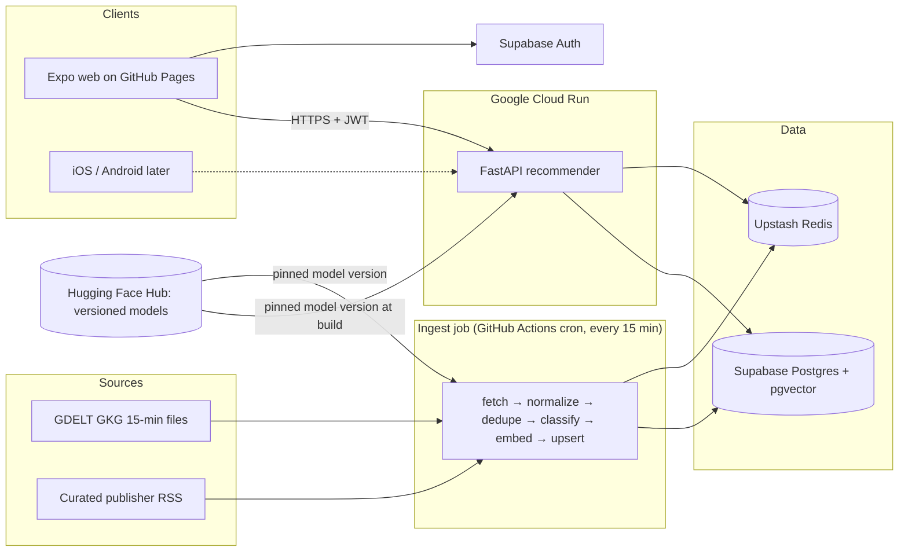

# FirstRead — Product & Technical Spec (v1)

Owner: Unmesh Achar (GitHub: Unmesh30) · Status: v1 draft · Last updated: 2026-10-18 (ADRs 0011–0013: free-tier budgets, runner-side window and pool snapshot, trending v2)

> This document is the single source of truth for what we are building. It is read before every phase. Change it deliberately (and record the reason in an ADR) rather than drifting away from it in code.

---

## 1. What FirstRead is

FirstRead is a personalized "For You" news feed that recommends **breaking stories within minutes of publication — before they have any clicks**. It understands each new article from its text (headline + summary) and each reader from what they have read, so a brand-new story can be ranked for the right readers immediately. This is the **cold-start problem** for new items, and solving it is the core of the project.

**Why v1 exists:** a free, live, production-grade demo for recruiters (ML Engineer / ML Platform roles) that real people can also use. It is architected so the same app can later ship to the App Store and Play Store.

---

## 2. Users and core flows

| User | Flow |
|---|---|
| **Reader (anonymous, default)** | Opens app → picks ≥3 topics → sees "For You" feed → taps a story (opens the publisher's page) → the feed adapts in real time; can like or hide; can ask "Why am I seeing this?" |
| **Signed-in reader (optional Google)** | Same as above, but the profile syncs across devices. Linking Google keeps the anonymous history. |
| **Recruiter** | Opens the web link → taps "Try a demo reader" → picks a persona → instantly sees a personalized feed with explanations → can open the **System** page (live metrics, architecture, model card, GitHub link). |
| **Owner/admin (Unmesh)** | Watches ingestion and API health, reruns jobs, ships new model versions. |

---

## 3. Scope

**v1 must-have**
- Live ingestion of English US & world news every ~15 minutes.
- Personalized, real-time feed with cold-start handling for new articles and new users.
- Anonymous use by default; optional "Continue with Google".
- Demo personas, "Why this?" explanations, System page with live stats.
- Web app (Expo web export) on GitHub Pages; API on Google Cloud Run.
- Offline evaluation on MIND with standard metrics and baselines.
- Load-tested, observable, tested, documented, CI/CD.

**Later (not v1):** native iOS/Android releases; push notifications for breaking news; learned re-ranker trained on FirstRead's own logs; online A/B testing; licensed news provider for commercial launch; multilingual news.

**Non-goals for v1:** full article text, comments/social features, ads, paid features.

---

## 4. Hard constraints

- **$0 per month.** Allowed services and their free limits (re-verify at the start of the phase that uses them):
  - GitHub: public repo, GitHub Pages, GitHub Actions (free on standard runners for public repos).
  - Google Cloud always-free tier with a **$1 budget alert**: Cloud Run (always-free tier of roughly 2M requests, 180K vCPU-seconds, 360K GiB-seconds per month with request-based billing), Artifact Registry (0.5 GiB storage free), Secret Manager free tier, Cloud Logging.
  - Supabase Free: 500 MB Postgres (read-only above it, until space is reclaimed), **5 GB/month egress** (with the shared pooler, the pooler's egress counts), Auth (50K MAU), project pauses after ~1 week of inactivity (our ingestion writes keep it active). Budgets per run and per session: ADR 0011.
  - Upstash Redis Free: 500K commands/month (every pipelined command is billed), 250 MB, 10 GB/month bandwidth.
  - Hugging Face Hub: public model repo for versioned model artifacts.
  - Local Mac (Apple Silicon, 16 GB+) for development and most training; Kaggle/Colab free GPUs as a fallback.
- **Never add a paid service** or anything that can bill without the owner's explicit approval.
- **Licensing:**
  - MIND is released for research purposes under Microsoft Research License Terms → use it for training/evaluation only; never commit or redistribute it; do not show MIND articles in the public app.
  - GDELT data is free for unlimited use but **must be credited with a link to gdeltproject.org** wherever shown.
  - Publisher content: show only headline, source, time, link, and (optionally) the source-provided thumbnail URL. No full text.
- **Non-commercial v1.** Before any commercial launch: replace MIND-trained weights with weights trained on FirstRead's own consented data and switch to a licensed news source.

---

## 5. Architecture



**Components**

| Component | Tech | Runs on |
|---|---|---|
| `apps/mobile` | Expo (React Native + TypeScript + Expo Router), TanStack Query, Zustand, supabase-js, OpenAPI-generated client | GitHub Pages (web) now; EAS builds later |
| `services/api` | Python 3.12, FastAPI, uvicorn, asyncpg, redis-py (asyncio), ONNX Runtime, numpy, pydantic-settings, structlog, prometheus-client | Google Cloud Run (us-east1) |
| `services/ingest` | Python 3.12, httpx (async), feedparser, fastembed, asyncpg | GitHub Actions scheduled workflow |
| `ml` | Python 3.12, PyTorch (MPS on Mac), pandas/polars, scikit-learn, MLflow (local), ONNX export | Local Mac; Kaggle/Colab fallback |
| `packages/core` | Shared Python package: text cleaning, URL canonicalization, embedding function, feature code, pydantic schemas | Imported by ml, ingest, api |
| Data | Supabase Postgres + pgvector (`halfvec`), Upstash Redis | Managed free tiers |

**Golden rule (train/serve consistency):** the embedding function, text preprocessing and feature code exist **once**, in `packages/core`, and are imported by `ml`, `services/ingest` and `services/api`.

---

## 6. Data sources

| Source | Use | Notes |
|---|---|---|
| **MIND** (Microsoft News Dataset): ~160K English articles, 15M+ impression logs from 1M users. `news.tsv` has ID, category, subcategory, title, abstract, URL, entities. `behaviors.tsv` has impression ID, user ID, time, click history, impressions (`N123-1 N456-0`). | Training and offline evaluation | Research license. Start with MIND-small, then MIND-large for final numbers. Download script prints the license notice; data lives in `data/` (gitignored). |
| **GDELT GKG 2.0 files** (ADR 0007) | Live headlines | One zip of English-language web articles every 15 minutes: URL, outlet domain, page title, sharing image, crawl time (no summary). Processed with a catch-up cursor (≤ 2 h per run), outlets placed by GDELT's domain→country lookup plus reviewed overrides, a spam/syndication blocklist, and a per-run cap of 50 ranked by story breadth with a topic floor. The DOC 2.0 API was evaluated and rejected: every probe call was throttled (HTTP 429) and 15-minute windows are refused. Credit and link GDELT. |
| **Curated RSS feeds** (ADR 0007) | Live source | Config file of publisher feeds with a topic hint, a geo (`us`/`intl`) and each publisher's terms verdict. **Only feeds whose own terms explicitly allow showing headlines on a website (with attribution) are enabled**; "personal, non-commercial" terms don't cover a public app. We store headline, link, time and thumbnail (unless the permission is text-only); descriptions are used in memory for the embedding and never stored. |
| **Embedding model** `BAAI/bge-small-en-v1.5` via `fastembed` (ONNX, CPU) | Article and persona embeddings | 384 dimensions, max 512 tokens, MIT license. Passages need no instruction prefix. |

---

## 7. ML design

1. **Article encoder (frozen):** text = `title + ". " + summary` (cleaned, truncated) → bge-small → 384-d, L2-normalized. Lives in `packages/core`. Embeddings for MIND are computed once and cached in `data/`.
2. **Topic classifier** (ADR 0006): logistic regression on embeddings predicting **13 app topics** (us, world, politics, business, tech_science, health, sports, entertainment, lifestyle, food_drink, travel, autos, weather), with labels mapped from MIND (category, subcategory) pairs by the reviewed table `ml/configs/topic_map.yaml`. Trained on title+abstract **and** title-only embeddings (live GDELT articles have no summary); exported to ONNX (skl2onnx). Report accuracy and macro-F1 in both text modes; release gate: every topic's title-only F1 ≥ 0.30. Ingestion resolves the final topic with `firstread_core.topics.resolve_topic`: the model's top-1, a feed's topic hint as tie-breaker below the shipped confidence threshold, then the geo rule (non-US source + us/politics → world).
3. **User encoder ("NRMS-lite"):** input = up to N=50 most recent clicked-article embeddings (masked) → multi-head self-attention → additive-attention pooling → user vector **in the same 384-d space** as article embeddings. Score = dot(user_vec, article_emb).
   - v1 decision: the **item tower is the frozen embedding (identity)**, so model updates never require re-embedding stored articles, and retrieval can run ANN directly on stored embeddings. Record in an ADR; a learned item tower is a v2 option.
   - Training: MIND impressions, negative sampling from the same impression (K=4), softmax cross-entropy; PyTorch with MPS; seeds fixed; config in YAML.
4. **Cold-start users:** initial user vector = normalized mean of the chosen topics' centroid vectors; blended with click-based vector as clicks arrive.
5. **Baselines:** random; popularity (train-period clicks); recency; mean-of-history cosine (zero-training content baseline); optional ID-based matrix factorization to demonstrate cold-start failure.
6. **Evaluation:** MIND dev set; per-impression **AUC, MRR, nDCG@5, nDCG@10** (MIND standard, averaged over impressions). Slices: **cold-start candidates** (articles never clicked in training), **cold users** (history ≤2), per category. Report a results table + plots in `ml/reports/` and compare against the published NRMS results from the MIND paper (cite it; don't invent numbers).
7. **Export:** ONNX (user encoder; category classifier) with a **parity test** (PyTorch vs ONNX max abs diff ≤ 1e-4). Versioned release `vX.Y.Z` on Hugging Face Hub `Unmesh30/firstread-models` with a model card. Services pin a version.
8. **Online ranking:**
   `final = w_model·model_score + w_fresh·freshness_decay(age) + w_trend·trending_score − penalties(seen, hidden source/category)`
   Weights tuned offline by replaying MIND impressions. Then **MMR diversity** (λ tunable) with at most 2 items per story cluster. Every item carries human-readable `reasons`.

---

## 8. Serving design (API)

### Endpoints (v1)

| Method | Path | Auth | Purpose |
|---|---|---|---|
| GET | `/healthz` | none | Liveness |
| GET | `/readyz` | none | DB + Redis reachable, model loaded |
| GET | `/v1/feed?limit=20&cursor=` | user | Ranked feed page |
| POST | `/v1/events` | user | Batch of `impression`/`click`/`like`/`hide`/`dwell` events; idempotent by client `event_id` |
| GET | `/v1/topics` | none | Topic list |
| PUT | `/v1/me/topics` | user | Set followed topics (onboarding) |
| GET | `/v1/me` | user | Profile summary |
| DELETE | `/v1/me` | user | Delete my data |
| GET | `/v1/demo/personas` | none | Demo readers |
| POST | `/v1/demo/personas/{id}/activate` | user | Load a persona's history into this session |
| GET | `/v1/articles/{id}/why` | user | Explanation for a recommendation |
| GET | `/v1/stats` | none | Public stats for the System page |
| GET | `/metrics` | internal | Prometheus metrics |

Feed item: `id, title, source_name, source_domain, url, image_url?, category, published_at?, first_seen_at, score, reasons[]`. Every response carries `request_id` and `model_version`.

**Demo personas** are synthetic readers built from **live** articles in chosen topics (for example "Markets & tech", "Sports & health"), not from MIND rows.

### Feed pipeline and latency budget

1. Auth + load user state from Redis (≤5 ms).
2. **Candidate generation in parallel** (`asyncio.gather`, per-source deadlines, graceful degradation): ANN top-200 by user vector over the last 72 h (pgvector HNSW) · fresh pool · trending pool · followed-topic pools → union, filter seen/hidden (≤60 ms).
3. **Scoring** with ONNX Runtime in a thread pool, with **micro-batching across concurrent requests** (collect up to ~5 ms or 32 requests, one ONNX call) (≤20 ms).
4. Blend + MMR diversity + reasons (≤10 ms).
5. Cache the page in Redis (60 s), respond, log impressions asynchronously.

If a candidate source times out, continue with the others. If ANN fails, fall back to fresh + trending.

**Real-time personalization:** a click event pushes the article onto the user's Redis history and invalidates the cached user vector; the next feed request recomputes it.

**Concurrency settings:** asyncpg pool sizes, ONNX intra-op threads and uvicorn workers are configurable. Cloud Run: concurrency 80, min instances 0, max instances 3, request-based billing, startup CPU boost.

---

## 9. Data model

### Postgres (migrations in `infra/db/`)

- **`articles`**: `id uuid pk`, `url`, `url_canonical unique`, `title`, `summary` (always NULL in v1), `source_name`, `source_domain`, `image_url`, `language`, `source_country` (ISO 3166-1 alpha-2), `category` (an app topic id, ADR 0006), `category_confidence`, `category_source ('model'|'feed_hint'|'geo_rule')`, `geo ('us'|'intl')`, `published_at`, `first_seen_at`, `embedding extensions.halfvec(384)`, `embedding_model`, `text_source ('title'|'title_summary')`, `title_fingerprint`, `story_cluster_id`, `origin ('gdelt'|'rss')`, `created_at`. Indexes: HNSW on `embedding` (`halfvec_ip_ops`: inner product on normalized vectors), btree on `first_seen_at desc`, `(category, first_seen_at desc)`, `(title_fingerprint, first_seen_at)`, `story_cluster_id`. pgvector lives in the `extensions` schema (ADR 0008).
- **`profiles`**: `user_id` (FK `auth.users`, cascade delete), `topics text[]`, `active_persona`, timestamps.
- **`events`**: `id uuid pk` (client-generated, for idempotency), `user_id`, `article_id`, `type`, `position`, `dwell_ms`, `request_id`, `model_version`, `created_at`. Index `(user_id, created_at desc)`.
- **`ingestion_runs`**: `id`, `started_at`, `finished_at`, `source`, `window_start`, `window_end`, `fetched`, `inserted`, `duplicates`, `near_duplicates`, `clustered`, `errors`, `gdelt_calls`, `redis_commands`, `status ('running'|'ok'|'partial'|'failed')`, `details jsonb`.
- **`story_coverage`**: `(story_cluster_id, source_domain)` pk, `first_seen_at`: every outlet that carried a story, including dropped duplicates (trending, ADR 0010).
- **`feed_state`**: RSS conditional-GET state (`etag`, `last_modified`, failures). **`source_cursor`**: the GKG catch-up cursor, and the published/pending pool snapshot versions (ADR 0012).
- **`demo_personas`**, **`persona_articles`**: persona definitions built from live articles.
- **RLS on every table** (ADR 0008): articles are public-read; profiles and events are owner-only; all service tables have no policy. Services use a dedicated DB role (P5).
- **Retention:** articles 14 days, `story_coverage` 48 h, `ingestion_runs` 30 days, events 30 days (P3). Target DB size < 400 MB; measured steady state ≈ 227 MB (3-day replay, ADR 0008). P3 must keep clicked articles' vectors beyond 14 days for user histories.

### Redis keys

- `u:{uid}:hist` (list, last 50 clicks)
- `u:{uid}:vec` (cached user vector, TTL 10 min)
- `u:{uid}:seen` (set, TTL 3 days)
- `u:{uid}:feed:{cursor}` (TTL 60 s)
- `pools:ver` (current snapshot version) and `pools:blob:{ver}` (one compressed snapshot: fresh, trending, 13 topic pools, centroids, stats; no TTL, the previous one expires 120 s after the switch). Replaces the `pool:*` sorted sets (ADR 0012).
- `rl:{key}` (rate limiting)

**Command budget:** ≤300K/month. Ingestion publishes in 3 commands a run; pipeline reads; count commands in metrics (ADR 0011).

---

## 10. Auth, privacy, security

- Supabase **anonymous sign-in** on first launch (enable CAPTCHA/Turnstile before public launch). **Google** via `linkIdentity` (manual linking enabled), so history is kept. Handle the "Google identity already linked to another user" case.
- API verifies Supabase JWTs (prefer the project's JWKS / asymmetric signing keys; check current Supabase docs).
- Minimal PII (email only when Google is linked). "Delete my data" in-app. Privacy page. No ads or third-party trackers.
- CORS restricted to the GitHub Pages origin and localhost. Rate limiting. Pydantic validation.
- Secrets only in `.env` (gitignored), GitHub Actions secrets and GCP Secret Manager. gitleaks in pre-commit; CodeQL and Dependabot in CI.

---

## 11. Non-functional targets (SLOs)

| Area | Target |
|---|---|
| Feed latency, local Docker stack | p95 ≤ 150 ms server time at 100 RPS |
| Feed latency, Cloud Run | warm p95 ≤ 300 ms end-to-end; cold start ≤ 5 s |
| Freshness | median ≤ 30 min from GDELT "seen" to recommendable (GKG files land ~15 min after their slot and runs are every 15 min, so this is tight; measured in P5) |
| Ingestion | ≥ 2,000 new English articles/day; ≥ 99% successful runs |
| Errors | < 1% 5xx |
| Quality | beat the best baseline on nDCG@10 overall **and** on the cold-start slice |

---

## 12. Observability

- Structured JSON logs (`request_id`, hashed user id, latency breakdown per pipeline stage, `model_version`).
- Prometheus metrics locally (`/metrics`); Cloud Logging/Monitoring in production.
- Sentry free tier for errors (optional).
- `ingestion_runs` table plus a GitHub Actions job summary.
- **System page** in the app backed by `/v1/stats`.

---

## 13. Testing strategy

- Unit tests (pytest; Jest + React Native Testing Library).
- Integration tests with Postgres/pgvector + Redis service containers.
- OpenAPI contract test.
- ONNX parity test.
- **Offline-eval regression gate in CI** on a small fixed eval subset (fail if nDCG@10 drops >1% vs the last release).
- k6 load tests against the **local** stack only.
- Post-deploy smoke tests.

---

## 14. CI/CD and environments

**Environments:** `local` (Docker Compose) and `prod`.

**Workflows:**
- `ci.yml` — PRs and main: lint, typecheck, tests, docker build.
- `deploy-api.yml` — main: build → Artifact Registry → Cloud Run; keyless auth via Workload Identity Federation; smoke test.
- `deploy-web.yml` — main: `expo export -p web` → GitHub Pages.
- `ingest.yml` — manual dispatch now (`dry_run` defaults to true); the `*/15 * * * *` schedule is enabled in P5 together with the database and Redis secrets; concurrency group so runs never overlap; caches the models and the pinned GDELT domain lookup, plus the runner-side 72 h window snapshot (ADR 0012; `actions: write` on that job only, to delete superseded entries).
- `codeql.yml`, plus Dependabot.

**Conventions:** protected `main`; branch per phase (`phase-N-name`); PRs; Conventional Commits; release tags `v0.x`.

**Known caveats:**
- GitHub scheduled runs can be delayed, and are disabled after 60 days without repo activity.
- Artifact Registry must stay < 0.5 GiB (cleanup policy: keep last 2 images).

---

## 15. Repository layout

```
firstread/
├── apps/mobile/            # Expo app (web now, iOS/Android later)
├── services/api/           # FastAPI recommender (Cloud Run)
├── services/ingest/        # News ingestion job (GitHub Actions cron)
├── ml/                     # Offline training & evaluation on MIND; reports/
├── packages/core/          # Shared Python code (embeddings, text, features, schemas)
├── infra/docker/           # docker-compose + Dockerfiles for the local stack
├── infra/db/               # SQL migrations, RLS policies, seeds
├── infra/gcp/              # Cloud Run / Artifact Registry / WIF setup scripts
├── loadtest/               # k6 scripts + results
├── docs/                   # architecture.md, adr/, learn/, runbook.md, model-card.md, data-card.md, perf.md
├── .github/workflows/      # ci, deploy-api, deploy-web, ingest, codeql
├── data/                   # gitignored (MIND, caches)
├── CLAUDE.md  SPEC.md  README.md  Makefile  .env.example  LICENSE (MIT)
```

The Python side is a **uv workspace** with members `packages/core`, `services/api`, `services/ingest`, `ml`.

---

## 16. Phases and acceptance criteria

Each phase ends with:
- green CI;
- a `docs/learn/NN-*.md` chapter (template in CLAUDE.md);
- ADRs for significant decisions;
- a merged PR.

**P0 — Bootstrap**
- Monorepo, uv workspace, Expo scaffold, Docker Compose (pgvector + Redis + API hello).
- Makefile, pre-commit, CI, repo hygiene files, docs skeleton.
- *Accept when:* `make lint typecheck test` passes; `docker compose up` is healthy; `/healthz` responds; `expo export -p web` works; the GitHub repo is public with CI green.

**P1 — Offline ML on MIND**
- Download script, EDA report, shared embedding module, cached embeddings, baselines.
- NRMS-lite training, evaluation with slices, category classifier.
- ONNX export + parity test, model card, HF Hub release `v0.1.0`.
- *Accept when:* the results table beats baselines on nDCG@10 overall and on cold-start; the eval is reproducible with one command.

**P2 — Live ingestion**
- GDELT + RSS adapters (async, bounded concurrency), canonical URLs, exact + near-duplicate detection, classification, embedding, upsert, Redis pools, retention, `ingestion_runs`, cron workflow.
- *Accept when:* running locally against the Docker DB inserts ≥200 deduped, classified, embedded articles per run, and tests cover adapters and dedupe.

**P3 — Recommendation API**
- All v1 endpoints, JWT auth (dev bypass locally), parallel candidate generation, micro-batched ONNX scoring, blend + MMR, reasons, events, real-time profile, personas, stats, rate limits, caching, metrics, OpenAPI.
- *Accept when:* integration tests pass; local p95 is reported; the OpenAPI spec is exported.

**P4 — App (Expo)**
- Onboarding, feed (infinite scroll, viewability-based impressions), article open, like/hide, Why sheet, account (anonymous → Google), System, Privacy, About (GDELT credit), demo personas.
- Responsive web; light/dark; accessible.
- *Accept when:* it works end to end against the local stack and app tests pass.

**P5 — Cloud deployment**
- Supabase project + migrations + auth config, Upstash, GCP (project, budget alert, Artifact Registry + cleanup, Cloud Run, Secret Manager, WIF), GitHub Pages, deploy workflows, smoke tests.
- *Accept when:* the live web app works with the live API; ingestion runs on schedule; cost is $0.

**P6 — Performance**
- k6 scenarios (50/100/200 RPS), profiling, micro-batching and caching on/off comparisons; `docs/perf.md` with charts.
- *Accept when:* SLOs are measured and reported honestly.

**P7 — Observability & hardening**
- Logs/metrics/traces, Sentry, CodeQL, Dependabot, runbook, SLO dashboard, CAPTCHA for anonymous sign-in.

**P8 — Showcase**
- README (live links, architecture diagram, demo GIF, results tables, how it works), `docs/interview-prep.md`, resume bullets, final learn chapter.

---

## 17. Future (post-v1)

- EAS builds and store releases (Apple Developer Program fee; Google Play registration fee and closed testing with at least 12 testers for 14 days for new personal accounts).
- Push notifications for breaking stories.
- Learned re-ranker on FirstRead logs.
- A/B testing.
- Licensed news API and retraining on own consented data for commercial launch.
