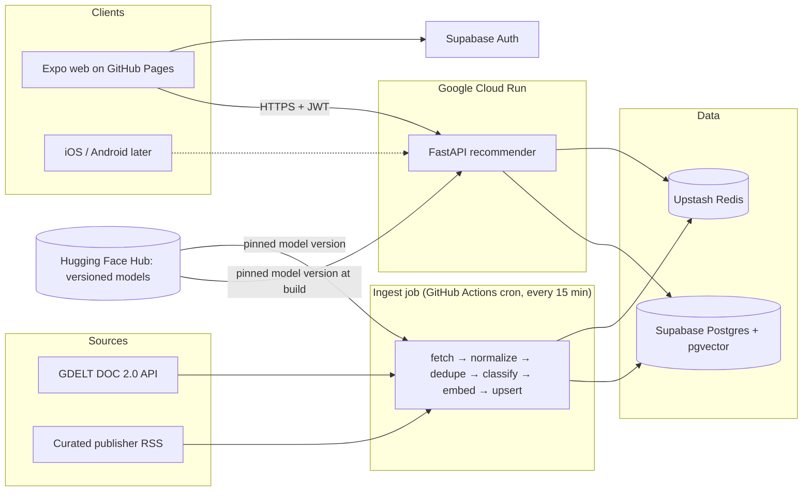
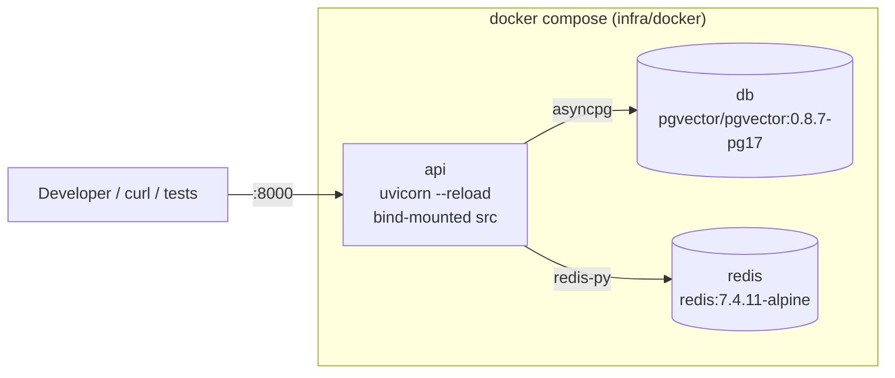
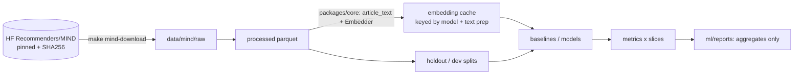
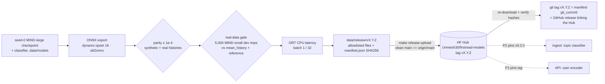

# FirstRead architecture

> Source of truth for *what* we build is [SPEC.md](../SPEC.md). This page describes the system and tracks **what exists today**.

## System overview

## Components

| Component | Tech | Runs on |
|---|---|---|
| `apps/mobile` | Expo SDK 57 (React Native + TypeScript strict + Expo Router) | GitHub Pages (web) now; EAS builds later |
| `services/api` | Python 3.12, FastAPI, uvicorn, asyncpg, redis-py, pydantic-settings, structlog | Google Cloud Run (us-east1) |
| `services/ingest` | Python 3.12, httpx, feedparser, fastembed, asyncpg | GitHub Actions scheduled workflow |
| `ml` | Python 3.12, PyTorch, scikit-learn, MLflow, ONNX export (onnx, onnxscript, skl2onnx, onnxruntime) | Local Mac; Kaggle/Colab fallback |
| `packages/core` | Shared Python: text cleaning, URL canonicalization, embeddings, features, schemas | Imported by ml, ingest, api |
| Data | Supabase Postgres + pgvector, Upstash Redis | Managed free tiers |

**Golden rule:** embedding, text-cleaning and feature code exist once, in `packages/core` (prevents train/serve skew).

## Local development stack (Phase 0)

All ports bind to `127.0.0.1` only. `api` starts only after `db` and `redis` report healthy.

## Offline ML pipeline (Phase 1)

The embedding function lives only in `packages/core` (`firstread-core[embed]`); the API image installs core without the `embed` extra, and CI fails if ML packages appear in it.

## Model release (Phase 1c)

- Hub repo: [Unmesh30/firstread-models](https://huggingface.co/Unmesh30/firstread-models), releases [`v0.1.0`](https://huggingface.co/Unmesh30/firstread-models/tree/v0.1.0) and [`v0.2.0`](https://huggingface.co/Unmesh30/firstread-models/tree/v0.2.0) (topic classifier; user encoder inherited from v0.1.0 by hash, ADR 0006).
- Model card: [docs/model-card.md](model-card.md). Decision record: [ADR 0005](adr/0005-model-artifacts-on-hf-hub.md).
- The weights are MIND-derived and **non-commercial** (MSR License Terms). The code is MIT.
- The release ships only weights and aggregates: no MIND rows, text or embedding caches.
- Services pin a tag and verify `manifest.json`. Article embeddings stay valid across releases (identity item tower, ADR 0004).

## Status by phase

| Phase | What exists |
|---|---|
| **P0 Bootstrap** ✅ | uv workspace (4 members), FastAPI `/healthz` + `/readyz`, structlog JSON logs, Expo app placeholder with web export under `/firstread`, Docker Compose stack, Makefile, pre-commit, CI (`python`, `mobile`, `docker`, `secrets`), Dependabot, docs |
| **P1 Offline ML** ✅ | **1a:** license-gated, SHA-pinned MIND download; parquet loader; shared embedder (`packages/core`, pinned bge-small revision, golden test, cache key); eval harness (AUC/MRR/nDCG, cold-candidate/cold-user/category slices, time-based holdout); baselines (random, popularity, recency, mean-history); EDA; synthetic CI eval gate. **1b:** NRMS-lite user encoder (identity item tower, ADR 0004), 3-seed results with paired bootstrap CIs, category classifier, MLflow (sqlite) tracking, `make reproduce`; beats every baseline on MIND-large dev overall and on cold-start. **1c:** ONNX export (user encoder, classifier) with parity tests, ONNX-based real-data eval gate, release builder with SHA256 manifest, model card, HF Hub release `v0.1.0`. |
| P2 Ingestion | **2a-ml:** title-only skew study (titles alone cost the user encoder 2.1% relative nDCG@10), 13 app topics in `packages/core` with the shared `resolve_topic` rule, reviewed MIND subcategory → topic map, topic classifier trained on title+abstract and title-only embeddings, release builder that inherits the v0.1.0 user encoder byte for byte (release `v0.2.0`, ADR 0006). |
| P3 API | — |
| P4 App | — |
| P5 Cloud | — |
| P6 Performance | — |
| P7 Hardening | — |
| P8 Showcase | — |

## Related

- ADRs: [0001 monorepo and tech stack](adr/0001-monorepo-and-tech-stack.md), [0002 free-tier hosting](adr/0002-free-tier-hosting.md), [0003 MIND data and eval protocol](adr/0003-mind-data-and-eval-protocol.md), [0004 identity item tower](adr/0004-identity-item-tower.md), [0005 model artifacts on the HF Hub](adr/0005-model-artifacts-on-hf-hub.md), [0006 topic taxonomy and classifier](adr/0006-topic-taxonomy-and-classifier.md)
- Learn chapters: [00 bootstrap](learn/00-bootstrap.md), [01 offline ML](learn/01-offline-ml.md)
- [Model card](model-card.md), [data card](data-card.md)
