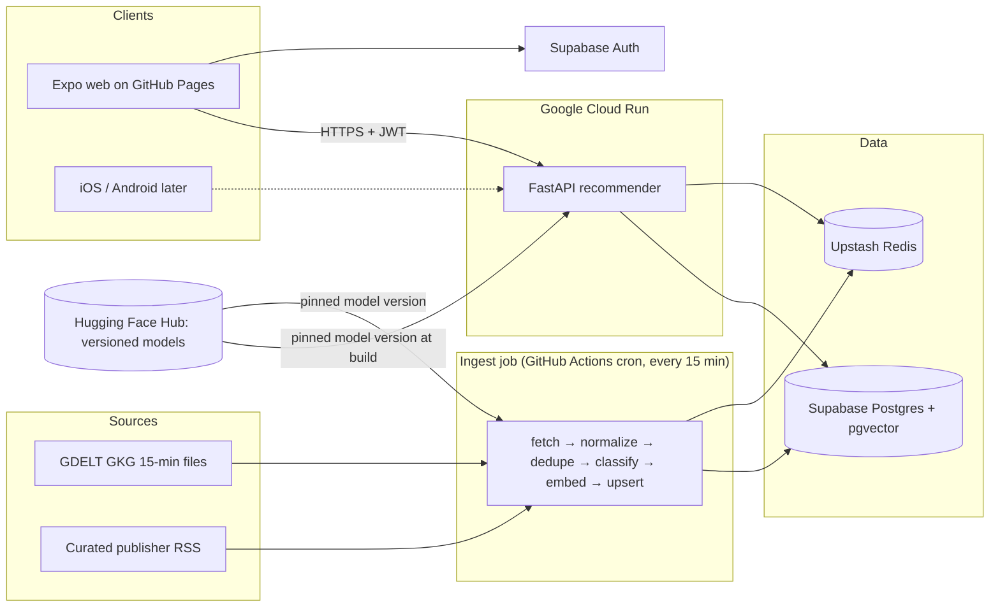
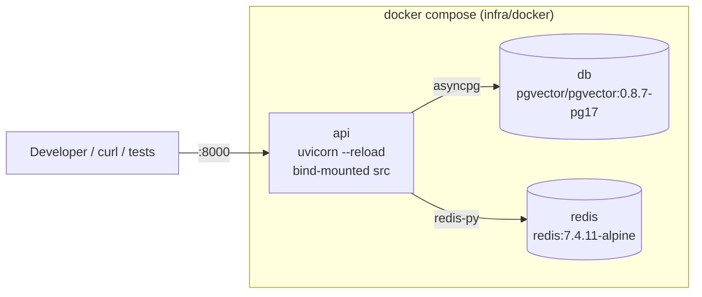
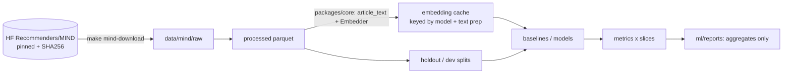
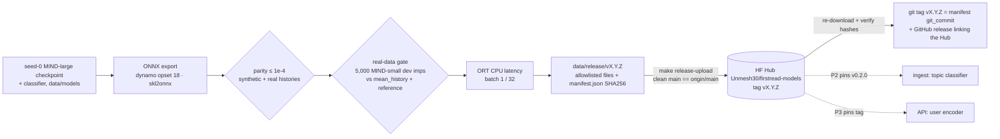

# FirstRead architecture

> Source of truth for *what* we build is [SPEC.md](../SPEC.md). This page describes the system and tracks **what exists today**.

## System overview

## Components

| Component | Tech | Runs on |
|---|---|---|
| `apps/mobile` | Expo SDK 57 (React Native + TypeScript strict + Expo Router) | GitHub Pages (web) now; EAS builds later |
| `services/api` | Python 3.12, FastAPI, uvicorn, asyncpg, redis-py, pydantic-settings, structlog | Google Cloud Run (us-east1) |
| `services/ingest` | Python 3.12, httpx, feedparser, fastembed, asyncpg | GitHub Actions scheduled workflow |
| `ml` | Python 3.12, PyTorch, scikit-learn, MLflow, ONNX export (onnx, onnxscript, skl2onnx, onnxruntime) | Local Mac; Kaggle/Colab fallback |
| `packages/core` | Shared Python: text cleaning, URL canonicalization, embeddings, features, schemas | Imported by ml, ingest, api |
| Data | Supabase Postgres + pgvector, Upstash Redis | Managed free tiers |

**Golden rule:** embedding, text-cleaning and feature code exist once, in `packages/core` (prevents train/serve skew).

## Local development stack (Phase 0)

All ports bind to `127.0.0.1` only. `api` starts only after `db` and `redis` report healthy.

## Offline ML pipeline (Phase 1)

The embedding function lives only in `packages/core` (`firstread-core[embed]`); the API image installs core without the `embed` extra, and CI fails if ML packages appear in it.

## Model release (Phase 1c)

- Hub repo: [Unmesh30/firstread-models](https://huggingface.co/Unmesh30/firstread-models), releases [`v0.1.0`](https://huggingface.co/Unmesh30/firstread-models/tree/v0.1.0) and [`v0.2.0`](https://huggingface.co/Unmesh30/firstread-models/tree/v0.2.0) (topic classifier; user encoder inherited from v0.1.0 by hash, ADR 0006).
- Model card: [docs/model-card.md](model-card.md). Decision record: [ADR 0005](adr/0005-model-artifacts-on-hf-hub.md).
- The weights are MIND-derived and **non-commercial** (MSR License Terms). The code is MIT.
- The release ships only weights and aggregates: no MIND rows, text or embedding caches.
- Services pin a tag and verify `manifest.json`. Article embeddings stay valid across releases (identity item tower, ADR 0004).

## Live ingestion (Phase 2)

```mermaid
flowchart LR
  subgraph Sources
    RSS[8 RSS feeds<br/>explicit permission only<br/>conditional GET]
    GKG[GDELT GKG 15-min files<br/>catch-up cursor ≤ 2 h]
  end
  WIN[(runner-side 72 h window<br/>Actions cache; delta + checksum)] <--> X
  GKG --> PL[place outlet: GDELT domain lookup<br/>+ overrides, blocklist]
  RSS --> N[normalize: clean title, canonical URL,<br/>English, junk/short/stale filters]
  PL --> N
  N --> X[exact dedupe: URL, title fingerprint 72 h]
  X --> E[embed new items<br/>packages/core Embedder]
  E --> D[near-dup + story cluster<br/>per-pair-type cosine thresholds, 48 h]
  D --> C[topic: v0.2.0 ONNX classifier<br/>+ feed hint + geo rule]
  C --> S[select GDELT: breadth, ≤ 3/outlet,<br/>topic floor, 50/run]
  S --> PG[(Postgres: articles, story_coverage,<br/>feed_state, source_cursor, ingestion_runs)]
  PG --> RET[retention: 14 d / 48 h / 30 d]
  PG -->|delta only| WIN
  WIN --> POOLS[(Redis: one versioned pool snapshot<br/>fresh · 13 topics · trending · centroids · stats<br/>3 commands a run)]
  PG -->|story_coverage aggregate| POOLS
```

## Status by phase

| Phase | What exists |
|---|---|
| **P0 Bootstrap** ✅ | uv workspace (4 members), FastAPI `/healthz` + `/readyz`, structlog JSON logs, Expo app placeholder with web export under `/firstread`, Docker Compose stack, Makefile, pre-commit, CI (`python`, `mobile`, `docker`, `secrets`), Dependabot, docs |
| **P1 Offline ML** ✅ | **1a:** license-gated, SHA-pinned MIND download; parquet loader; shared embedder (`packages/core`, pinned bge-small revision, golden test, cache key); eval harness (AUC/MRR/nDCG, cold-candidate/cold-user/category slices, time-based holdout); baselines (random, popularity, recency, mean-history); EDA; synthetic CI eval gate. **1b:** NRMS-lite user encoder (identity item tower, ADR 0004), 3-seed results with paired bootstrap CIs, category classifier, MLflow (sqlite) tracking, `make reproduce`; beats every baseline on MIND-large dev overall and on cold-start. **1c:** ONNX export (user encoder, classifier) with parity tests, ONNX-based real-data eval gate, release builder with SHA256 manifest, model card, HF Hub release `v0.1.0`. |
| P2 Ingestion | **2a-ml:** title-only skew study (titles alone cost the user encoder 2.1% relative nDCG@10), 13 app topics in `packages/core` with the shared `resolve_topic` rule, reviewed MIND subcategory → topic map, topic classifier trained on title+abstract and title-only embeddings, release builder that inherits the v0.1.0 user encoder byte for byte (release `v0.2.0`, ADR 0006). **2a:** Postgres schema as SQL migrations with RLS on every table, checked on the Supabase image in CI (ADR 0008); RSS adapter (conditional GET, per-host serial, only feeds with explicit website permission) and GDELT GKG adapter (catch-up cursor, domain placement, blocklist, breadth-ranked topic-aware cap) (ADR 0007); URL canonicalization, title fingerprints, validated per-pair-type near-duplicate and story-clustering thresholds (ADR 0009); topic classification with the v0.2.0 classifier; idempotent upsert. A run inserts about 220 articles from a cold start (169 RSS + 50 GDELT) and 0 when repeated. **2b:** press-release filter (press-wire domains, PR-shaped titles); retention (articles 14 d, coverage 48 h); Redis pools (fresh, 13 topics, trending by outlet breadth with a 6 h half-life) rebuilt from Postgres within 30 commands per run (ADR 0010); per-story cap in GDELT selection; replay of archived GKG files with a stepped clock (steady state: 4,800 articles/day, ~227 MB for 14 days, all pools full); GDELT↔GDELT story threshold raised to 0.925 after a replay-based re-check; manual-dispatch `ingest.yml` with a Markdown job summary. Live topic accuracy 0.79 (LLM-labeled, independently spot-checked). |
| P3 API (in progress) | **3a:** runner-side 72 h window snapshot in the Actions cache (delta + count/max/id-checksum, any mismatch reloads), cutting ingestion egress from ~14 MB to 84 KB a run with identical dedupe decisions (0 of 267,877 changed on the replay) (ADR 0012); pools published as one versioned blob in 3 commands a run (ADR 0012); trending v2: split stories merged by complete linkage at τ_feed, syndication networks counted once, representatives by quality (ADR 0013); free-tier budget table (ADR 0011). **3b:** ranking in `packages/core` (freshness, per-request normalization, rank-only trend feature, blend, MMR with a 2-per-story cap, cold-start vector, reasons, versioned configs), tuned on MIND-small holdout by pre-registered rules (`rank-1`) and reported once on MIND-large dev: nDCG@10 0.4149 → 0.4199 overall, cold users 0.3625 → 0.3811; the default `rank-2` adds the owner's cold-start k = 3 (ADR 0014). |
| P4 App | — |
| P5 Cloud | — |
| P6 Performance | — |
| P7 Hardening | — |
| P8 Showcase | — |

## Related

- ADRs: [0001 monorepo and tech stack](adr/0001-monorepo-and-tech-stack.md), [0002 free-tier hosting](adr/0002-free-tier-hosting.md), [0003 MIND data and eval protocol](adr/0003-mind-data-and-eval-protocol.md), [0004 identity item tower](adr/0004-identity-item-tower.md), [0005 model artifacts on the HF Hub](adr/0005-model-artifacts-on-hf-hub.md), [0006 topic taxonomy and classifier](adr/0006-topic-taxonomy-and-classifier.md), [0007 live sources](adr/0007-live-sources-gdelt-gkg-and-rss.md), [0008 Postgres schema](adr/0008-postgres-schema-and-migrations.md), [0009 dedupe and clustering](adr/0009-dedupe-and-story-clustering.md), [0010 Redis pools and trending](adr/0010-redis-pools-and-trending.md), [0011 free-tier budgets](adr/0011-free-tier-budgets.md), [0012 runner window and pool snapshot](adr/0012-runner-window-and-pool-snapshot.md), [0013 trending v2](adr/0013-trending-v2.md), [0014 ranking](adr/0014-ranking-blend-mmr-cold-start.md)
- Learn chapters: [00 bootstrap](learn/00-bootstrap.md), [01 offline ML](learn/01-offline-ml.md), [02 live ingestion](learn/02-live-ingestion.md)
- [Model card](model-card.md), [data card](data-card.md)
