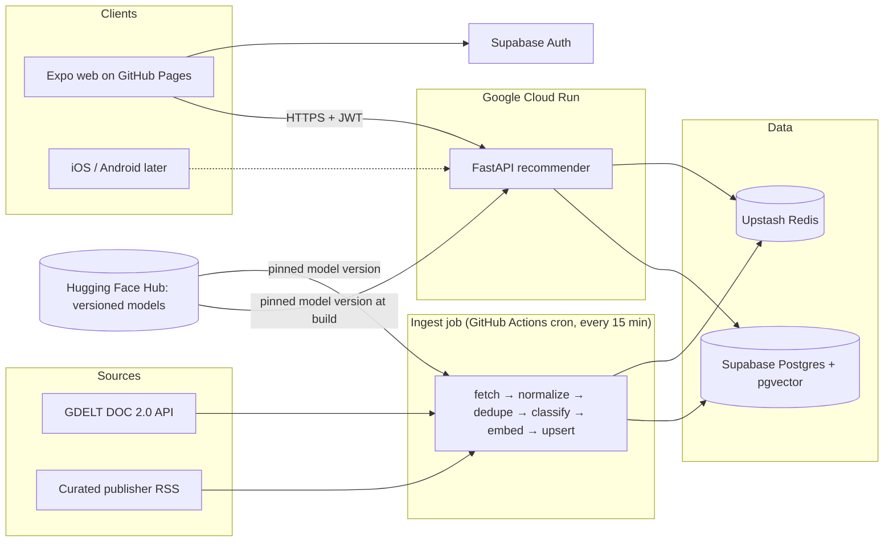
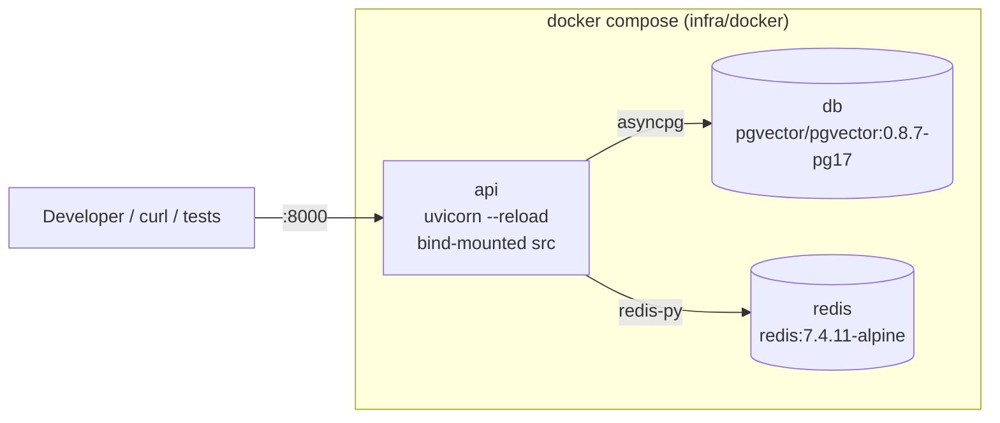
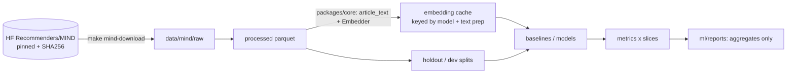

# FirstRead architecture

> Source of truth for *what* we build is [SPEC.md](../SPEC.md). This page describes the system and tracks **what exists today**.

## System overview

## Components

| Component | Tech | Runs on |
|---|---|---|
| `apps/mobile` | Expo SDK 57 (React Native + TypeScript strict + Expo Router) | GitHub Pages (web) now; EAS builds later |
| `services/api` | Python 3.12, FastAPI, uvicorn, asyncpg, redis-py, pydantic-settings, structlog | Google Cloud Run (us-east1) |
| `services/ingest` | Python 3.12, httpx, feedparser, fastembed, asyncpg | GitHub Actions scheduled workflow |
| `ml` | Python 3.12, PyTorch, scikit-learn, MLflow, ONNX export | Local Mac; Kaggle/Colab fallback |
| `packages/core` | Shared Python: text cleaning, URL canonicalization, embeddings, features, schemas | Imported by ml, ingest, api |
| Data | Supabase Postgres + pgvector, Upstash Redis | Managed free tiers |

**Golden rule:** embedding, text-cleaning and feature code exist once, in `packages/core` (prevents train/serve skew).

## Local development stack (Phase 0)

All ports bind to `127.0.0.1` only. `api` starts only after `db` and `redis` report healthy.

## Offline ML pipeline (Phase 1)

The embedding function lives only in `packages/core` (`firstread-core[embed]`); the API image installs core without the `embed` extra, and CI fails if ML packages appear in it.

## Status by phase

| Phase | What exists |
|---|---|
| **P0 Bootstrap** ✅ | uv workspace (4 members), FastAPI `/healthz` + `/readyz`, structlog JSON logs, Expo app placeholder with web export under `/firstread`, Docker Compose stack, Makefile, pre-commit, CI (`python`, `mobile`, `docker`, `secrets`), Dependabot, docs |
| P1 Offline ML | 🚧 **1a:** license-gated, SHA-pinned MIND download; parquet loader; shared embedder (`packages/core`, pinned bge-small revision, golden test, cache key); eval harness (AUC/MRR/nDCG, cold-candidate/cold-user/category slices, time-based holdout); baselines (random, popularity, recency, mean-history); EDA; synthetic CI eval gate. 1b models and 1c release next. |
| P2 Ingestion | — |
| P3 API | — |
| P4 App | — |
| P5 Cloud | — |
| P6 Performance | — |
| P7 Hardening | — |
| P8 Showcase | — |

## Related

- ADRs: [0001 monorepo and tech stack](adr/0001-monorepo-and-tech-stack.md), [0002 free-tier hosting](adr/0002-free-tier-hosting.md)
- Learn chapters: [00 bootstrap](learn/00-bootstrap.md)
