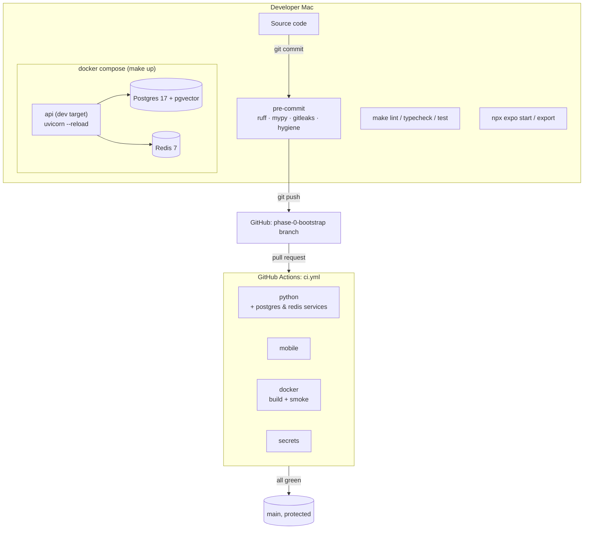

# 00 — Bootstrap: a monorepo skeleton with green CI

> Phase 0 of [SPEC.md §16](../../SPEC.md). No ML or product features yet. We build the "workshop" that every later phase works in.

---

## 1. What we built and why

We built the empty-but-working skeleton of FirstRead:

- **One repository** with five parts: an Expo app, an API service, an ingestion job, an ML package and a shared Python package.
- A **Python workspace** managed by `uv`, so all Python code shares one lockfile and one virtual environment.
- A **FastAPI** service with two operational endpoints: `/healthz` ("am I alive?") and `/readyz` ("can I reach Postgres and Redis?").
- An **Expo** app showing a "FirstRead" placeholder screen that exports to static files for GitHub Pages.
- A **local stack** in Docker Compose: Postgres 17 with pgvector, Redis 7, and the API with hot reload.
- **Guard rails**: formatting, linting, type checking, tests, secret scanning, and a CI pipeline that runs all of them on every pull request.

**Analogy.** Before a restaurant cooks its first meal it builds the kitchen. That means wiring the gas and water (Postgres, Redis), installing smoke detectors (`/healthz`, `/readyz`, healthchecks) and writing the hygiene rules everybody follows (ruff, mypy, pre-commit). It also books a health inspector who checks every delivery (CI). None of this is food, but without it every meal is a gamble. Phase 0 is the kitchen.

**Why first?** The rules are cheap to set up on day one and expensive to retrofit. If CI exists before any feature code, every feature PR is checked from the start.

---

## 2. Concepts from first principles

### 2.1 Virtual environments, dependencies and lockfiles
A Python project depends on other packages (FastAPI, asyncpg...). Each package depends on more packages. A **virtual environment** (`.venv/`) is a private folder of installed packages for one project, so projects don't fight over versions.

`pyproject.toml` lists what we *want* (`fastapi>=0.143.0`). A **lockfile** (`uv.lock`) records exactly what we *got*, meaning every package, transitively, at one exact version with hashes. Commit the lockfile and everyone (you, CI, Docker) installs the identical set. That's what "pin versions" means in practice: lower bounds in `pyproject.toml`, exact pins in the lockfile.

### 2.2 uv
[`uv`](https://docs.astral.sh/uv/) is one tool that replaces `pip`, `venv`, `pip-tools` and `pyenv`:
- `uv sync` creates `.venv`, resolves dependencies, writes/reads `uv.lock`, installs everything.
- `uv run <cmd>` runs a command inside the project's environment (no "activate" step).
- uv also **installs Python itself**: `.python-version` says `3.12`, and uv downloads a matching CPython if needed.
- `--frozen` means "use the lockfile exactly; don't update it". We use it in CI and Docker so builds never silently change versions.

### 2.3 Workspaces (monorepo for Python)
A **uv workspace** is several Python packages in one repo that share **one lockfile and one `.venv`**. The root `pyproject.toml` declares the members:

```toml
[tool.uv.workspace]
members = ["packages/core", "services/api", "services/ingest", "ml"]
```

A member depends on another member by name, and `[tool.uv.sources] firstread-core = { workspace = true }` tells uv "don't fetch this from PyPI, use the local folder" (installed *editable*, so code changes are visible immediately).

Why this matters for FirstRead: the embedding and text-cleaning code must be **identical** in training (ml), ingestion and serving (api). If those copies drift, offline metrics lie. This is *train/serve skew*. With a workspace there's exactly one copy in `packages/core`, and all three import it.

Our root is a **virtual root** (`[tool.uv] package = false`). It isn't a package itself; it just holds the workspace config, shared tool config (ruff, mypy, pytest) and dev tools.

### 2.4 The `src/` layout
Each member keeps code in `src/<package_name>/`. That forces tests to import the *installed* package, not whatever file happens to be in the current directory, which catches packaging mistakes early.

### 2.5 Liveness vs readiness
- **Liveness (`/healthz`)**: the process is running and can answer HTTP. It never touches the DB. If it did, a DB outage would make the orchestrator restart healthy API containers in a loop.
- **Readiness (`/readyz`)**: this instance can do useful work right now. We run `SELECT 1` on Postgres and `PING` on Redis **concurrently** (`asyncio.gather`) with a **timeout** each, and return 200 or 503 with a per-check status.

### 2.6 Containers and Docker Compose
A **container image** is a frozen filesystem plus a start command. A **container** is a running instance of it. **Docker Compose** starts several containers from one YAML file, puts them on a private network where they reach each other by service name (`db`, `redis`), and maps chosen ports to your Mac.

A **healthcheck** is a command Docker runs periodically (e.g. `pg_isready`). `depends_on: condition: service_healthy` makes the API wait until Postgres and Redis are actually ready, not just started.

**Multi-stage builds**: our Dockerfile has a `builder` stage (has uv, compiles and installs deps) and a slim `runtime` stage that only copies the finished virtualenv. Build tools never ship to production, so the image is smaller and has less attack surface.

**Hot reload**: in the `dev` target, `uvicorn --reload` watches the source folders, which are **bind-mounted** from your Mac into the container. Save a file and the server restarts in about a second, with no rebuild.

### 2.7 Linting, formatting, type checking, tests
- **ruff format** rewrites code into one consistent style (no style debates in review).
- **ruff check** finds bugs and smells (unused imports, mutable defaults, insecure calls...).
- **mypy --strict** checks type hints, e.g. "you pass `str | None` where `str` is required". Strict mode also requires every function to be annotated. It's strict for `packages/` and `services/`, and relaxed for `ml/` research code.
- **pytest** runs tests. We use two kinds: *unit* tests (fast, fake dependencies) and *integration* tests (real Postgres + Redis).

### 2.8 pre-commit
A **git hook** is a script git runs at certain moments. `pre-commit` manages hooks declared in `.pre-commit-config.yaml` and runs them on the files you're about to commit. If a hook fails, or modifies files, the commit is stopped so you can review. Ours run ruff, mypy, **gitleaks** (secret scanner) and hygiene checks (trailing whitespace, valid YAML/TOML/JSON, no huge files, no private keys).

### 2.9 Continuous Integration (CI)
**GitHub Actions** runs workflows (`.github/workflows/*.yml`) on GitHub's machines. Ours (`ci.yml`) runs on every PR and every push to `main`, with four parallel **jobs**:

| Job | What it proves |
|---|---|
| `python` | ruff, mypy, pytest, with **real Postgres + Redis service containers** so integration tests run |
| `mobile` | ESLint, Prettier, `tsc`, Jest, and a real `expo export -p web` |
| `docker` | the production API image builds **and starts** (`/healthz` smoke test) |
| `secrets` | gitleaks finds no secrets anywhere in git history |

**Branch protection** on `main` requires a PR and all four checks green before merging.

### 2.10 Expo and Expo Router
**React Native** renders native UI from React components. **Expo** is the toolkit around it (dev server, SDK modules, builds), and **react-native-web** lets the same components render in a browser.

**Expo Router** is *file-based routing*: every file in `src/app/` is a screen and a URL.
- `src/app/index.tsx` → `/`
- `src/app/_layout.tsx` wraps all screens (here a `Stack` navigator)
- Later: `src/app/article/[id].tsx` → `/article/123`

Keep non-route code (components, hooks) **outside** `src/app/`, or Expo Router will treat it as a page.

**Static web export**: `npx expo export -p web` with `web.output: "static"` **pre-renders every route to HTML at build time, in Node**. There is no `window` or `localStorage` in Node, so code that touches them at module import time crashes the build (see §8).

**`experiments.baseUrl: "/firstread"`**: GitHub Pages serves this repo at `https://unmesh30.github.io/firstread/`, not at `/`. The base URL prefixes every asset path. A `public/.nojekyll` file disables GitHub's Jekyll processor, which would otherwise hide the `_expo/` folder (Jekyll ignores names starting with `_`).

---

## 3. Architecture of this phase



Repository layout (SPEC §15):

```
firstread/
├── apps/mobile/          Expo app (src/app = routes)
├── services/api/         FastAPI: config, logging, health, main
├── services/ingest/      placeholder (Phase 2)
├── ml/                   placeholder (Phase 1); reports/
├── packages/core/        shared Python (text helpers for now)
├── infra/docker/         api.Dockerfile, docker-compose.yml
├── infra/db/  infra/gcp/  loadtest/  data/ (gitignored)
├── docs/                 architecture, adr/, learn/, glossary
├── .github/              workflows/ci.yml, dependabot, templates, CODEOWNERS
└── pyproject.toml  uv.lock  Makefile  .pre-commit-config.yaml  .env.example
```

---

## 4. Walkthrough of the important files

| File | What it does / why it exists |
|---|---|
| `pyproject.toml` (root) | Declares the workspace members, the shared dev tools (ruff, mypy, pytest, pre-commit, httpx) and their config. One place for tool settings means every member is checked identically. |
| `uv.lock` | Exact versions of every Python package. Committed; CI and Docker install with `--frozen`. |
| `.python-version` / `.node-version` | Pin Python 3.12 (uv reads it) and Node 24 (fnm and `actions/setup-node` read it). |
| `packages/core/src/firstread_core/text.py` | First shared helper (`normalize_whitespace`). P1 adds the embedding function here. |
| `services/api/src/firstread_api/config.py` | `Settings` (pydantic-settings) reads env vars / `.env`, validates types (e.g. `APP_ENV` must be `local|test|prod`), and stores URLs as `SecretStr` so they never appear in logs or reprs. |
| `services/api/src/firstread_api/logging.py` | Configures structlog to print **one JSON object per line**. Middleware assigns a `request_id` (or reuses the client's `X-Request-ID`), binds it to every log line via contextvars, returns it in the response header, and logs latency. |
| `services/api/src/firstread_api/health.py` | `run_checks()` runs named async checks concurrently with a timeout and maps each to `ok`/`error`/`timeout`. Only the exception *type* is logged, because driver messages can contain connection strings. |
| `services/api/src/firstread_api/main.py` | `create_app()` factory. The **lifespan** creates the asyncpg pool (`min_size=0` so startup doesn't need the DB; `statement_cache_size=0` for the Supabase pooler) and the Redis client, and closes them on shutdown. Readiness checks are a FastAPI **dependency**, so tests can swap in fakes. |
| `services/api/tests/test_health.py` | Unit tests: healthz, request-id echo, readyz ok / DB down / Redis down / timeout → 503, no secret leakage, OpenAPI lists both paths. |
| `services/api/tests/test_integration.py` | Hits real Postgres + Redis and checks the `vector` extension is available. Skips locally if `make up` isn't running; **fails** in CI (`REQUIRE_INTEGRATION=1`) so it can never silently skip there. |
| `infra/docker/api.Dockerfile` | Multi-stage: `builder` (uv, deps layer cached separately from code), `runtime` (slim, non-root uid 10001, honours Cloud Run's `$PORT`), `dev` (editable install + `--reload`). |
| `infra/docker/docker-compose.yml` | db, redis, api with healthchecks; ports bound to `127.0.0.1` only; API waits for healthy deps; source bind-mounted for hot reload. |
| `.env.example` | Every environment variable, documented. `make setup` copies it to `.env` (gitignored). |
| `Makefile` | The commands you actually type: `setup fmt lint typecheck test up down logs`. `make help` lists them. |
| `.pre-commit-config.yaml` | Hooks: hygiene, ruff, gitleaks, mypy (runs through `uv run`, so it sees real installed deps). |
| `.github/workflows/ci.yml` | The four CI jobs. `permissions: contents: read` (least privilege), `concurrency` cancels outdated runs. |
| `.github/dependabot.yml` | Weekly grouped update PRs for uv, npm, GitHub Actions and Docker images. Expo packages are grouped because they must move together. |
| `apps/mobile/app.json` | App name, bundle IDs, `web.output: "static"`, `experiments.baseUrl: "/firstread"`, typed routes. |
| `apps/mobile/src/app/_layout.tsx`, `index.tsx` | Root `Stack` navigator and the `/` route. |
| `apps/mobile/src/components/home-screen.tsx` | Placeholder screen; light/dark via `useColorScheme`; title has `accessibilityRole="header"`. |
| `apps/mobile/__tests__/home-screen.test.tsx` | Jest + React Native Testing Library: finds the header by role and the tagline. |
| `apps/mobile/eslint.config.js`, `.prettierrc.json` | ESLint flat config = Expo rules + `eslint-config-prettier` (turns off rules Prettier owns). |
| `apps/mobile/public/.nojekyll` | Copied into `dist/` on export so GitHub Pages serves `_expo/`. |
| `apps/mobile/AGENTS.md` | Generated by `create-expo-app`: SDK-specific guidance for AI coding agents (use `npx expo install`, check versioned docs). Kept on purpose. |

---

## 5. Rebuild from scratch

Prerequisites: macOS (Apple Silicon), Homebrew, Docker Desktop running, `uv` ≥ 0.13, Node 24 via `fnm`, `gh` logged in.

The canonical file contents are in the repo. The steps below are the exact order and commands; the code blocks show the essential content of each file.

### 5.1 Repo and Python workspace

```bash
mkdir firstread && cd firstread && git init -b main
echo "3.12" > .python-version
echo "24"   > .node-version
mkdir -p packages/core/src/firstread_core packages/core/tests \
         services/api/src/firstread_api services/api/tests \
         services/ingest/src/firstread_ingest services/ingest/tests \
         ml/src/firstread_ml ml/tests ml/reports \
         infra/docker infra/db infra/gcp loadtest data docs/adr docs/learn \
         .github/workflows .github/ISSUE_TEMPLATE apps
```

Root `pyproject.toml` (abridged; tool config for ruff/mypy/pytest is in the repo):

```toml
[project]
name = "firstread"
version = "0.0.0"
requires-python = ">=3.12,<3.13"
dependencies = []

[dependency-groups]
dev = ["firstread-core", "firstread-api", "firstread-ingest", "firstread-ml",
       "ruff>=0.17.0", "mypy>=2.4.0", "pytest>=9.1.1", "pytest-asyncio>=1.4.0",
       "httpx>=0.28.1", "pre-commit>=4.7.0"]

[tool.uv]
package = false                # virtual root

[tool.uv.workspace]
members = ["packages/core", "services/api", "services/ingest", "ml"]

[tool.uv.sources]
firstread-core   = { workspace = true }
firstread-api    = { workspace = true }
firstread-ingest = { workspace = true }
firstread-ml     = { workspace = true }

[tool.mypy]
files = ["packages/core/src", "packages/core/tests", "services/api/src", "..."]
strict = true
[[tool.mypy.overrides]]
module = ["firstread_ml", "firstread_ml.*"]
strict = false

[tool.pytest.ini_options]
addopts = ["--import-mode=importlib", "-ra", "--strict-markers"]
asyncio_mode = "auto"
markers = ["integration: needs a running Postgres and Redis (make up)"]
```

Each member's `pyproject.toml` (API shown; the others have `dependencies = ["firstread-core"]` or none):

```toml
[project]
name = "firstread-api"
version = "0.0.0"
requires-python = ">=3.12,<3.13"
dependencies = ["firstread-core", "fastapi>=0.143.0", "uvicorn[standard]>=0.54.0",
  "asyncpg>=0.32.0", "redis>=8.1.0", "pydantic-settings>=2.15.0", "structlog>=26.1.0"]

[build-system]
requires = ["uv_build>=0.13.0,<0.14"]
build-backend = "uv_build"

[tool.uv.sources]
firstread-core = { workspace = true }
```

Add `src/<pkg>/__init__.py`, an empty `src/<pkg>/py.typed` (tells mypy the package ships types), and one test per member. Then:

```bash
uv sync --all-packages        # creates .venv and uv.lock
uv run pytest -q
```

### 5.2 The API

Core of `health.py`:

```python
Check = Callable[[], Awaitable[None]]


async def _run_one(name: str, check: Check, timeout_s: float) -> CheckStatus:
    try:
        await asyncio.wait_for(check(), timeout=timeout_s)
    except TimeoutError:
        return "timeout"
    except Exception as exc:
        log.warning("readiness_check_failed", check=name, reason=type(exc).__name__)
        return "error"
    return "ok"


async def run_checks(checks: dict[str, Check], timeout_s: float) -> ReadyResponse:
    names = list(checks)
    results = await asyncio.gather(*(_run_one(n, checks[n], timeout_s) for n in names))
    statuses = dict(zip(names, results, strict=True))
    ready = all(s == "ok" for s in statuses.values())
    return ReadyResponse(status="ready" if ready else "not_ready", checks=statuses)
```

Core of `main.py`:

```python
@asynccontextmanager
async def lifespan(app: FastAPI) -> AsyncIterator[None]:
    s: Settings = app.state.settings
    app.state.db_pool = await asyncpg.create_pool(
        dsn=s.database_url.get_secret_value(), min_size=0, max_size=5, statement_cache_size=0
    )
    app.state.redis = Redis.from_url(s.redis_url.get_secret_value())
    try:
        yield
    finally:
        await app.state.redis.aclose()
        await app.state.db_pool.close()


def get_readiness_checks(request: Request) -> dict[str, Check]:
    st = request.app.state
    return {"postgres": postgres_check(st.db_pool), "redis": redis_check(st.redis)}


def create_app(settings: Settings | None = None) -> FastAPI:
    settings = settings or get_settings()
    configure_logging(settings.log_level)
    app = FastAPI(title="FirstRead API", version=__version__, lifespan=lifespan)
    app.state.settings = settings
    app.middleware("http")(request_context_middleware)

    @app.get("/healthz", response_model=HealthResponse)
    async def healthz() -> HealthResponse:
        return HealthResponse()

    @app.get("/readyz", response_model=ReadyResponse)
    async def readyz(
        response: Response, checks: Annotated[dict[str, Check], Depends(get_readiness_checks)]
    ) -> ReadyResponse:
        result = await run_checks(checks, settings.readyz_timeout_s)
        if result.status != "ready":
            response.status_code = 503
        return result

    return app


app = create_app()
```

Tests override the dependency: `client.app.dependency_overrides[get_readiness_checks] = lambda: {"postgres": fake_ok, "redis": fake_fail}`.

### 5.3 Docker

`infra/docker/api.Dockerfile` (key lines):

```dockerfile
FROM python:3.12.15-slim AS builder
COPY --from=ghcr.io/astral-sh/uv:0.13.0 /uv /usr/local/bin/uv
ENV UV_COMPILE_BYTECODE=1 UV_LINK_MODE=copy UV_PYTHON_DOWNLOADS=never UV_PROJECT_ENVIRONMENT=/app/.venv
WORKDIR /app
COPY pyproject.toml uv.lock ./
COPY packages/core/pyproject.toml packages/core/pyproject.toml   # + api, ingest, ml pyproject.toml
RUN uv sync --frozen --no-dev --package firstread-api --no-install-workspace   # deps layer
COPY packages/core packages/core
COPY services/api services/api
RUN uv sync --frozen --no-dev --package firstread-api --no-editable

FROM python:3.12.15-slim AS runtime
RUN useradd --create-home --uid 10001 app
COPY --from=builder --chown=app:app /app/.venv /app/.venv
ENV PATH="/app/.venv/bin:$PATH" PYTHONUNBUFFERED=1 PORT=8000
USER app
CMD ["sh", "-c", "exec uvicorn firstread_api.main:app --host 0.0.0.0 --port ${PORT}"]

FROM builder AS dev
RUN uv sync --frozen --no-dev --package firstread-api      # editable install
CMD ["uvicorn", "firstread_api.main:app", "--host", "0.0.0.0", "--port", "8000", "--reload", ...]
```

`infra/docker/docker-compose.yml` defines `db` (`pgvector/pgvector:0.8.7-pg17`, `pg_isready` healthcheck, named volume), `redis` (`redis:7.4.11-alpine`, `redis-cli ping`), and `api` (`build.target: dev`, `depends_on: service_healthy`, bind mounts of `services/api/src` and `packages/core/src`, healthcheck calls `/healthz` with Python's `urllib`). Inside Compose the API's `DATABASE_URL`/`REDIS_URL` hostnames are overridden to `db` and `redis`.

```bash
cp .env.example .env
make up            # = docker compose -f infra/docker/docker-compose.yml --env-file .env up -d --build --wait
```

### 5.4 The Expo app

```bash
cd apps
npx create-expo-app@latest mobile --template default@sdk-57 --yes
cd mobile
# Strip the example: delete src/, scripts/, LICENSE, README.md, .claude/, example images.
npm uninstall @expo/ui expo-device expo-glass-effect expo-symbols
echo "save-exact=true" > .npmrc
npx expo install -- --save-dev jest-expo jest @types/jest @testing-library/react-native \
  eslint eslint-config-expo prettier eslint-config-prettier
npm install --save-dev @types/jest@29.5.14     # match Jest 29 (see §8)
mkdir -p src/app src/components public __tests__ && touch public/.nojekyll
```

Then write `src/app/_layout.tsx`, `src/app/index.tsx`, `src/components/home-screen.tsx`, the test, `eslint.config.js`, `.prettierrc.json`. In `tsconfig.json` add `"types": ["jest"]`. In `app.json` set `experiments.baseUrl: "/firstread"` and keep `web.output: "static"`. Add scripts in `package.json`: `lint` (`expo lint --max-warnings 0`), `format`, `format:check`, `typecheck` (`tsc --noEmit`), `test` (`jest --ci`), `export:web`; and `"jest": {"preset": "jest-expo"}`.

```bash
npm run lint && npm run typecheck && npm test && npx expo export -p web
```

### 5.5 Tooling, GitHub, docs

Write `Makefile`, `.pre-commit-config.yaml`, `.gitignore`, `.editorconfig`, `.dockerignore`, `LICENSE`, `README.md`, `SECURITY.md`, `CONTRIBUTING.md`, `.github/*` and `docs/*` (see the repo). Then:

```bash
make setup
uv run pre-commit run --all-files
make lint typecheck test
git add -A && git commit -m "chore: ..."      # several small Conventional Commits
gh repo create Unmesh30/firstread --public --source . --remote origin --push   # once, from main
git switch -c phase-0-bootstrap && git push -u origin phase-0-bootstrap
gh pr create --fill && gh pr checks --watch
gh pr merge --rebase --delete-branch
```

Protect `main` (0 required approvals for a solo developer, 4 required checks, admins not enforced so the owner can recover):

```bash
gh api -X PUT repos/Unmesh30/firstread/branches/main/protection --input - <<'JSON'
{
  "required_status_checks": {"strict": true, "contexts": ["python", "mobile", "docker", "secrets"]},
  "enforce_admins": false,
  "required_pull_request_reviews": {"required_approving_review_count": 0},
  "restrictions": null,
  "allow_force_pushes": false,
  "allow_deletions": false
}
JSON
```

---

## 6. How to test and verify it, and how to read the results

| Command | Good result | If it fails |
|---|---|---|
| `make lint` | `All checks passed!`, `N files already formatted`, ESLint silent, Prettier "All matched files use Prettier code style!" | Run `make fmt`, then re-read the remaining ruff messages (each has a rule code you can search, e.g. `B008`). |
| `make typecheck` | `Success: no issues found in N source files` and silent `tsc` | mypy prints file:line and the type mismatch. Fix the annotation or the code, and avoid `# type: ignore` unless a library is untyped. |
| `make test` | pytest `N passed`, and locally `2 skipped` if the stack is down; Jest `Tests: 2 passed` | Run `make up` for the integration tests. Use `uv run pytest -x -vv path::test` to focus on one test. |
| `make up` then `docker compose -f infra/docker/docker-compose.yml ps` | all three services `Up ... (healthy)` | `make logs`; `docker inspect --format '{{json .State.Health}}' firstread-api-1`. |
| `curl -s localhost:8000/healthz` | `{"status":"ok"}` | Container not running or port 8000 in use (change `API_PORT`). |
| `curl -s localhost:8000/readyz` | `{"status":"ready","checks":{"postgres":"ok","redis":"ok"}}` | The failing dependency shows `error` or `timeout`, and the API log has a `readiness_check_failed` line with the exception type. |
| Stop Redis: `docker compose ... stop redis` then curl `/readyz` | **HTTP 503** `{"status":"not_ready","checks":{"postgres":"ok","redis":"error"}}` | This *is* the expected failure behaviour. |
| `cd apps/mobile && npx expo export -p web` | `Exported: dist`; `dist/.nojekyll` exists; `index.html` script src starts with `/firstread/_expo/` | If assets 404 on Pages, check `baseUrl`. If the build crashes, look for browser-only APIs used at import time (§8). |
| `uv run pre-commit run --all-files` | every hook `Passed` | Hooks that *modify* files (whitespace, ruff format) fail once; re-stage and re-run. |
| `gh pr checks` | `python`, `mobile`, `docker`, `secrets` all `pass` | Open the run log (`gh run view --log-failed`). |

Reading the API logs: each line is JSON, e.g.

```json
{"method":"GET","path":"/readyz","status":200,"latency_ms":8.98,"event":"request","request_id":"b63d…","level":"info","timestamp":"2026-10-13T22:04:48Z"}
```

`request_id` is also returned in the `X-Request-ID` header, so a client error report can be matched to the exact server log line.

---

## 7. Decisions and alternatives considered

- [ADR 0001: Monorepo with a uv workspace, FastAPI and Expo](../adr/0001-monorepo-and-tech-stack.md)
- [ADR 0002: Free-tier hosting ($0/month)](../adr/0002-free-tier-hosting.md)

Smaller decisions made in this phase:
- **Rebase-merge, not squash**, so each Conventional Commit stays visible on `main`.
- **Branch protection with 0 required approvals** (GitHub doesn't let you approve your own PR) and `enforce_admins: false` as an escape hatch if a check name changes.
- **pre-commit installed through uv** (a dev dependency), not globally: one less thing to install, and the version is locked.
- **gitleaks in CI as a downloaded CLI**, not `gitleaks-action` (the action needs a license key for organization repos; the CLI is MIT and works anywhere).
- **Integration tests skip locally but fail in CI** when services are missing, which is convenient for development but strict where it matters.
- **asyncpg pool `min_size=0`**: the API starts and `/healthz` responds even while the DB is still booting; readiness reports the truth.
- **Exact Docker tags** (`pgvector/pgvector:0.8.7-pg17`, `redis:7.4.11-alpine`, `python:3.12.15-slim`) instead of floating `latest`; Dependabot proposes bumps.

**What I verified against current sources (2026-10-13):**
- Expo: `npm view expo dist-tags` → `latest` = 57.0.28 (SDK 57). The [Expo publishing-websites guide](https://docs.expo.dev/guides/publishing-websites/) says to set `baseUrl` to `/repo-name` for GitHub Pages and to disable Jekyll because Expo emits underscore-prefixed folders.
- uv: [workspace docs](https://docs.astral.sh/uv/concepts/projects/workspaces/) cover member globs, `workspace = true` sources (editable by default), the single shared lockfile and `--package`.
- Docker Hub tags for `pgvector/pgvector`, `redis`, `python`; GitHub releases for every action and pre-commit hook used (checkout v7, setup-uv v10, setup-node v7, buildx v4, build-push v7, gitleaks v8.30.1, ruff-pre-commit v0.17.0, pre-commit-hooks v6.0.0).

---

## 8. What went wrong and the gotchas

1. **TypeScript 6 didn't see Jest's globals.** `tsc` failed with `Cannot find name 'describe'` even though `@types/jest` was installed. TS 6 no longer auto-includes every `@types/*` package. **Fix:** `"types": ["jest"]` in `tsconfig.json`.
2. **`expo install` picked `@types/jest@30` while the SDK pins `jest@29`.** Mismatched types can claim matchers exist that don't. **Fix:** pin `@types/jest@29.5.14`.
3. **`create-expo-app` adds extra files**: an `AGENTS.md`, a `.claude/settings.json` enabling an Expo plugin, its own `LICENSE`, and lots of example screens and assets. We kept `AGENTS.md` (useful SDK-specific guidance), removed the rest, and removed example-only dependencies.
4. **npm 11 `allowScripts` warning** for `unrs-resolver` (a native module resolver used by ESLint's import plugin). npm 11 no longer runs unapproved install scripts. ESLint works anyway because the prebuilt binary ships as an optional dependency, so we left the script unapproved.
5. **Starlette deprecation warning:** `Using httpx with starlette.testclient is deprecated; install httpx2`. It's harmless for now. Switching the dev dependency to `httpx2` is pending the owner's go-ahead, so we kept `httpx` and accept the warning.
6. **Static web export runs your code in Node.** With `web.output: "static"`, Expo pre-renders every route at build time in Node, where `window`, `document`, `localStorage` and AsyncStorage's web backend don't exist. **Never touch them at module import time**; use them only inside `useEffect` or behind `Platform.OS === 'web' && typeof window !== 'undefined'` checks. (Also recorded in CLAUDE.md.)
7. **Liveness must not check dependencies.** If `/healthz` checked Postgres, a DB blip would make Cloud Run/Docker restart perfectly healthy API containers.
8. **Don't log exception messages from DB drivers in health checks.** They can include the DSN, password included. We log only the exception type. There's a test for this.
9. **Supabase transaction pooler (port 6543) breaks prepared statements**, so `statement_cache_size=0` is set from day one.
10. **Ports bound to `127.0.0.1`** so the local Postgres/Redis (with dev passwords) aren't reachable from the café Wi-Fi.
11. **`check-json` vs `tsconfig.json`**: tsconfig files may contain comments (JSONC), which strict JSON parsers reject, so the pre-commit `check-json` hook excludes it.

---

## 9. Ten interview questions (with strong answers)

1. **Why a monorepo for an ML system?**
   The biggest silent failure in recommenders is train/serve skew. A monorepo with a shared `packages/core` means training, ingestion and serving import the same embedding and preprocessing code, a change to it is tested against all consumers in one PR, and there's one CI, one lockfile and one set of docs. The cost is coarser CI and shared dependency versions. I mitigate that by installing only `--package firstread-api` in the API image.

2. **What's the difference between `pyproject.toml` and `uv.lock`?**
   `pyproject.toml` states intent (`fastapi>=0.143`), and `uv.lock` records the resolved reality: every transitive package at an exact version with hashes, for all platforms. You commit both. CI and Docker install with `--frozen`, so builds are reproducible and an upstream release can't break you silently. Upgrades are deliberate (`uv lock --upgrade`, Dependabot PRs).

3. **Liveness vs readiness: why two endpoints?**
   Liveness asks whether to restart the process, and readiness asks whether to send it traffic. If liveness checked the DB, a database outage would cause restart storms of healthy containers. Readiness checks dependencies concurrently with timeouts and returns 503 so load balancers route around the instance without killing it.

4. **Why `asyncio.gather` with per-check timeouts in `/readyz`?**
   Latency is the max of the checks rather than their sum. A hung dependency can't hang the endpoint, because each check is bounded, and the response says which dependency failed and how (`error` vs `timeout`). The same pattern (parallel sources, deadlines, graceful degradation) is what the feed's candidate generation uses in P3.

5. **Explain your Dockerfile's multi-stage design.**
   The builder has uv and installs dependencies in a layer keyed only on the lockfile and the pyproject files, so code changes don't reinstall dependencies. The runtime stage is `python:slim` plus the copied virtualenv: no build tools, non-root user, `$PORT` for Cloud Run. A separate `dev` target installs editable and runs `--reload` for Compose. The result is smaller images, faster rebuilds and less attack surface.

6. **How does Compose ensure the API doesn't start before Postgres is ready?**
   Healthchecks (`pg_isready`, `redis-cli ping`) plus `depends_on: condition: service_healthy`. "Started" isn't "ready": Postgres takes seconds to accept connections. The API also uses `min_size=0` for its pool, so it would still boot without the DB and just report not-ready.

7. **How do you keep secrets out of the repo?**
   Layered defenses. `.env` is gitignored, and `.env.example` documents the variables with dev-only values. Settings hold URLs as `SecretStr`, so they don't leak via repr or logs. Health logs record exception types only. gitleaks runs in pre-commit and scans full history in CI, and `detect-private-key` is a hook. Production secrets will live in GCP Secret Manager and GitHub Actions secrets.

8. **Why do integration tests skip locally but fail in CI?**
   For local ergonomics: `make test` works even without Docker running. In CI, a silent skip would be a false green, so `REQUIRE_INTEGRATION=1` turns "service unreachable" into a failure. CI runs real Postgres+pgvector and Redis as service containers.

9. **What does `experiments.baseUrl` do, and why `.nojekyll`?**
   GitHub Pages serves a project repo at `/<repo>/`, so every asset URL must be prefixed with `/firstread`, or the page loads but its JS 404s. Expo emits assets under `_expo/`, and Jekyll (GitHub Pages' default processor) ignores paths starting with `_`. An empty `.nojekyll` file disables Jekyll.

10. **What's the risk of static rendering in Expo web, and how do you handle it?**
    Routes are pre-rendered in Node at build time, so code that reads `window` or `localStorage` at import time crashes the export (or causes hydration mismatches). Browser-only APIs go inside effects or behind platform/`typeof window` guards. Benefits: fast first paint and real HTML for each route on a static host.

---

## 10. Glossary of new terms

| Term | Meaning |
|---|---|
| **uv** | Python package/project manager: installs Python, resolves, locks, syncs, runs. |
| **Workspace** | Multiple packages in one repo sharing a lockfile and environment. |
| **Virtual root** | A workspace root that isn't itself an installable package (`package = false`). |
| **Editable install** | Installed package points at your source folder, so edits take effect without reinstalling. |
| **src layout** | Code in `src/<pkg>/` so tests import the installed package, not stray local files. |
| **`py.typed`** | Marker file telling type checkers a package ships inline type hints. |
| **Lifespan** | FastAPI hook for startup/shutdown work (open/close DB pools). |
| **Dependency override** | Replacing a FastAPI dependency in tests (e.g. fake readiness checks). |
| **structlog / JSON logs** | Logs as machine-parseable key/value objects instead of free text. |
| **Request ID** | Unique ID per request, in every log line and the `X-Request-ID` header, for tracing. |
| **Multi-stage build** | Dockerfile with several `FROM` stages; only the final stage ships. |
| **Bind mount** | Mapping a host folder into a container (enables hot reload). |
| **Service container** | A container (Postgres, Redis) that GitHub Actions starts alongside a CI job. |
| **Git hook** | Script git runs at events like commit; pre-commit manages them. |
| **gitleaks** | Scanner that finds secrets (keys, tokens, passwords) in files and git history. |
| **Branch protection** | GitHub rules on `main`: require PRs and passing checks, block force pushes. |
| **Dependabot** | GitHub bot that opens PRs to update dependencies. |
| **Expo Router** | File-based navigation; files in `src/app/` are screens/URLs. |
| **Static rendering** | Pre-rendering each route to HTML at build time. |
| **`baseUrl`** | Path prefix for all routes/assets when hosted under a sub-path. |
| **`.nojekyll`** | Empty file that disables Jekyll on GitHub Pages. |
