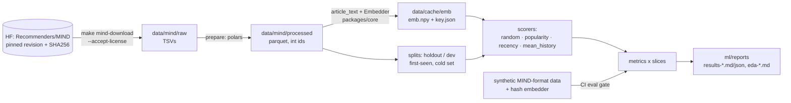

# 01: Offline ML on MIND

> Phase 1 of [SPEC.md §16](../../SPEC.md). This chapter grows with each PR:
> **1a: data, shared embedder, eval harness, baselines** (this PR) · 1b: NRMS-lite and the category classifier · 1c: ONNX export and the Hugging Face release.

---

## 1. What we built and why

Before training any model we need three things we can trust:

1. **Data we're allowed to use, verified byte for byte.** MIND is a license-gated download, pinned by SHA256.
2. **One embedding function** for the whole system. It turns an article's title and summary into 384 numbers. Training, ingestion and serving all call the same function in `packages/core`.
3. **A measuring stick.** An evaluation harness computes the standard MIND ranking metrics, overall and on the slices FirstRead cares about: brand-new articles (cold-start candidates), new readers (cold users), and each category. It also scores four simple **baselines** that any real model has to beat.

**Analogy.** Before a coaching program you buy a calibrated stopwatch, agree exactly how the race is timed, and time a few ordinary runners. Only then can you say the coached runner is faster. In 1a, the stopwatch is the metrics and slices, the timing rules are the splits and tie handling (ADR 0003), and the ordinary runners are the baselines.

**Why first?** If the measuring stick is wrong, every later number is wrong. If the embedding differs between training and serving, offline wins don't survive production (train/serve skew).

---

## 2. Concepts from first principles

### 2.1 The MIND dataset
- `news.tsv` holds one article per row: id, category, subcategory, title, abstract, URL, entities.
- `behaviors.tsv` holds one **impression** per row. An impression is one feed shown to one user. It contains:
  - the user's click **history** before that moment (article ids, oldest first);
  - the **candidates** that were shown, each labelled clicked (`-1`) or not (`-0`): `N123-1 N456-0 …`.

MIND-small train covers 2019-11-09 to 11-14; dev is 11-15. The task: given the history, rank the candidates so the clicked ones come first.

### 2.2 Embeddings and cosine similarity
An embedding model maps text to a vector, so that texts with similar meaning get vectors pointing in similar directions. We use `BAAI/bge-small-en-v1.5`, which has 384 dimensions.

We **L2-normalize** every vector (scale it to length 1). Then the dot product `a·b` *equals* the cosine similarity. That's why the database index can use inner product (SPEC gotcha).

### 2.3 Train/serve skew and the golden test
If training embeds `"Title. Summary"` but serving embeds `"Title Summary"`, the model sees slightly different inputs in production. Offline metrics then overstate real quality. Our defences:
- **One function.** `article_text()` builds the text and `Embedder` embeds it, both in `packages/core`. Everything imports them.
- **Pinned model.** fastembed always downloads the *latest* revision of its model repo, so the model could change silently. We download a **pinned revision** ourselves, check the ONNX file's SHA256, and pass the folder to fastembed.
- **Golden-vector test.** We embed three sentences we wrote ourselves and compare them to vectors stored in git. A changed model, library or text-prep step fails CI.
  - A *negative control* proves the tolerance is tight: changing one word must move the vector at least 10× more than the tolerance allows.
- **Cache key.** Cached embeddings are stored with a key built from the model, revision, fastembed version, `TEXT_PREP_VERSION` and `MAX_CHARS`. If anything differs, the cache is rebuilt.
  - A pinned-output test fails if someone changes `article_text` without bumping `TEXT_PREP_VERSION`.

### 2.4 Ranking metrics (per impression, then averaged)
For one impression, sort candidates by score, highest first.
- **AUC**: the probability that a random clicked candidate scores higher than a random non-clicked one. 0.5 is random, 1.0 is perfect. Ties count as half.
- **MRR**: the mean reciprocal rank of the clicked items. If the click is at rank 3, that's 1/3.
- **nDCG@k**: rewards clicks near the top, with discount `1/log2(rank+1)`, normalized by the best possible ordering. @5 and @10 mean only the top 5 or 10 count.

**Ties matter.** Popularity gives every brand-new article a score of 0. If ties are broken by the order candidates were logged in, the result depends on logging order rather than the model. We break ties with a seeded random key. AUC uses average ranks, which matches scikit-learn.

### 2.5 Slices
An overall average hides the cases we care about.
- **cold_candidates** keeps only articles never clicked in training.
- **cold_users** keeps impressions whose user has ≤ 2 history clicks.
- **category:c** keeps one category.

An impression stays in a slice only if it still has a click *and* a non-click; otherwise the metrics are undefined.

### 2.6 Time-based holdout (no test-set tuning)
If you try ten ideas and keep whichever scores best on dev, dev is no longer a fair test. It has become training data for your choices. So:
- We **tune on train's last day** (the holdout), after fitting on the earlier days.
- We **report dev once**.

The split is *by time*, because news is time-sensitive: a random split would let "yesterday's" model see "tomorrow's" popular articles.

### 2.7 The four baselines
| Baseline | Idea | Why it's here |
|---|---|---|
| random | coin flip | the floor (AUC ≈ 0.5) |
| popularity | most-clicked in training first | classic, and helpless on new articles (all 0) |
| recency | newest first | news-specific. MIND has no publish time, so we use **first-seen**: the earliest impression the article appears in |
| mean_history | cosine(candidate, mean of the user's last 50 clicked embeddings) | zero-training content model. It works on brand-new articles, and it's the one NRMS-lite must beat |

### 2.8 CSR layout
Impressions have different numbers of candidates. Instead of a Python list per impression, we store all candidates in one flat array plus an **offsets** array: impression *i* owns `cand[offsets[i]:offsets[i+1]]`. This is how sparse CSR matrices work. Metrics then run over all impressions with a few vectorized numpy calls (`lexsort`, `bincount`) instead of a 73K-iteration Python loop.

---

## 3. Architecture of this phase (1a)



Everything left of `ml/reports` lives in gitignored `data/`. Only aggregate reports are committed.

---

## 4. Walkthrough of the important files

| File | What it does / why it exists |
|---|---|
| `packages/core/src/firstread_core/text.py` | `clean_text` (HTML unescape, strip tags, NFKC, whitespace), `article_text(title, summary)`, `MAX_CHARS`, `TEXT_PREP_VERSION`. |
| `packages/core/src/firstread_core/embedding.py` | Pins (model, source repo, revision, file SHA256, fastembed version). `fetch_model()` downloads and verifies. `Embedder.embed()` sorts by length, batches, restores order and L2-normalizes. `embedding_cache_key()`. fastembed is imported lazily, so the API doesn't need it. |
| `packages/core/src/firstread_core/features.py` | `HISTORY_LEN = 50`. `history_index_matrix` (newest click in the last slot, padding on the left), `pad_history`, `gather_history`, `mean_history_vector` (empty history → fallback vector). The API reuses these in P3. |
| `packages/core/tests/test_embedding_golden.py` | Golden vectors, model checksum, negative control. Needs the model download (cached in CI). |
| `ml/src/firstread_ml/mind/manifest.py` | HF repo, revision, and each zip's SHA256 and size. |
| `ml/src/firstread_ml/mind/download.py` | License gate, download, verify, zip-slip-safe atomic extract, skips work already done. |
| `ml/src/firstread_ml/mind/load.py` | TSV → parquet. Unions train and dev news into one `nidx` index and maps ids with explode + join (79 s → 1.2 s vs. mapping inside `list.eval`). |
| `ml/src/firstread_ml/mind/data.py` | `Impressions`: the CSR container with `take`, `concat`, `histories(rows)`. |
| `ml/src/firstread_ml/mind/splits.py` | `holdout_split` (last calendar day), `clicked_articles` (the cold set), `click_counts`, `first_seen`. |
| `ml/src/firstread_ml/embed_cache.py` | Cached embeddings with a `key.json` sidecar. Rebuilds on any mismatch and says which component changed. |
| `ml/src/firstread_ml/eval/metrics.py` | Vectorized AUC/MRR/nDCG with seeded tie-breaking. |
| `ml/src/firstread_ml/eval/slices.py` | Slice definitions and `restrict()`. |
| `ml/src/firstread_ml/baselines.py` | `FitContext` (training-period data plus the population vector), `Scorer` protocol, the four baselines, chunked dot-product scoring. |
| `ml/src/firstread_ml/eval/harness.py` | Loads a split, fits scorers, scores, computes metrics on every slice. |
| `ml/src/firstread_ml/eval/report.py` | JSON + Markdown tables. `acceptance()` prints the bar to beat (and PASS/FAIL once a model exists). |
| `ml/src/firstread_ml/eval/gate.py` | Synthetic eval-regression gate (CI). |
| `ml/src/firstread_ml/testing/synthetic.py` | Seeded MIND-format generator with planted topics, popularity, cold articles and empty histories, plus `hash_backend`, a model-free embedder. |
| `ml/src/firstread_ml/eda.py` | Aggregate EDA → `ml/reports/eda-mind-<variant>.md` + SVG plots. |
| `ml/src/firstread_ml/cli.py` | `firstread-ml download / prepare / embed / eda / eval / eval-gate`. |

---

## 5. Rebuild from scratch

Prerequisites: P0 is done (`make setup` works).

```bash
git checkout -b phase-1a-data-baselines

# 1. Dependencies. fastembed is an optional extra of core, so the API image stays lean.
#    packages/core/pyproject.toml: dependencies = ["numpy>=2.5.4"]; [project.optional-dependencies] embed = ["fastembed==0.9.0"]
#    ml/pyproject.toml: "firstread-core[embed]", "polars>=2.0.0", "scikit-learn>=1.9.1",
#                       "matplotlib>=3.11.2", "huggingface-hub>=0.36,<2.0"; [project.scripts] firstread-ml = "firstread_ml.cli:main"
uv lock && uv sync --all-packages

# 2. Look up the pins (they go in embedding.py and manifest.py)
curl -s https://huggingface.co/api/models/Qdrant/bge-small-en-v1.5-onnx-Q | jq .sha
curl -s "https://huggingface.co/api/models/Qdrant/bge-small-en-v1.5-onnx-Q/tree/<sha>" | jq '.[] | {path, lfs}'
curl -s "https://huggingface.co/api/datasets/Recommenders/MIND/tree/main" | jq '.[] | {path, size, lfs}'

# 3. Write packages/core: text.py, embedding.py, features.py (see section 4). Then generate the golden file once:
uv run python packages/core/tests/make_golden.py

# 4. Write ml/: paths, mind/{manifest,download,load,data,splits}, embed_cache, eval/*, baselines, eda, testing/*, cli

# 5. Get the data (read the license first)
make mind-download VARIANT=small ACCEPT_LICENSE=1

# 6. One command reproduces the eval (prepare → embed → holdout + dev reports; each step cached)
make eval VARIANT=small
make eda VARIANT=small

# 7. Synthetic gate expectations (only when a change in numbers is intended)
uv run firstread-ml eval-gate --update
```

---

## 6. How to test and verify it, and how to read the results

```bash
make lint && make typecheck && make test     # includes the golden test and the synthetic eval gate
make eval-gate                               # prints GATE PASS / GATE FAIL
make eval VARIANT=small                      # writes ml/reports/results-mind-small-{holdout,dev}.{md,json}
```

How to read a results file:
- Check **random ≈ 0.50 AUC** first. If it isn't, the metric code is wrong.
- **popularity on cold candidates is exactly 0.50 AUC**, because every brand-new article has zero clicks and is tied. That is expected, and it's the whole cold-start problem in one number.
- The `> Bar to beat` lines give the best baseline's nDCG@10 overall and on cold candidates. NRMS-lite (1b) must beat both.
- Per-category rows marked ⚠ have fewer than 100 impressions. Don't read much into them.

**MIND-small results (baselines).** The full tables are in `ml/reports/results-mind-small-dev.md`.

Dev split, 73,152 impressions; nDCG@10 (AUC in brackets):

| Model | Overall | Cold-start candidates (40,128 imps) | Cold users (5,038 imps) |
|---|---:|---:|---:|
| random | 0.2862 (0.498) | 0.3273 (0.499) | 0.3110 (0.495) |
| popularity | 0.3090 (0.532) | 0.3256 (**0.500**) | 0.3337 (0.535) |
| recency | 0.2914 (0.514) | 0.3516 (0.529) | 0.3099 (0.499) |
| mean_history | **0.3904** (0.625) | **0.4383** (0.625) | **0.3554** (0.553) |

What this tells us:
- **mean_history is the bar for NRMS-lite** on every headline slice (dev nDCG@10 0.3904 overall, 0.4383 cold-start). The holdout bar used for tuning is 0.3662 / 0.4340.
- Popularity helps on warm articles but is exactly a coin flip on cold ones (AUC 0.500). Recency is the only non-content baseline that does anything on cold candidates.
- Cold users are the hardest slice. 2,214 of the 5,038 have no history at all, so content can only use the population vector.

Measured runtimes on an M-series Mac (16 GB):

| Step | MIND-small |
|---|---|
| Download (84 MB) + verify + extract | under 1 min; 328 MB raw on disk |
| `prepare` (TSV → parquet) | 1.2 s; 35 MB parquet |
| `embed` (65,238 articles) | 13 min 41 s (~79 texts/s); 96 MB cache |
| `eval` holdout + dev (4 baselines, all slices) | 14 s once embeddings are cached |

Rerunning `make eval VARIANT=small` produces a byte-identical `results-mind-small-dev.json`. MIND-large is used in 1b. Extrapolating, its ~130K articles take ~25–30 min to embed (one-time, cached).

---

## 7. Decisions and alternatives considered

- [ADR 0003](../adr/0003-mind-data-and-eval-protocol.md): HF mirror with SHA pins, license gate, time-based holdout, slice definitions, tie-breaking, eval-gate strategy.
- **fastembed as an optional extra** rather than a hard dependency of core: the API image never embeds text, so it shouldn't carry ONNX Runtime and tokenizers (until P3, which needs ONNX Runtime for the user encoder only). CI checks that ML packages stay out of the image.
- **Pinning the model revision ourselves** instead of trusting fastembed's "latest". It costs one `snapshot_download` call and buys reproducibility.
- **polars + numpy** instead of pandas: MIND-large has ~83M candidate rows in train, and polars parses it in seconds.
- **SVG plots** so the existing `*.png` ignore rule stays, and diffs are text.

---

## 8. What went wrong and the gotchas

- **fastembed downloads the latest model revision.** Its `TextEmbedding` resolves `model_info(repo).sha` at load time, so a re-upload to `Qdrant/bge-small-en-v1.5-onnx-Q` would silently change our vectors. Fix: `snapshot_download(revision=PINNED)` + SHA256 check + `specific_model_path`.
- **fastembed's bge-small is the int8-quantized Qdrant export** (`model_optimized.onnx`), not BAAI's original weights. Vectors differ slightly from the PyTorch model. That's fine, because every component uses this one file.
- **Embedding was ~10× slower than my plan estimated.** The first full run, with fastembed defaults and unsorted input, managed ~35 texts/s on 2,000-text samples (would be about 30 minutes for MIND-small). Every batch is padded to its longest text, and MIND abstracts vary a lot in length. Measured on an M-series Mac with a 2,000-article sample:

  | Setting | Texts/s |
  |---|---:|
  | unsorted, batch 256 (fastembed default) | 35 |
  | length-sorted, batch 256 | 64 |
  | length-sorted, batch 64 | 73 |
  | length-sorted, batch 16 | 82 |
  | length-sorted, batch 16, 4 threads | **100** |
  | length-sorted, batch 16, 10 threads | 86 |
  | data-parallel 8 processes × 1 thread | 64 |

  Vectors were bit-identical across all settings. `Embedder` now length-sorts and defaults to batch 16 with 4 threads. A faster option is BAAI's fp32 ONNX export: int8 kernels are often slow on ARM. That would be a different, new model source, so it's deferred and needs approval.
- **polars `replace_strict` inside `list.eval` was slow** (79 s on MIND-small). Exploding, joining against the id table and re-aggregating gives identical output in 1.2 s.
- **A long pipeline hid progress.** Piping a long job through `grep` buffered its progress lines, so a run looked hung. Write logs to a file and tail it.
- **gitleaks flagged a SHA256 as an API key.** A field named `embedding_cache_key` holding a hex string matches the `generic-api-key` rule. It's a hash of public config, not a secret, so we renamed it to `embedding_cache_id` instead of allowlisting a pattern that could hide real leaks later.
- **Generated SVGs and whitespace hooks.** matplotlib writes trailing spaces in SVG path data, and its element ids are random unless `svg.hashsalt` is set. We set the salt (identical files on every run) and exclude `ml/reports/figures/*.svg` from the whitespace hooks.
- **`pgrep -f <pattern>` matches the loop that runs it.** A shell `until ! pgrep -f "firstread-ml embed"` loop contains the pattern in its own command line, so it never exits. Wait on a PID or a log line instead.
- **`--import-mode=importlib` means test modules can't import each other.** Shared test builders live in `firstread_ml.testing`.
- **Two `conftest.py` files in one mypy run collide** ("Duplicate module named conftest"). `ml/tests/__init__.py` gives the ml one a distinct module name.
- **Golden vectors and CPU architecture.** The golden file was generated on macOS arm64; CI runs Linux x86-64. An int8 model can differ slightly across CPUs. The test's failure message prints the measured difference and both platforms. If CI ever fails only for this reason, measure it, record it here, and set the tolerance to ~3× the measurement. The negative control must still pass. Don't just loosen it.

---

## 9. Ten interview questions (with strong answers)

1. **Why evaluate per impression instead of pooling all candidates?**
   A user only ever sees their own list, so the question is "did we order *this* list well?" Pooling lets easy users dominate and mixes score scales across users. MIND's standard is per-impression averages.

2. **Your popularity baseline has AUC 0.5 on cold-start candidates. Is that a bug?**
   No, it's the point. Articles never clicked in training all have count 0, so popularity can't order them, and ties give exactly 0.5. Content-based scoring, which reads the text, is the only way to rank them. That's FirstRead's thesis.

3. **How do you avoid overfitting to the test set when MIND's test labels aren't public?**
   Fit on train minus its last day, tune on that day, and evaluate dev once with the chosen config. The holdout is time-based because news popularity shifts by day; a random split would leak the future.

4. **How does the recency baseline work without publish times?**
   First-seen = the earliest impression timestamp in which the article is a candidate. It can't leak: if the article is shown at time *t*, its first appearance is at or before *t*. So the global minimum equals the minimum over the past.

5. **What is train/serve skew, and what did you do about it concretely?**
   It's when features differ between training and production. Text prep and embedding exist once, in `packages/core`. The model revision and file hash are pinned. A golden-vector test fails if outputs change. The cache key includes the text-prep version, and a pinned-output test forces a version bump whenever the prep changes.

6. **Why L2-normalize embeddings?**
   Dot product then equals cosine, so the same vectors work for ANN with inner-product indexes and for scoring. Vector length (which often tracks text length) stops affecting the score.

7. **How did you make the metric computation fast?**
   A CSR layout plus vectorized numpy. One `lexsort` by (impression, −score, random tie-break) gives within-impression ranks, `bincount` sums per impression, and tie-aware average ranks give AUC. No per-impression Python loop.

8. **How do you test an ML pipeline in CI without the dataset?**
   A seeded synthetic generator writes MIND-format files with planted structure (topics, popularity, cold articles, empty histories), and a hash embedder replaces the model. The full pipeline runs, and a gate fails if any model's nDCG@10 drops more than 1% versus committed expectations. Real-data quality is gated locally before release.

9. **Why break ties randomly?**
   Input-order tie-breaking makes results depend on how candidates were logged. In MIND that could systematically favour or punish tie-heavy scorers like popularity on new items. A seeded random tie-break is neutral and reproducible. AUC already handles ties with average ranks.

10. **Your embedding job was 10× slower than estimated. How did you approach it?**
    Benchmark on a fixed sample, change one variable at a time, and check outputs stay identical. Length-sorting removed padding waste (2×), smaller batches and 4 threads gave another ~1.5×, and multi-process parallelism didn't help. The remaining lever, an fp32 model, changes a pinned dependency, so it's a deliberate decision rather than a quick fix.

---

## 10. Glossary of new terms

| Term | Meaning |
|---|---|
| **Impression** | One feed shown to one user: their history plus labelled candidates. |
| **Candidate** | An article shown in an impression, labelled clicked or not. |
| **Cold-start candidate** | An article never clicked in the training period. |
| **Cold user** | A user with ≤ 2 history clicks. |
| **Slice** | A subset of candidates/impressions that metrics are computed on separately. |
| **Holdout** | Data held back from fitting, used for tuning: here, train's last day. |
| **AUC / MRR / nDCG@k** | Ranking metrics; see §2.4. |
| **Baseline** | A simple method that sets the bar a real model must beat. |
| **First-seen time** | The earliest impression timestamp an article appears in; our stand-in for publish time. |
| **Population vector** | The normalized mean embedding of all training clicks; used for users with no history. |
| **Golden test** | A test that compares outputs to stored known-good values. |
| **Negative control** | A check that a test *can* fail: a deliberately different input must exceed the tolerance. |
| **CSR** | Compressed Sparse Row: a flat values array plus offsets. |
| **Cache key / sidecar** | A hash of everything that determines cached data, stored in a small file next to it. |
| **int8 quantization** | Storing model weights as 8-bit integers: smaller, sometimes faster, slightly different outputs. |
