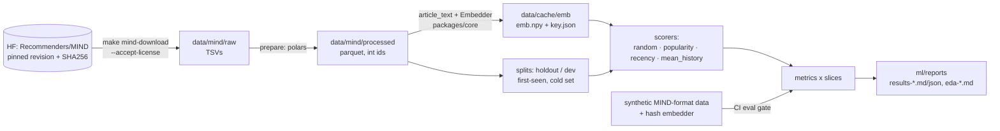

# 01: Offline ML on MIND

> Phase 1 of [SPEC.md §16](../../SPEC.md). This chapter grows with each PR:
> **1a: data, shared embedder, eval harness, baselines** · **1b: NRMS-lite and the category classifier** · 1c: ONNX export and the Hugging Face release.

---

## 1. What we built and why

Before training any model we need three things we can trust:

1. **Data we're allowed to use, verified byte for byte.** MIND is a license-gated download, pinned by SHA256.
2. **One embedding function** for the whole system. It turns an article's title and summary into 384 numbers. Training, ingestion and serving all call the same function in `packages/core`.
3. **A measuring stick.** An evaluation harness computes the standard MIND ranking metrics, overall and on the slices FirstRead cares about: brand-new articles (cold-start candidates), new readers (cold users), and each category. It also scores four simple **baselines** that any real model has to beat.

**Analogy.** Before a coaching program you buy a calibrated stopwatch, agree exactly how the race is timed, and time a few ordinary runners. Only then can you say the coached runner is faster. In 1a, the stopwatch is the metrics and slices, the timing rules are the splits and tie handling (ADR 0003), and the ordinary runners are the baselines.

**Why first?** If the measuring stick is wrong, every later number is wrong. If the embedding differs between training and serving, offline wins don't survive production (train/serve skew).

**1b adds two models:**
- **NRMS-lite** reads a reader's last 50 clicked articles and outputs a vector in the same space as article embeddings. Scoring any article, even one published a minute ago, is then just a dot product.
- **A category classifier** lets ingestion label live articles ("sports", "finance", ...) from their embedding alone.

**Analogy, continued.** If 1a timed ordinary runners, 1b is the coached runner. The coach (NRMS-lite) doesn't change the shoes (frozen article embeddings), only the running style (how the reader's history is summarized). We start the coached runner from the best ordinary runner's style (mean-of-history), so coaching can only add.

---

## 2. Concepts from first principles

### 2.1 The MIND dataset
- `news.tsv` holds one article per row: id, category, subcategory, title, abstract, URL, entities.
- `behaviors.tsv` holds one **impression** per row. An impression is one feed shown to one user. It contains:
  - the user's click **history** before that moment (article ids, oldest first);
  - the **candidates** that were shown, each labelled clicked (`-1`) or not (`-0`): `N123-1 N456-0 …`.

MIND-small train covers 2019-11-09 to 11-14; dev is 11-15. The task: given the history, rank the candidates so the clicked ones come first.

### 2.2 Embeddings and cosine similarity
An embedding model maps text to a vector, so that texts with similar meaning get vectors pointing in similar directions. We use `BAAI/bge-small-en-v1.5`, which has 384 dimensions.

We **L2-normalize** every vector (scale it to length 1). Then the dot product `a·b` *equals* the cosine similarity. That's why the database index can use inner product (SPEC gotcha).

### 2.3 Train/serve skew and the golden test
If training embeds `"Title. Summary"` but serving embeds `"Title Summary"`, the model sees slightly different inputs in production. Offline metrics then overstate real quality. Our defences:
- **One function.** `article_text()` builds the text and `Embedder` embeds it, both in `packages/core`. Everything imports them.
- **Pinned model.** fastembed always downloads the *latest* revision of its model repo, so the model could change silently. We download a **pinned revision** ourselves, check the ONNX file's SHA256, and pass the folder to fastembed.
- **Golden-vector test.** We embed three sentences we wrote ourselves and compare them to vectors stored in git. A changed model, library or text-prep step fails CI.
  - A *negative control* proves the tolerance is tight: changing one word must move the vector at least 10× more than the tolerance allows.
- **Cache key.** Cached embeddings are stored with a key built from the model, revision, fastembed version, `TEXT_PREP_VERSION` and `MAX_CHARS`. If anything differs, the cache is rebuilt.
  - A pinned-output test fails if someone changes `article_text` without bumping `TEXT_PREP_VERSION`.

### 2.4 Ranking metrics (per impression, then averaged)
For one impression, sort candidates by score, highest first.
- **AUC**: the probability that a random clicked candidate scores higher than a random non-clicked one. 0.5 is random, 1.0 is perfect. Ties count as half.
- **MRR**: the mean reciprocal rank of the clicked items. If the click is at rank 3, that's 1/3.
- **nDCG@k**: rewards clicks near the top, with discount `1/log2(rank+1)`, normalized by the best possible ordering. @5 and @10 mean only the top 5 or 10 count.

**Ties matter.** Popularity gives every brand-new article a score of 0. If ties are broken by the order candidates were logged in, the result depends on logging order rather than the model. We break ties with a seeded random key. AUC uses average ranks, which matches scikit-learn.

### 2.5 Slices
An overall average hides the cases we care about.
- **cold_candidates** keeps only articles never clicked in training.
- **cold_users** keeps impressions whose user has ≤ 2 history clicks.
- **category:c** keeps one category.

An impression stays in a slice only if it still has a click *and* a non-click; otherwise the metrics are undefined.

### 2.6 Time-based holdout (no test-set tuning)
If you try ten ideas and keep whichever scores best on dev, dev is no longer a fair test. It has become training data for your choices. So:
- We **tune on train's last day** (the holdout), after fitting on the earlier days.
- We **report dev once**.

The split is *by time*, because news is time-sensitive: a random split would let "yesterday's" model see "tomorrow's" popular articles.

### 2.7 The four baselines
| Baseline | Idea | Why it's here |
|---|---|---|
| random | coin flip | the floor (AUC ≈ 0.5) |
| popularity | most-clicked in training first | classic, and helpless on new articles (all 0) |
| recency | newest first | news-specific. MIND has no publish time, so we use **first-seen**: the earliest impression the article appears in |
| mean_history | cosine(candidate, mean of the user's last 50 clicked embeddings) | zero-training content model. It works on brand-new articles, and it's the one NRMS-lite must beat |

### 2.8 CSR layout
Impressions have different numbers of candidates. Instead of a Python list per impression, we store all candidates in one flat array plus an **offsets** array: impression *i* owns `cand[offsets[i]:offsets[i+1]]`. This is how sparse CSR matrices work. Metrics then run over all impressions with a few vectorized numpy calls (`lexsort`, `bincount`) instead of a 73K-iteration Python loop.

### 2.9 Two towers and why ours has one learned tower
A two-tower recommender scores `user_vec · item_vec`. Usually both towers are learned. FirstRead keeps the **item tower frozen**: the item vector is exactly the bge-small embedding stored at ingestion. Retraining the user model then never invalidates stored article vectors or the ANN index, and brand-new articles are scorable the moment they're embedded ([ADR 0004](../adr/0004-identity-item-tower.md)).

### 2.10 Multi-head self-attention over a click history
Self-attention lets each clicked article "look at" the others and update its representation from the ones related to it. For example, a click on a trade-war story is read differently next to finance clicks than next to politics clicks.
- **Multi-head** means doing this in several smaller subspaces at once (8 heads × 48 dims = 384).
- A **key padding mask** stops real items from attending to padding.

### 2.11 Additive attention pooling
After self-attention we still have 50 vectors. They're pooled into one using weights `softmax(q · tanh(W h_i))`, where `q` is a learned "what matters" query. Recent or more informative clicks can then get more weight than a plain average gives them.

### 2.12 Residual on the baseline (alpha = 0 at init)
`user = normalize(mean(history)) + α · proj(pool(MHSA(history)))`. With `α = 0` the untrained model *equals* mean-of-history, and a unit test checks this exactly. Training moves `α` only if the attention branch actually helps. That's a cheap way to make "at least as good as the baseline" the starting point instead of a hope.

### 2.13 Negative sampling and softmax cross-entropy
For each click we take K=4 non-clicked articles **from the same impression** (same moment, same feed). We score all 5 and apply softmax cross-entropy with the click as the correct class. "Same impression" matters: those negatives were shown alongside the click, so they're hard and realistic. Random articles from the whole catalogue would be too easy.

### 2.14 The temperature and keeping it sane
Scores are `s · dot(user, article)`. Because vectors are normalized, the dot lies in [−1, 1], and softmax over such small numbers is nearly uniform. `s` (initialized to 10) sharpens it. We learn `log s` and clamp it to [log 1, log 100], so `s` can't go negative or explode. A test pushes it with a huge learning rate in both directions and checks the bounds hold.

### 2.15 Why empty histories need special care
Softmax over a row where *every* position is masked divides 0 by 0, which gives **NaN**. `torch.where(empty, population, model_output)` doesn't save you: autograd still computes the gradient of the unused branch, and `0 × NaN = NaN` poisons the weights. So for empty rows we unmask one zero-vector slot, which keeps every computation finite, and replace the output with the population vector afterwards. Tests check finite loss and gradients on a batch mixing empty, length-1, partial and full histories, and that an empty history returns the population vector exactly.

### 2.16 Tuning without fooling yourself
On the holdout we look at the whole epoch curve, not just the final number, and repeat promising configs with different **seeds**. If two configs differ by less than seed-to-seed variation, the difference isn't real. The full log is committed: `ml/reports/tuning-nrms-lite-small.md`.

---

## 3. Architecture of this phase (1a)



Everything left of `ml/reports` lives in gitignored `data/`. Only aggregate reports are committed.

### 1b: NRMS-lite and the classifier

```mermaid
flowchart LR
  EMB[(frozen article embeddings<br/>data/cache/emb)] --> H[last 50 clicks<br/>history_index_matrix]
  H --> MH[mean + normalize]
  H --> AT[MHSA, 8 heads] --> AP[additive pooling] --> PR[linear 384→384]
  MH --> SUM((+))
  PR -->|× α, init 0| SUM
  SUM --> EW{empty history?}
  EW -->|yes| POP[population vector]
  EW -->|no| U[user vector, 384-d]
  U --> SC[score = s · dot&#40;user, article&#41;]
  EMB --> SC
  SC --> CE[softmax CE over click + 4 same-impression negatives]
  EMB --> LR[logistic regression] --> CAT[MIND category]
```



---

## 4. Walkthrough of the important files

| File | What it does / why it exists |
|---|---|
| `packages/core/src/firstread_core/text.py` | `clean_text` (HTML unescape, strip tags, NFKC, whitespace), `article_text(title, summary)`, `MAX_CHARS`, `TEXT_PREP_VERSION`. |
| `packages/core/src/firstread_core/embedding.py` | Pins (model, source repo, revision, file SHA256, fastembed version). `fetch_model()` downloads and verifies. `Embedder.embed()` sorts by length, batches, restores order and L2-normalizes. `embedding_cache_key()`. fastembed is imported lazily, so the API doesn't need it. |
| `packages/core/src/firstread_core/features.py` | `HISTORY_LEN = 50`. `history_index_matrix` (newest click in the last slot, padding on the left), `pad_history`, `gather_history`, `mean_history_vector` (empty history → fallback vector). The API reuses these in P3. |
| `packages/core/tests/test_embedding_golden.py` | Golden vectors, model checksum, negative control. Needs the model download (cached in CI). |
| `ml/src/firstread_ml/mind/manifest.py` | HF repo, revision, and each zip's SHA256 and size. |
| `ml/src/firstread_ml/mind/download.py` | License gate, download, verify, zip-slip-safe atomic extract, skips work already done. |
| `ml/src/firstread_ml/mind/load.py` | TSV → parquet. Unions train and dev news into one `nidx` index and maps ids with explode + join (79 s → 1.2 s vs. mapping inside `list.eval`). |
| `ml/src/firstread_ml/mind/data.py` | `Impressions`: the CSR container with `take`, `concat`, `histories(rows)`. |
| `ml/src/firstread_ml/mind/splits.py` | `holdout_split` (last calendar day), `clicked_articles` (the cold set), `click_counts`, `first_seen`. |
| `ml/src/firstread_ml/embed_cache.py` | Cached embeddings with a `key.json` sidecar. Rebuilds on any mismatch and says which component changed. |
| `ml/src/firstread_ml/eval/metrics.py` | Vectorized AUC/MRR/nDCG with seeded tie-breaking. |
| `ml/src/firstread_ml/eval/slices.py` | Slice definitions and `restrict()`. |
| `ml/src/firstread_ml/baselines.py` | `FitContext` (training-period data plus the population vector), `Scorer` protocol, the four baselines, chunked dot-product scoring. |
| `ml/src/firstread_ml/eval/harness.py` | Loads a split, fits scorers, scores, computes metrics on every slice. |
| `ml/src/firstread_ml/eval/report.py` | JSON + Markdown tables. `acceptance()` prints the bar to beat (and PASS/FAIL once a model exists). |
| `ml/src/firstread_ml/eval/gate.py` | Synthetic eval-regression gate (CI). |
| `ml/src/firstread_ml/testing/synthetic.py` | Seeded MIND-format generator with planted topics, popularity, cold articles and empty histories, plus `hash_backend`, a model-free embedder. |
| `ml/src/firstread_ml/eda.py` | Aggregate EDA → `ml/reports/eda-mind-<variant>.md` + SVG plots. |
| `ml/src/firstread_ml/cli.py` | `firstread-ml download / prepare / embed / eda / eval / eval-gate`. |


**1b files**

| File | What it does / why it exists |
|---|---|
| `ml/src/firstread_ml/models/nrms_lite.py` | The user encoder: `AdditiveAttention`, `NRMSLite` (residual on mean-of-history, empty-history guard, clamped temperature, population buffer). |
| `ml/src/firstread_ml/models/train.py` | `build_samples` (one sample per click), `sample_negatives` (K from the same impression, with replacement if needed), training loop (AdamW, grad clipping, seeds), `user_vectors` for inference. |
| `ml/src/firstread_ml/models/scorer.py` | NRMS-lite as an eval-harness `Scorer`: `fit` trains, or reuses a checkpoint whose `key.json` (config + embedding id + training-data fingerprint + code version) matches. |
| `ml/src/firstread_ml/models/tune.py` | `firstread-ml tune`: trains on the fit days, evaluates the holdout every epoch, and appends to the tuning log. `--set train.lr=…`, `--set seed=…`. |
| `ml/src/firstread_ml/models/classifier.py` | Logistic regression on embeddings. C and class weighting are chosen by validation macro-F1 on train articles; the test set is articles that appear only in dev. |
| `ml/src/firstread_ml/config.py` | Pydantic schema for the YAML configs (`extra="forbid"`, so a typo is an error, not a silent default). |
| `ml/configs/nrms_lite.yaml`, `nrms_lite_ci.yaml` | The committed training config (chosen on the holdout), and a tiny CPU config for tests and the CI gate. |
| `ml/src/firstread_ml/tracking.py` | MLflow (skinny) file store in `data/mlruns`. Best-effort; `FIRSTREAD_TRACKING=0` disables it. |
| `docs/adr/0004-identity-item-tower.md` | Why the article tower is the frozen embedding. |
---

## 5. Rebuild from scratch

Prerequisites: P0 is done (`make setup` works).

```bash
git checkout -b phase-1a-data-baselines

# 1. Dependencies. fastembed is an optional extra of core, so the API image stays lean.
#    packages/core/pyproject.toml: dependencies = ["numpy>=2.5.4"]; [project.optional-dependencies] embed = ["fastembed==0.9.0"]
#    ml/pyproject.toml: "firstread-core[embed]", "polars>=2.0.0", "scikit-learn>=1.9.1",
#                       "matplotlib>=3.11.2", "huggingface-hub>=0.36,<2.0"; [project.scripts] firstread-ml = "firstread_ml.cli:main"
uv lock && uv sync --all-packages

# 2. Look up the pins (they go in embedding.py and manifest.py)
curl -s https://huggingface.co/api/models/Qdrant/bge-small-en-v1.5-onnx-Q | jq .sha
curl -s "https://huggingface.co/api/models/Qdrant/bge-small-en-v1.5-onnx-Q/tree/<sha>" | jq '.[] | {path, lfs}'
curl -s "https://huggingface.co/api/datasets/Recommenders/MIND/tree/main" | jq '.[] | {path, size, lfs}'

# 3. Write packages/core: text.py, embedding.py, features.py (see section 4). Then generate the golden file once:
uv run python packages/core/tests/make_golden.py

# 4. Write ml/: paths, mind/{manifest,download,load,data,splits}, embed_cache, eval/*, baselines, eda, testing/*, cli

# 5. Get the data (read the license first)
make mind-download VARIANT=small ACCEPT_LICENSE=1

# 6. One command reproduces the eval (prepare → embed → holdout + dev reports; each step cached)
make eval VARIANT=small
make eda VARIANT=small

# 7. Synthetic gate expectations (only when a change in numbers is intended)
uv run firstread-ml eval-gate --update
```


**1b, in order:**

```bash
git checkout -b phase-1b-models
# ml/pyproject.toml adds: "torch>=2.14.1", "pyyaml>=6.0.3", "pydantic>=2.14.1", "mlflow>=3.17.1"
# Root pyproject.toml routes torch to the CPU index on Linux (CI/Docker), PyPI elsewhere:
#   [tool.uv.sources] torch = [{ index = "pytorch-cpu", marker = "sys_platform == 'linux'" }]
#   [[tool.uv.index]] name = "pytorch-cpu", url = "https://download.pytorch.org/whl/cpu", explicit = true
uv lock && uv sync --all-packages
grep -A3 'version = "2.14.1+cpu"' uv.lock      # Linux wheel comes from download.pytorch.org/whl/cpu

# Write: config.py, models/{nrms_lite,train,scorer,tune,classifier}.py, tracking.py,
#        eval/stats.py, ml/configs/nrms_lite{,_ci}.yaml (see section 4)

# Tune on the MIND-small holdout (never dev). Each run appends to ml/reports/tuning-nrms-lite-small.md
uv run firstread-ml tune --variant small --label lr1e-3 --set train.epochs=5
uv run firstread-ml tune --variant small --label cos-lr1e-3-s1 --set train.epochs=5 \
    --set train.lr_schedule=cosine --set seed=1
# ...then commit the chosen values in ml/configs/nrms_lite.yaml

# Final numbers: 3 seeds, all baselines, dev evaluated once, plus the classifier
make reproduce VARIANT=small          # ~35 min on an M-series Mac
make mind-download VARIANT=large ACCEPT_LICENSE=1
make reproduce VARIANT=large          # ~7 h 50 min after a 56 min one-time embed (section 6)
make mlflow-ui                        # browse runs at http://127.0.0.1:5000
```
---

## 6. How to test and verify it, and how to read the results

```bash
make lint && make typecheck && make test     # includes the golden test and the synthetic eval gate
make eval-gate                               # prints GATE PASS / GATE FAIL
make eval VARIANT=small                      # writes ml/reports/results-mind-small-{holdout,dev}.{md,json}
```

How to read a results file:
- Check **random ≈ 0.50 AUC** first. If it isn't, the metric code is wrong.
- **popularity on cold candidates is exactly 0.50 AUC**, because every brand-new article has zero clicks and is tied. That is expected, and it's the whole cold-start problem in one number.
- The `> Bar to beat` lines give the best baseline's nDCG@10 overall and on cold candidates. NRMS-lite (1b) must beat both.
- Per-category rows marked ⚠ have fewer than 100 impressions. Don't read much into them.

**MIND-small results (baselines).** The full tables are in `ml/reports/results-mind-small-dev.md`.

Dev split, 73,152 impressions; nDCG@10 (AUC in brackets):

| Model | Overall | Cold-start candidates (40,128 imps) | Cold users (5,038 imps) |
|---|---:|---:|---:|
| random | 0.2862 (0.498) | 0.3273 (0.499) | 0.3110 (0.495) |
| popularity | 0.3090 (0.532) | 0.3256 (**0.500**) | 0.3337 (0.535) |
| recency | 0.2914 (0.514) | 0.3516 (0.529) | 0.3099 (0.499) |
| mean_history | **0.3904** (0.625) | **0.4383** (0.625) | **0.3554** (0.553) |

What this tells us:
- **mean_history is the bar for NRMS-lite** on every headline slice (dev nDCG@10 0.3904 overall, 0.4383 cold-start). The holdout bar used for tuning is 0.3662 / 0.4340.
- Popularity helps on warm articles but is exactly a coin flip on cold ones (AUC 0.500). Recency is the only non-content baseline that does anything on cold candidates.
- Cold users are the hardest slice. 2,214 of the 5,038 have no history at all, so content can only use the population vector.

Measured runtimes on an M-series Mac (16 GB):

| Step | MIND-small |
|---|---|
| Download (84 MB) + verify + extract | under 1 min; 328 MB raw on disk |
| `prepare` (TSV → parquet) | 1.2 s; 35 MB parquet |
| `embed` (65,238 articles) | 13 min 41 s (~79 texts/s); 96 MB cache |
| `eval` holdout + dev (4 baselines, all slices) | 14 s once embeddings are cached |

Rerunning `make eval VARIANT=small` produces a byte-identical `results-mind-small-dev.json`. MIND-large is used in 1b; its measured runtimes are below, after the NRMS-lite results.


**MIND-small results with NRMS-lite** (dev, evaluated once, 3 seeds; `ml/reports/results-mind-small-dev.md`):

| Model | Overall nDCG@10 | Cold-start nDCG@10 | Overall AUC |
|---|---:|---:|---:|
| mean_history (best baseline) | 0.3904 | 0.4383 | 0.6247 |
| NRMS-lite, seed 0 / 1 / 2 | 0.4077 / 0.4065 / 0.4077 | 0.4540 / 0.4523 / 0.4542 | 0.6527 / 0.6516 / 0.6527 |
| **NRMS-lite, mean ± std** | **0.4073 ± 0.0007** | **0.4535 ± 0.0010** | **0.6523 ± 0.0006** |
| **Paired gain over mean_history, 95% CI** | **+0.0168 [+0.0149, +0.0186]** | **+0.0152 [+0.0126, +0.0177]** | |

- `ACCEPT PASS` on both slices for every seed, and no bootstrap resample showed a gain ≤ 0.
- On the holdout (tuning split) the same config gives 0.3769 ± 0.0006 overall and 0.4534 ± 0.0011 cold-start, against mean_history's 0.3662 / 0.4340.
- The category classifier on 13,955 dev-only articles reaches **accuracy 0.749, macro-F1 0.549**, against a majority-class reference of 0.348 (`ml/reports/classifier-mind-small.md`).
- Training cost on an M-series Mac: ~60 s/epoch on MPS for MIND-small (190K–236K samples/epoch). The whole `make reproduce VARIANT=small` (EDA, 6 trainings, 2 evals, classifier) took about 50 minutes.

**MIND-large final results** (dev, 376,471 impressions, evaluated once, 3 seeds with the locked config; `ml/reports/results-mind-large-dev.md`):

| Model | Overall nDCG@10 | Cold-start nDCG@10 (125,472 imps) | Cold users nDCG@10 (25,688 imps) | Overall AUC |
|---|---:|---:|---:|---:|
| random | 0.2864 | 0.4302 | 0.3119 | 0.5000 |
| popularity | 0.3079 | 0.4303 | 0.3348 | 0.5385 |
| recency | 0.2946 | 0.4830 | 0.3075 | 0.5117 |
| mean_history (best baseline) | 0.3906 | 0.5332 | 0.3552 | 0.6247 |
| NRMS-lite, seed 0 / 1 / 2 | 0.4149 / 0.4141 / 0.4145 | 0.5515 / 0.5501 / 0.5501 | 0.3625 / 0.3622 / 0.3622 | 0.6624 / 0.6618 / 0.6621 |
| **NRMS-lite, mean ± std** | **0.4145 ± 0.0004** | **0.5506 ± 0.0008** | **0.3623 ± 0.0001** | **0.6621 ± 0.0003** |
| **Paired gain over mean_history, 95% CI** | **+0.0239 [+0.0232, +0.0248]** | **+0.0174 [+0.0159, +0.0188]** | | |

- `ACCEPT PASS` on overall and cold-start for every seed; no bootstrap resample showed a gain ≤ 0. This meets the P1 acceptance criterion.
- Holdout (tuning split, 431,517 impressions): NRMS-lite 0.3882 ± 0.0003 overall and 0.4921 ± 0.0002 cold-start, against mean_history's 0.3668 / 0.4685. The paired gain is +0.0214 [+0.0206, +0.0223] overall.
- More data helps the learned part. The gain over mean_history grew from +0.017 (MIND-small) to +0.024 (MIND-large) overall, with the same config and no retuning.
- Against the published NRMS (MIND-large **test**, nDCG@10 0.4163, AUC 0.6776), NRMS-lite's dev 0.4145 / 0.6621 is in the same range. It is not directly comparable: a different split, and NRMS learns its own news encoder (ADR 0004).
- Category classifier: **accuracy 0.721, macro-F1 0.598** on 2,624 dev-only articles (majority-class reference 0.326; `ml/reports/classifier-mind-large.md`). MIND-large's train news covers far more of dev, so this test set is 5× smaller than MIND-small's, with a different class mix. Don't compare the two accuracies directly.
- **Where NRMS-lite loses.** In the per-category table (candidates restricted to one category), NRMS-lite is below mean_history in 4 of 14 categories on MIND-large dev, on all three seeds:
  - tv: −0.028 nDCG@10 (20,840 impressions)
  - weather: −0.011 (2,263)
  - video: −0.007 (10,924)
  - lifestyle: −0.0025 (69,053)

  None of these is flagged low-n. We have no per-category CIs, though, so the lifestyle gap may be noise; tv is the clearest loss. The other ten categories gain, from +0.015 (entertainment) to +0.060 (autos). The aggregate win doesn't mean NRMS-lite is better for every kind of content. Possible reasons are discussed in interview question 16; none has been tested.

Measured runtimes for MIND-large on an M-series Mac (16 GB):

| Step | MIND-large |
|---|---|
| Download (635 MB) + verify + extract | 2.6 GB raw on disk; 375 MB parquet |
| `embed` (104,151 articles) | 55 min 42 s (~31 texts/s), peak RSS 4.6 GB; 153 MB cache |
| Baselines, holdout + dev (all slices) | 15–40 s each |
| NRMS-lite training on MPS | ~15 min/epoch (2.7M samples holdout-fit, 3.4M full train), ~1 GB RSS; 65–83 min per seed |
| `make reproduce VARIANT=large` (EDA, 6 trainings, 2 evals, classifier) | 7 h 47 min, after the embed |

**Reading the 1b results (`results-mind-<variant>-dev.md`):**
- **Acceptance lines.** `ACCEPT PASS [overall]` and `[cold_candidates]` mean *every* NRMS-lite seed beat the best baseline. One seed below the bar is a FAIL, by design.
- **Per-seed rows plus `mean ± std`.** If std is comparable to the gap over the baseline, the gain isn't solid.
- **Paired bootstrap table.** The 95% CI of the nDCG@10 gain over mean_history. A CI entirely above 0, with "resamples with gain ≤ 0" at 0.0%, is the evidence that the gain is real, not noise. Pairing (comparing both models on the *same* impressions) removes impression-difficulty variance, which is why the CI is much tighter than the per-model metric spread.
  - **Caveat: impressions aren't independent.** The bootstrap resamples impressions as if each were an independent draw, but one user contributes many impressions, and their gains are correlated. An impression-level bootstrap therefore somewhat understates the uncertainty.
  - A user-level (cluster) bootstrap would be more honest and wider: resample users, then take all their impressions.
  - We haven't run it. With CIs this far from zero (MIND-large overall [+0.0232, +0.0248]), widening them by any plausible factor wouldn't reach 0, so the conclusion holds. Still, quote the interval as impression-level.
- **Classifier (`classifier-mind-<variant>.md`).** Compare accuracy with the majority-class reference. Macro-F1 is pulled down by tiny or ambiguous classes (kids, video, tv); per-class F1 shows which ones.
---

## 7. Decisions and alternatives considered

- [ADR 0003](../adr/0003-mind-data-and-eval-protocol.md): HF mirror with SHA pins, license gate, time-based holdout, slice definitions, tie-breaking, eval-gate strategy.
- **fastembed as an optional extra** rather than a hard dependency of core: the API image never embeds text, so it shouldn't carry ONNX Runtime and tokenizers (until P3, which needs ONNX Runtime for the user encoder only). CI checks that ML packages stay out of the image.
- **Pinning the model revision ourselves** instead of trusting fastembed's "latest". It costs one `snapshot_download` call and buys reproducibility.
- **Keep the pinned int8 model (`Qdrant/bge-small-en-v1.5-onnx-Q`) rather than switching to BAAI's fp32 ONNX export.** fp32 might embed faster on ARM, but embedding is a one-time, cached cost (MIND-small 14 min, MIND-large 56 min), and switching would change every pin (source repo, revision, file SHA256), the cache key and the golden file. int8's small numeric effects (cross-platform ≤ 2.3e-4, padding ≤ 4.4e-4) are bounded by tests and far below anything that changes a ranking. Owner decision, 2026-10-14.
- **polars + numpy** instead of pandas: MIND-large has ~83M candidate rows in train, and polars parses it in seconds.
- **SVG plots** so the existing `*.png` ignore rule stays, and diffs are text.

- [ADR 0004](../adr/0004-identity-item-tower.md): **identity item tower.** Only the user encoder is learned, so stored article vectors and the ANN index survive model releases.
- **Residual on mean-of-history (α = 0 at init)** rather than learning a user vector from scratch: the baseline is the floor at step 0, and a test checks the equality.
- **Locked config: cosine LR decay, lr 1e-3, 5 epochs.** Every config in the sweep landed within seed noise (0.374–0.378 holdout nDCG@10). Cosine cut the across-seed std at the final epoch from 0.006–0.013 to under 0.001. That matters because dev and MIND-large runs train a fixed number of epochs with no early stopping (there's nothing to stop on without peeking at dev).
- **3 seeds, PASS only if every seed beats the bar, plus a paired bootstrap CI.** The first holdout margin (+0.016 from one lucky seed) was close to the ±0.01 epoch-to-epoch swing, so a single number wasn't evidence. Owner decision.
- **MLflow: full `mlflow` with a sqlite store** (`data/mlruns/mlflow.db`) instead of mlflow-skinny's file store, which MLflow 3 has in maintenance mode and only allows behind `MLFLOW_ALLOW_FILE_STORE=true`. ml-only dependency; the API image check stays green. Owner decision.
- **Classifier: logistic regression with C and class_weight chosen by validation macro-F1.** Macro-F1 because ingestion labels every topic, not just the big two. Categories with fewer than 10 training articles are dropped instead of being guessed. The test set is articles that appear only in dev, so it's honest for new articles.
---

## 8. What went wrong and the gotchas

- **fastembed downloads the latest model revision.** Its `TextEmbedding` resolves `model_info(repo).sha` at load time, so a re-upload to `Qdrant/bge-small-en-v1.5-onnx-Q` would silently change our vectors. Fix: `snapshot_download(revision=PINNED)` + SHA256 check + `specific_model_path`.
- **fastembed's bge-small is the int8-quantized Qdrant export** (`model_optimized.onnx`), not BAAI's original weights. Vectors differ slightly from the PyTorch model. That's fine, because every component uses this one file.
- **Embedding was ~10× slower than my plan estimated.** The first full run, with fastembed defaults and unsorted input, managed ~35 texts/s on 2,000-text samples (would be about 30 minutes for MIND-small). Every batch is padded to its longest text, and MIND abstracts vary a lot in length. Measured on an M-series Mac with a 2,000-article sample:

  | Setting | Texts/s |
  |---|---:|
  | unsorted, batch 256 (fastembed default) | 35 |
  | length-sorted, batch 256 | 64 |
  | length-sorted, batch 64 | 73 |
  | length-sorted, batch 16 | 82 |
  | length-sorted, batch 16, 4 threads | **100** |
  | length-sorted, batch 16, 10 threads | 86 |
  | data-parallel 8 processes × 1 thread | 64 |

  `Embedder` now length-sorts and defaults to batch 16 with 4 threads. We considered BAAI's fp32 ONNX export (int8 kernels are often slow on ARM) and **decided to keep the pinned int8 model**: embedding is a one-time, cached cost, and switching would change every pin and the golden file.

  **Correction (found in review).** I first wrote that vectors were "bit-identical across all settings". The benchmark only diffed outputs across *thread counts*, which really are identical. A batch-invariance test then showed that **padding changes vectors slightly**. Measured on a 600-article MIND sample, embedding inside batches of 16, 64 or 256 vs. one at a time gave max abs diff **4.4e-4** (median 1.1e-4) and min cosine **0.99999952**. A text batched with identical copies, so no padding, matches its solo vector exactly (0.0). Adding one long text forces padding and moves it by ~1.9e-4.
  - Most likely cause: the int8 model quantizes activations dynamically, with a scale computed over the whole padded tensor. That's an inference, not confirmed in ONNX Runtime's source.
  - Why it matters: ingestion (P2) embeds different batches than training did.
  - Now locked in by `test_vectors_do_not_depend_on_batch_composition`. It embeds the golden texts alone and inside a batch mixed with very short and very long texts, then asserts the golden tolerance (abs ≤ 7e-4, 1 − cos ≤ 1.1e-6); locally it measures 2.07e-4.
  - At this size the effect can't change a ranking: score gaps between candidates are orders of magnitude larger.
- **polars `replace_strict` inside `list.eval` was slow** (79 s on MIND-small). Exploding, joining against the id table and re-aggregating gives identical output in 1.2 s.
- **A long pipeline hid progress.** Piping a long job through `grep` buffered its progress lines, so a run looked hung. Write logs to a file and tail it.
- **gitleaks flagged a SHA256 as an API key.** A field named `embedding_cache_key` holding a hex string matches the `generic-api-key` rule. It's a hash of public config, not a secret, so we renamed it to `embedding_cache_id` instead of allowlisting a pattern that could hide real leaks later.
- **Generated SVGs and whitespace hooks.** matplotlib writes trailing spaces in SVG path data, and its element ids are random unless `svg.hashsalt` is set. We set the salt (identical files on every run) and exclude `ml/reports/figures/*.svg` from the whitespace hooks.
- **`pgrep -f <pattern>` matches the loop that runs it.** A shell `until ! pgrep -f "firstread-ml embed"` loop contains the pattern in its own command line, so it never exits. Wait on a PID or a log line instead.
- **`--import-mode=importlib` means test modules can't import each other.** Shared test builders live in `firstread_ml.testing`.
- **Two `conftest.py` files in one mypy run collide** ("Duplicate module named conftest"). `ml/tests/__init__.py` gives the ml one a distinct module name.
- **Golden vectors differ across CPU architectures. This really happened in CI.** The golden file was generated on macOS arm64. On GitHub's Linux x86-64 runner the same pinned int8 model gave **max abs diff 2.30e-4** (the initial tolerance was 1e-4) and **min cosine 0.99999964** (1 − cos = 3.6e-7). int8 matrix-multiply kernels differ by CPU, so outputs are close but not bit-identical. What we did, in order:
  1. The failure message printed the measured values and both platforms.
  2. We measured the negative control locally: a one-word change moves vectors by ≥ 0.083 max abs and ≥ 0.109 in 1 − cos.
  3. We set the tolerances to ~3× the measurement: max abs ≤ 7e-4, and 1 − cos ≤ 1.1e-6 (the cosine check got *tighter* than the original 1e-4).
  4. We added a test that keeps both tolerances within 2–4× of the recorded measurement, so they can't be loosened quietly. A one-word change is still ≥ 119× (abs) and ≥ 99,000× (cosine) outside them.

  Lesson: golden tests for quantized models need a cross-platform tolerance, measured rather than guessed.

- **A lucky seed looked like a result.** The first NRMS-lite holdout run gave 0.3822 against mean_history's 0.3662. Two more seeds of the same config gave 0.3712 and 0.3750. Constant-LR curves also swung by about ±0.01 between epochs. Always repeat a promising config with other seeds before believing it.
- **Masked softmax NaN.** Covered in §2.15. It only shows up when a batch contains a user with *no* history, which is rare in a random batch, so a test builds such a batch deliberately.
- **`float(exp(log(100)))` is 100.0000076 in float32.** The bound test compares with a relative tolerance.
- **mlflow-skinny can't use sqlite** (its model-registry store rejects the URI), and its file store raises unless `MLFLOW_ALLOW_FILE_STORE=true`. We switched to full mlflow with sqlite.
- **The pre-commit mypy hook sees untracked files.** pre-commit stashes unstaged changes to tracked files but leaves new untracked files in place. A partial commit can therefore fail type-checking against a half-old tree. Stash unrelated new files (`git stash push -u -- <paths>`) before committing in pieces.
- **A partial `eval` once overwrote a committed report.** Running `eval --models mean_history,nrms_lite` rewrote `results-mind-small-holdout.md` without the other baselines. `report.write` now refuses to write a report missing any of the four baselines, and partial runs go to `data/reports-scratch/`.
- **The classifier's best C was at the edge of the grid.** C = 10 was the largest value tried. Extending to 30 and 100 confirmed it as an interior optimum; otherwise "best" might just mean "biggest tried".
- **The MIND-large embed estimate was off by 2×.** The plan extrapolated ~25–30 min from MIND-small's throughput. It took 56 min: ~31 texts/s against ~79/s on MIND-small, although text lengths are almost identical (abstract mean 36.4 vs 35.0 words, per the EDA reports). The cause wasn't isolated; it may be machine load or thermals during a long run, but that's unverified. Time a sample on the actual machine before promising a runtime, and budget for the long run being slower.
- **The classifier test set shrinks with more training data.** "Articles that appear only in dev" is 13,955 for MIND-small but 2,624 for MIND-large, since the large train set already contains most dev articles. The large numbers are on a smaller, differently mixed test set.
- **The published NRMS numbers had to be read, not recalled.** The paper's PDF text scrambles Table 3's layout. The columns were mapped by the repeating four-number groups and cross-checked against the paper's prose (NRMS best, DFM below DSSM). Our planning-stage recollection (nDCG@10 41.98) was wrong; the table says 41.63.
---

## 9. Ten interview questions (with strong answers)

1. **Why evaluate per impression instead of pooling all candidates?**
   A user only ever sees their own list, so the question is "did we order *this* list well?" Pooling lets easy users dominate and mixes score scales across users. MIND's standard is per-impression averages.

2. **Your popularity baseline has AUC 0.5 on cold-start candidates. Is that a bug?**
   No, it's the point. Articles never clicked in training all have count 0, so popularity can't order them, and ties give exactly 0.5. Content-based scoring, which reads the text, is the only way to rank them. That's FirstRead's thesis.

3. **How do you avoid overfitting to the test set when MIND's test labels aren't public?**
   Fit on train minus its last day, tune on that day, and evaluate dev once with the chosen config. The holdout is time-based because news popularity shifts by day; a random split would leak the future.

4. **How does the recency baseline work without publish times?**
   First-seen = the earliest impression timestamp in which the article is a candidate. It can't leak: if the article is shown at time *t*, its first appearance is at or before *t*. So the global minimum equals the minimum over the past.

5. **What is train/serve skew, and what did you do about it concretely?**
   It's when features differ between training and production. Text prep and embedding exist once, in `packages/core`. The model revision and file hash are pinned. A golden-vector test fails if outputs change. The cache key includes the text-prep version, and a pinned-output test forces a version bump whenever the prep changes.

6. **Why L2-normalize embeddings?**
   Dot product then equals cosine, so the same vectors work for ANN with inner-product indexes and for scoring. Vector length (which often tracks text length) stops affecting the score.

7. **How did you make the metric computation fast?**
   A CSR layout plus vectorized numpy. One `lexsort` by (impression, −score, random tie-break) gives within-impression ranks, `bincount` sums per impression, and tie-aware average ranks give AUC. No per-impression Python loop.

8. **How do you test an ML pipeline in CI without the dataset?**
   A seeded synthetic generator writes MIND-format files with planted structure (topics, popularity, cold articles, empty histories), and a hash embedder replaces the model. The full pipeline runs, and a gate fails if any model's nDCG@10 drops more than 1% versus committed expectations. Real-data quality is gated locally before release.

9. **Why break ties randomly?**
   Input-order tie-breaking makes results depend on how candidates were logged. In MIND that could systematically favour or punish tie-heavy scorers like popularity on new items. A seeded random tie-break is neutral and reproducible. AUC already handles ties with average ranks.

10. **Your embedding job was 10× slower than estimated. How did you approach it?**
    Benchmark on a fixed sample, change one variable at a time, and diff the outputs for *every* variable. I initially only diffed thread counts, and a later test showed padding shifts vectors by up to 4.4e-4, so the "identical" claim had to be corrected and locked in with a test. Length-sorting removed padding waste (2×), smaller batches and 4 threads gave another ~1.5×, and multi-process parallelism didn't help. The remaining lever, an fp32 model, changes a pinned dependency, so it's a deliberate decision rather than a quick fix.

**1b questions** (the list is trimmed to the best ten for the whole phase in 1c):

11. **Why not learn the article tower too?**
    Every model release would invalidate every stored article vector and the ANN index, and new articles would need a text model at request time. With the frozen embedding as the item tower, a release changes only the user encoder. The cost is a lower ceiling, which we accept and report (ADR 0004).

12. **How do you guarantee the learned model is no worse than the baseline at the start?**
    The user vector is `normalize(mean(history)) + α · f(history)` with α initialized to 0, so the untrained model *is* mean-of-history (a unit test checks equality). Training moves α only if f helps on the loss.

13. **What breaks with an all-masked attention row, and how did you fix it?**
    softmax over all −inf is 0/0 = NaN. `torch.where` still backpropagates through the unused branch, and 0 × NaN = NaN poisons every weight. We unmask one zero slot for empty rows so the forward pass is finite, then substitute the population vector. Tests assert finite gradients for a batch mixing empty and non-empty histories.

14. **Your first result beat the baseline by 0.016. Why didn't you ship that number?**
    The same config with two other seeds gave much less, and constant-LR curves swung by ±0.01 between epochs. So we added LR decay, chose the config by its mean across seeds, trained the final model with 3 seeds, required every seed to pass, and reported a paired bootstrap CI for the gain.

15. **Why a *paired* bootstrap?**
    Impressions vary hugely in difficulty, and both models see the same ones. Resampling per-impression *differences* cancels that shared variance, so the CI reflects the model difference, not which impressions happened to be drawn. Unpaired CIs on each model's mean would overlap even for a real gain. One caveat: impressions from the same user aren't independent, so a user-level (cluster) bootstrap would give a wider, more honest interval. Ours is far enough from zero that the conclusion survives that.

16. **Where does your model fail, and why might that be?**
    Per category on MIND-large dev, NRMS-lite is below the mean-of-history baseline in tv, weather, video and lifestyle, on all three seeds. tv is the clearest loss (−0.028 nDCG@10); lifestyle (−0.0025) may be noise, since there are no per-category CIs.

    I haven't tested why, so these are hypotheses:
    - Within one category, the ranking may depend on things a generic sentence embedding captures poorly. For tv that might be specific shows or celebrities; for weather, location and timeliness. A learned attention re-weighting of history may then add noise compared with a plain average.
    - Training optimizes the overall softmax loss across all categories mixed together, so it can trade small losses in some categories for larger gains in big ones like news and sports.
    - Video items may have short or generic text ("Watch: ..."), which leaves the embedding little to work with.

    I'd check these by slicing the per-category gain by history length and abstract length, and by trying a per-category bootstrap. A mixed approach could also help, falling back toward mean-of-history where the model is less certain. I wouldn't tune anything against dev categories to close the gap.

---

## 10. Glossary of new terms

| Term | Meaning |
|---|---|
| **Impression** | One feed shown to one user: their history plus labelled candidates. |
| **Candidate** | An article shown in an impression, labelled clicked or not. |
| **Cold-start candidate** | An article never clicked in the training period. |
| **Cold user** | A user with ≤ 2 history clicks. |
| **Slice** | A subset of candidates/impressions that metrics are computed on separately. |
| **Holdout** | Data held back from fitting, used for tuning: here, train's last day. |
| **AUC / MRR / nDCG@k** | Ranking metrics; see §2.4. |
| **Baseline** | A simple method that sets the bar a real model must beat. |
| **First-seen time** | The earliest impression timestamp an article appears in; our stand-in for publish time. |
| **Population vector** | The normalized mean embedding of all training clicks; used for users with no history. |
| **Golden test** | A test that compares outputs to stored known-good values. |
| **Negative control** | A check that a test *can* fail: a deliberately different input must exceed the tolerance. |
| **CSR** | Compressed Sparse Row: a flat values array plus offsets. |
| **Cache key / sidecar** | A hash of everything that determines cached data, stored in a small file next to it. |
| **int8 quantization** | Storing model weights as 8-bit integers: smaller, sometimes faster, slightly different outputs. |
| **Two-tower model** | Scores `user_vec · item_vec`, with one network ("tower") per side. |
| **Identity item tower** | The item vector is the frozen embedding itself; nothing is learned on the item side. |
| **Multi-head self-attention (MHSA)** | Each element of a sequence updates itself from a weighted mix of the others, in several subspaces ("heads") at once. |
| **Additive attention pooling** | Weighted average of a sequence with weights `softmax(q · tanh(W x))`. |
| **Negative sampling** | Training on a click plus a few non-clicked examples instead of the whole catalogue. |
| **Temperature (scale)** | Multiplier on scores before softmax; higher means sharper probabilities. |
| **Cosine LR decay** | The learning rate follows a half cosine from its initial value down to 0 over training. |
| **Seed variance** | How much a result changes when only the random seed changes; the noise floor for comparisons. |
| **Paired bootstrap** | Resample test units (impressions) with replacement, recomputing the mean *difference* between two models on the same units, to get a confidence interval. |
| **Macro-F1** | The F1 score averaged over classes with equal weight, so small classes count as much as big ones. |
