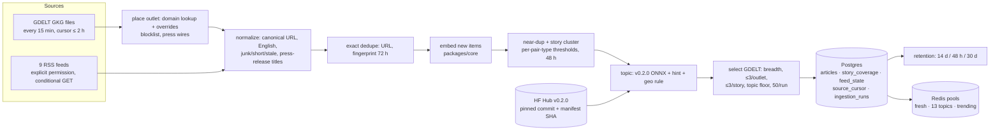

# 02: Live ingestion

> Phase 2 of [SPEC.md §16](../../SPEC.md), shipped as three PRs:
> **2a-ml: topic classifier v0.2.0 and the title-only study** · **2a: schema, sources, dedupe, classification, upsert** · **2b: retention, Redis pools, trending, replay, the ingest workflow.**

---

## 1. What we built and why

FirstRead recommends news **before anyone has clicked it**. For that, every new article must become a row with a vector, a topic and a story id within minutes of appearing on the web, and the API needs ready-made candidate lists to rank from.

Every 15 minutes the ingestion job:

1. **Fetches** headlines from two sources: GDELT's 15-minute GKG files (worldwide, ~1,200 English articles per file) and 9 publisher RSS feeds whose terms explicitly allow showing headlines on a website.
2. **Cleans and filters:** canonical URLs, English only, junk and too-short titles, stale items, spam outlets, press releases.
3. **Removes copies:** the same URL, the same headline on many sites, and near-identical rewrites.
4. **Embeds** what's new with the shared `packages/core` embedder (the same one used to train the model).
5. **Labels a topic** (one of 13) with the v0.2.0 ONNX classifier, plus two small rules.
6. **Groups articles into stories** and keeps the best 50 GDELT articles per run: stories carried by many outlets first, at most 3 per outlet, at most 3 stored per story, and a floor for each topic.
7. **Upserts** to Postgres idempotently, records which outlets carried each story, applies retention, and **rebuilds Redis pools** (fresh, per topic, trending) for the API.

**Analogy.** A newsroom's wire desk.
- Wires and feeds pour in (fetch).
- An editor bins the press releases and the spam (filters).
- Spots that 30 papers ran the same Reuters story (dedupe) and files it once, noting all 30 (coverage).
- Tags each story with a section (topic).
- Pins the most important ones on three boards: "just in", one per section, and "everyone's covering this" (pools).

The desk works from a ledger (Postgres) and redraws the boards from the ledger every shift, so a lost board costs nothing.

**Why this shape?**
- **Budget.** Postgres has 500 MB (the target is 400 MB) and Redis is billed per command. That forces a per-run cap and whole-pool rebuilds.
- **Data rights.** We only store headlines, links, times and thumbnails, and only from sources that allow it.
- **Honesty.** Every threshold and accuracy number here was measured on live or replayed data and hand-checked.

---

## 2. Concepts from first principles

### 2.1 GDELT, the GKG and why not the DOC API
GDELT monitors the world's news. Every 15 minutes it publishes zip files at `https://data.gdeltproject.org/gdeltv2/<YYYYMMDDHHMMSS>.<kind>.zip`. One kind is the **GKG** (Global Knowledge Graph): one row per article, with its URL, outlet domain, page title (inside an XML field), sharing image and crawl time. `lastupdate.txt` names the newest files.

GDELT also has a search API (DOC 2.0). We probed it first (`scripts/probe_gdelt.py`):
- a 15-minute window answers HTTP 200 with the plain text "Timespan is too short.";
- **every other call returned HTTP 429**, ten calls six minutes apart.

Static files have no throttle, so ingestion reads files (ADR 0007).

### 2.2 Catch-up cursors and "pending" files
Scheduled jobs run late or get skipped. So instead of "process the newest file", the job keeps a **cursor**, the last slot it processed (`source_cursor` table), and processes every slot since then, up to 8 (2 hours).

`lastupdate.txt` can list a file before it exists. We saw four listed slots return 404 for 40+ minutes, then appear. A 404 younger than the 2-hour catch-up horizon is therefore **pending**: later slots are processed, but the cursor stops before the gap so the next run retries it. We also send `Cache-Control: no-cache`, because a cached `lastupdate.txt` can be hours old.

### 2.3 Where is an outlet? The domain lookup and FIPS codes
GKG rows say *which site* published, not *which country*. GDELT published a lookup of every outlet to the country it mentions most (2015–2021), coded in **FIPS 10-4** (UK = United Kingdom, AS = Australia, EI = Ireland). We pin it by SHA256, convert to **ISO 3166-1** for storage (`firstread_core.countries`), and override known misplacements: Reuters, Al Jazeera and The Economist are placed in the US by the "mentions most" rule. Unplaceable domains are dropped.

### 2.4 Conditional GET
An RSS reader remembers each feed's `ETag` and `Last-Modified` and sends them back as `If-None-Match` / `If-Modified-Since`. If nothing changed, the server answers **304 Not Modified** with no body. That's cheap for both sides, and the state lives in `feed_state` because Actions runners have no disk between runs.

### 2.5 Canonical URLs and title fingerprints
The same article arrives as `http://www.bbc.co.uk/news/articles/x?at_medium=RSS` and `https://bbc.com/news/articles/x`. `canonicalize_url` maps both to `https://bbc.co.uk/news/articles/x`:
- https; no `www.`/`m.`/`amp.`;
- tracking parameters stripped (`utm_*`, BBC's `at_*`, `fbclid`, …), the rest sorted;
- no fragment or trailing slash;
- known host aliases.

A **title fingerprint** is a hash of the headline's lowercase words. The same wire headline on 30 sites shares one fingerprint even though the URLs differ.

### 2.6 Cosine thresholds, pair types and story clusters
Each new article is compared with every article from the last 48 hours: a dot product of normalized vectors, which equals cosine similarity.
- **≥ τ_dup:** a **near-duplicate**, not stored.
- **≥ τ_story:** **same story**, stored under the neighbour's `story_cluster_id`.
- Otherwise a new story.

Thresholds depend on the **pair type**. A GDELT item is embedded from its title alone, an RSS item from title + description, and those vectors sit further apart even for the same story.

We **chose thresholds by labelling**:
1. Sample nearest-neighbour pairs, stratified by type and by cosine bin, and capped per story.
2. Label each pair duplicate / same story / different.
3. Accept a threshold only if every bin at or above it is ≥ 95% precise (ADR 0009).

### 2.7 Breadth ranking, caps and the topic floor
GKG offers ~750 new candidates per run after dedupe; the database budget allows ~50. We keep the **broadest** stories first: distinct outlets carrying the story *in this run*, duplicates included. Then:
- **at most 3 per outlet,** so one prolific site can't fill the run;
- **at most 3 stored per story,** because the feed shows ≤ 2 and the first replay found 26% of inserts were a story's 3rd-or-later copy;
- **a topic floor:** up to 2 per topic first, so thin topics don't starve.

### 2.8 Press releases
A syndicated press release appears on dozens of finance sites at once, so it *looks* like breadth. We drop press-wire domains and **PR-shaped** titles before dedupe:
- "Q2 & H1 FY27 Financial Results" (a fiscal period plus a year);
- "Announces Date of Q3 2026 Results and Conference Call";
- "Declares Quarterly Dividend".

News *about* results ("Netflix reports third-quarter results as subscriber growth slows") stays. In the replay this removed 1.1% of GDELT records.

### 2.9 Topic resolution
The v0.2.0 classifier outputs probabilities over 13 topics. `resolve_topic` (shared code) applies, in order:
1. the model's top topic;
2. if the model is unsure (top-1 < 0.50) and the RSS feed's topic hint is in the model's top 3, the hint;
3. the **geo rule:** a non-US outlet labelled `us` or `politics` becomes `world`, because MIND's `us`/`politics` labels mean US domestic news.

### 2.10 Sorted sets, atomic swaps and decay
A Redis **sorted set** keeps members ordered by a score. `ZREVRANGE pool:fresh 0 19` gives the 20 newest ids.

To replace a pool atomically we write `pool:fresh:tmp`, then `RENAME` it over `pool:fresh`, so readers see the old pool or the new one, never half of each. An empty pool is `DEL`'d, because `ZADD` with no members and `RENAME` of a missing key are errors.

**Trending** scores a story by `Σ over outlets of 2^(−hours since that outlet first ran it / 6)`: breadth with a 6-hour half-life.

### 2.11 Replay with a stepped clock
To measure steady state without waiting a week, we replay GDELT's archive. Each 15-minute file goes through the **unchanged** pipeline with the clock set to that slot, and a mock HTTP transport serves only the cached files. The cursor, cap, 48-hour windows, retention and pools behave exactly as in production; only the clock is fake.

RSS can't be replayed (feeds show only their current items), so its share is estimated from one live fetch.

---

## 3. Architecture of this phase



Two operating modes:
- `firstread-ingest run` (live, or `--dry-run`): GitHub Actions `ingest.yml`, manual dispatch until P5.
- `firstread-ingest replay` (local): archived GKG files into `firstread_replay` / Redis db 1.

---

## 4. Walkthrough of the important files

**Shared (`packages/core/src/firstread_core/`)**

| File | What it does and why |
|---|---|
| `topics.py` | The 13 topic ids and `resolve_topic` (top-1, feed-hint tie-breaker, geo rule), shared by ml, ingest and the API |
| `urls.py` | `canonicalize_url`, `canonical_host`: one string per article, for exact dedupe |
| `text.py` | Adds `strip_source_suffix` (" - CNN") and `title_fingerprint` |
| `countries.py` | FIPS 10-4 → ISO 3166-1 (209 codes) |
| `db.py` | `connect` (`statement_cache_size=0`); append-only, SHA-checked, advisory-locked migration runner; refuses the 6543 pooler |
| `dbtest.py` | Test helper: a throwaway database per test |

**Database:** `infra/db/migrations/0001–0006`. pgvector lives in `extensions`, with `halfvec(384)` and an HNSW inner-product index. RLS is on for every table (ADR 0008).

**Ingest (`services/ingest/src/firstread_ingest/`)**

| File | What it does and why |
|---|---|
| `sources/gkg.py` | GKG files: slots, cursor, pending/missing, `lastupdate.txt`, parsing, placement |
| `sources/gdelt_domains.py` | The pinned domain lookup, overrides, blocklist, press wires |
| `sources/rss.py` | Feeds: conditional GET, per-host serial, thumbnails, the run clock |
| `normalize.py` | Every drop has a reason: `no_url`, `non_english`, `short_title`, `junk_title`, `section_page`, `press_release:<rule>`, `stale` |
| `dedupe.py` | Exact, near-duplicate and story decisions; `VALIDATED_BY_PAIR` thresholds |
| `select.py` | The per-run GDELT selection (breadth, caps, topic floor) |
| `models.py` | Downloads v0.2.0 at a pinned Hub commit and checks the manifest SHA and its blocks against `packages/core` |
| `store.py` | The only Postgres code: recent window, batched upserts, coverage, cursors, retention, sizes |
| `pools.py` | Redis pools and trending, within 30 commands |
| `pipeline.py` | One run end to end; `RunSummary` |
| `replay.py` | The stepped-clock replay and its report |
| `report.py`, `main.py` | Job summary Markdown, CLI, exit codes |

**Config (`config/`)**

| File | Contents |
|---|---|
| `feeds.yaml` | 53 feeds with terms verdicts (9 enabled) |
| `gdelt_domains.yaml` | Overrides, blocklist, press wires |
| `announcement_titles.yaml` | PR-shaped title patterns |
| `junk_titles.yaml` | Junk and short-title rules |

**Scripts:** `probe_gdelt.py`, `probe_gkg.py`, `record_fixtures.py`, `sample_pairs.py`, `score_pairs.py`, `topic_audit.py`. Manual only, never in CI.

**ML (2a-ml):**
- `ml/configs/topic_map.yaml`: MIND (category, subcategory) → topic;
- `models/topic_classifier.py`: two rows per article (title+abstract and title only);
- `eval/skew.py`: the title-only study;
- `release.py`: inherits the v0.1.0 encoder by pinned hash.

**Workflow:** `.github/workflows/ingest.yml`.

---

## 5. Rebuild from scratch

```bash
# 0. Stack and schema
make up                                   # Postgres+pgvector, Redis, API
make db-migrate                           # applies infra/db/migrations (refuses port 6543)

# 1. The topic classifier (only to rebuild v0.2.0; ingestion downloads it)
make mind-download VARIANT=large ACCEPT_LICENSE=1
make topics                               # ml/reports/topic-classifier-mind-large.md
make skew                                 # ml/reports/skew-title-only-mind-small.md
make release-build VERSION=0.2.0 INHERIT=0.1.0 DRY_RUN=1

# 2. One live run, then a re-run (should insert ~0)
make ingest DRY_RUN=1                     # fetch, embed, classify; writes nothing
make ingest
make ingest

# 3. Steady state without waiting: replay 3 days of GKG (~1.3 GB cached under data/replay/)
make replay DAYS=3 FRESH=1                # -> data/replay/report.json, docs/learn/data/02-replay.json

# 4. Validation (LLM-labeled; then a second, independent LLM session spot-checks)
uv run python services/ingest/scripts/sample_pairs.py --from-replay --hours 4 \
    --per-bin 12 --per-story 3 --out data/validation/pairs-2b.jsonl
#   ... label each pair's "label", then:
uv run python services/ingest/scripts/score_pairs.py --pairs data/validation/pairs-2b.jsonl \
    --out docs/learn/data/02-thresholds-2b.json
uv run python services/ingest/scripts/topic_audit.py sample --gdelt 90 --rss 30
#   ... label each item's "true", then:
uv run python services/ingest/scripts/topic_audit.py score
```

Environment variables are documented in `.env.example` (`INGEST_*`). GitHub Actions needs `DATABASE_URL` and `REDIS_URL` only from P5.

---

## 6. How to test and verify it, and how to read the results

```bash
make lint typecheck test       # unit + integration (Postgres + Redis db 15); CI also runs
                               # the Supabase-image migration job (required on main)
```

**What the tests guarantee**
- Adapters: recorded fixtures with synthetic text; any unmocked HTTP request fails.
- A second run over the same items inserts 0.
- RLS is on for every table.
- The HNSW index is used for inner-product search.
- Pools stay within 30 commands; empty pools are `DEL`'d.
- Retention deletes in batches; pending GKG slots hold the cursor.
- Press-release patterns drop PR-shaped titles and keep news about results.

**Reading a run summary** (stdout JSON, and the Actions job summary)
- `fetched → dropped.* → duplicates / near_duplicates → inserted`. `clustered` means an insert joined an existing story.
- `details.gdelt`: `files` (pending/missing), `stale`, `capped.{run_cap, domain_cap, story_cap}`, and `top_domains`. Scan that for new spam or press wires.
- `redis_commands` (≤ 30), `pools`, `retention`, `size.db` (a warning above 350 MB).
- `status`: `ok`, `partial` (a source, feed or Redis failed; exit 0 with a warning) or `failed` (exit 1).

**Measured steady state: replay of 2026-10-12 02:30 → 10-15 02:15 UTC (288 slots)**

| Measure | Value |
|---|---|
| Runs | 288 `ok`, 2.6 s mean, 3.9 s p95 |
| Inserted | 14,400 (50/run, cap always binding), in 13,065 stories; 2.4% beyond a story's 2nd copy (25.9% before the per-story cap) |
| Removed before dedupe | 27,538 blocklisted, 6,020 unplaceable, 3,444 press-wire and 366 PR-title records (1.1% press releases) |
| Duplicates / near-duplicates | 80,092 / 4,293 |
| Redis commands | 30 on every run (≈ 86K/month): the topic floor gives every topic new articles every run |
| Pools at the end | `fresh` 500, `trending` 200, each of the 13 topic pools 300 (all full) |
| Storage | 3,153 B/article (heap 1,570, indexes 1,580, HNSW 1,171); `story_coverage` 13 MB at 48 h |
| 14-day estimate | 4,800 GDELT + ~55 RSS articles/day → **227 MB**, within the 400 MB budget |
| Topic mix | world 20%, business 14%, us 10%, sports 8%, entertainment 8%, … autos 4%; outlets 49% US / 51% non-US |

**Trending check.** The daily top 10 were real big stories (the Pope's surgery, the Six Flags death, the Tupac sentencing, Netflix layoffs, Sally Rooney's books), with no press release in any day's top 10 (aggregates in `docs/learn/data/02-replay.json`).

**Steady-state topic accuracy** (`docs/learn/data/02-topic-audit-2b.json`):
- GDELT: **0.786** (95% CI 0.693–0.880), n = 90, reweighted to the replayed topic mix. US outlets 0.790 (n = 45), non-US 0.783 (n = 45).
- RSS: 0.910 (0.750–1.000), n = 30.
- **Combined, weighted by volume (GDELT is 98.9%): 0.788 (0.696–0.880).**
- The geo rule fired 5 times and was right 3 times.

All labels are LLM-labeled, **spot-checked by a second, independent LLM session, approved by the owner**. This supersedes the 2a audit (0.84), whose sample was 77% RSS.

**Thresholds:** see §7 and ADR 0009.

---

## 7. Decisions and alternatives considered

| Decision | ADR | In one line |
|---|---|---|
| 13 app topics; classifier trained on title+abstract **and** titles; v0.2.0 inherits the encoder by hash | [0006](../adr/0006-topic-taxonomy-and-classifier.md) | MIND's categories had no tech/politics/world, and GDELT has no summaries |
| GDELT via GKG files; RSS only with explicit permission; press-release filter; per-run selection | [0007](../adr/0007-live-sources-gdelt-gkg-and-rss.md) | The DOC API throttled every call; "personal, non-commercial" isn't a public app |
| SQL migrations, `extensions` schema, `halfvec` + HNSW, RLS everywhere, retention, migrations over port 5432 | [0008](../adr/0008-postgres-schema-and-migrations.md) | Same SQL locally and on Supabase; the anon key can't reach service tables |
| Exact + near-duplicate + story clustering with per-pair-type thresholds | [0009](../adr/0009-dedupe-and-story-clustering.md) | Title-only and title+description vectors sit at different distances |
| Redis pools rebuilt from Postgres; trending by outlet breadth with decay | [0010](../adr/0010-redis-pools-and-trending.md) | Self-healing, ≤ 30 commands per run |

**Thresholds after the 2b re-check:**

| Pair type | 2a sample | 2b sample (per-story capped) | Used (τ_dup / τ_story) | Status |
|---|---|---|---|---|
| GDELT↔GDELT | 144 pairs, 28 dup | 144 pairs, 26 dup | **0.975 / 0.925** (was 0.875) | Validated |
| GDELT↔RSS | 96, 2 dup | 87, 0 dup | 0.95 / 0.80 | **Provisional** |
| RSS↔RSS | 51, 0 dup | 42, 0 dup | 0.97 / 0.875 | **Provisional** |

GDELT↔GDELT τ_story rose because templated headlines sit at 0.85–0.92 without being the same story ("Florida / California Midterm Elections 2026: Key Races…", "X vs The State Of Bihar on 13 October"). Neither provisional type reached 100 pairs and 10 duplicates: 9 RSS feeds publish about 55 articles a day.

---

## 8. What went wrong and the gotchas

- **The GDELT DOC API was unusable:** a 15-minute window answers "Timespan is too short." with HTTP 200, and every other request was throttled. Hence the static GKG files.
- **`lastupdate.txt` runs ahead of the files.** Four listed slots 404'd for 40+ minutes, then appeared. A 404 is "pending" until it's older than the catch-up horizon.
- **Most RSS terms don't allow a public app.** Personal, non-commercial use only (NYT, Guardian, NPR, NBC, PBS, Al Jazeera); RNZ and CBS forbid website use outright. 9 of 53 feeds remain.
- **The same BBC article on two hosts** (bbc.co.uk from RSS, bbc.com from GDELT) and BBC's `at_*` tracking parameters defeated URL dedupe until we added a host alias and the prefix.
- **A Spanish article from a feed declared English** got in. Items are now checked one by one (a function-word ratio).
- **pgvector lives in `extensions`,** which isn't on the local `search_path`: write `OPERATOR(extensions.<#>)` and `extensions.halfvec(384)` (CLAUDE.md gotcha).
- **The domain lookup's "mentions most" rule** places international outlets that cover the US heavily in the US. That's what the overrides table is for.
- **Breadth ranking without a per-story cap** spent 26% of the budget on copies of a few stories; found only by replaying.
- **Templated headlines** fooled a 0.875 story threshold; found only with a per-story-capped sample.
- **Section pages stored as articles** ("Health - Carroll Broadcasting Inc."), found during the 2b spot-check, are now dropped as `section_page`.
- **Known limitations:** corporate-milestone press releases ("QuickMD Surpasses 2 Million Patient Visits") pass the filter, and local-TV suffixes ("– NBC4 Washington") aren't stripped, so syndicated copies cluster as the same story instead of dropping as duplicates. The per-story cap limits the impact (ADR 0007).
- **Tighter story thresholds fragment big evolving stories** (the Pope's surgery appeared as three trending entries on 10-13). P3's 2-per-story feed rule and MMR must treat near-identical stories as one.
- **Breadth favours UK local-news networks:** one PA wire story on dozens of UK local sites counts as dozens of outlets. An ownership-group weight is a P3/P6 candidate.
- **The topic floor makes every topic change every run,** so the Redis budget's worst case (30 commands) is the normal case. That's fine (86K/month), but the estimate of ~16 was wrong.
- **RSS times came from the wall clock,** which broke clock-stepped runs. They now use the run clock.
- **Migrations through Supabase's transaction pooler (6543)** can't reliably release the session advisory lock. Use port 5432; the runner refuses 6543.
- **Retention deletes clicked articles after 14 days.** P3 must keep vectors for user histories (ADR 0008 note).

---

## 9. Interview questions (with strong answers)

**1. Why read GDELT's files instead of its API?**
The API refused 15-minute windows and throttled every request we made; static files have no throttle, are complete, and can be replayed. The cost is placement: GKG has no source country, so we use GDELT's domain lookup plus overrides.

**2. How do you make a 15-minute cron reliable when runs are late or skipped?**
Process slots, not "the latest file". A cursor stores the last processed slot; each run catches up (bounded to 2 h). A missing file younger than the horizon is "pending", so the cursor waits for it. The upsert is idempotent, so overlapping windows are harmless.

**3. How do you detect duplicates across sources?**
Three layers:
- canonical URL (scheme, host aliases, tracking parameters);
- a title fingerprint within 72 h for wire copies;
- cosine similarity to the last 48 h of embeddings with per-pair-type thresholds: near-duplicates are dropped, same-story items share a cluster id.

Dropped copies still record which outlet carried the story.

**4. How did you pick the thresholds, and why per pair type?**
Stratified nearest-neighbour pairs by type and cosine bin, capped per story, LLM-labeled and checked by a second, independent LLM session. A threshold is accepted only if every bin at or above it is ≥ 95% precise. Title-only and title+description vectors of the same story sit further apart, so one global threshold over- or under-merges. Types without enough data stay provisional and strict.

**5. How do you rank 1,200 new articles into 50 slots without clicks?**
By breadth (distinct outlets carrying the story this run), then recency, with caps per outlet (3) and per story (3), and a floor per topic (2). Breadth is a strong proxy for importance; the caps keep it diverse.

**6. How did press releases break that, and how did you fix it?**
Syndicated releases appear on many sites, so they look broad. We drop press-wire domains and PR-shaped titles before dedupe and coverage, and the patterns are tested both ways so news about earnings stays.

**7. Why rebuild Redis pools from Postgres every run instead of updating them?**
Idempotence and self-healing: a lost Redis, a failed run or a manual edit is fixed by the next run. With `ZADD tmp` + `RENAME` readers never see a partial pool, and it fits in 30 billed commands.

**8. How do you know the system works at steady state without running it for weeks?**
Replay: 3 days of archived GKG files through the unchanged pipeline with the clock stepped per slot and a mock transport. It measured the database size (227 MB / 14 days), pool fill, trending quality, press-release share, and found two real defects (budget wasted on story copies, templated-title merges).

**9. How accurate is the topic classifier on live news, and how do you know?**
0.79 (95% CI 0.70–0.88) at steady state. That's a stratified, LLM-labeled sample of replayed GDELT plus live RSS, reweighted to the live topic mix and weighted by source volume, then spot-checked by a second, independent LLM session. The offline number (0.72 title-only on MIND's dev-only articles) measures a different distribution, so only the live audit goes in the README. The main live confusions are US local news vs politics, and local features (festivals, faith columns, brewery openings) filed under sports or travel.

**10. What would you change for a commercial launch?**
- Licensed news sources instead of explicit-permission RSS plus GDELT.
- Retrain the classifier and encoder on our own consented data.
- A press-release detector learned from labels rather than regexes.
- Ownership-group weighting in trending.
- Keep the replay harness as a regression test for every pipeline change.

---

## 10. Glossary of new terms

| Term | Meaning |
|---|---|
| GKG | GDELT's Global Knowledge Graph: one row per web article, published every 15 minutes |
| Slot | A 15-minute GKG file, named by its start time `YYYYMMDDHHMMSS` |
| Cursor | The last slot ingestion processed; catch-up starts after it |
| Pending slot | A listed slot whose file still 404s, retried until older than the 2 h horizon |
| FIPS 10-4 | The country codes GDELT uses (UK, AS, EI…); we store ISO 3166-1 |
| Conditional GET | Sending `If-None-Match` / `If-Modified-Since`; the server answers 304 if unchanged |
| Canonical URL | One normalized string per article, used for exact dedupe |
| Title fingerprint | A hash of a headline's words; the same wire headline on many sites shares one |
| Near-duplicate | Cosine ≥ τ_dup to a recent article; not stored |
| Story cluster | Articles about the same event, sharing `story_cluster_id` |
| Pair type | Which text each side was embedded from (title only vs title + description) |
| Provisional threshold | Set stricter than the data allowed, because the sample was too thin to validate |
| Breadth | Distinct outlets carrying a story in a run (or in 24 h, for trending) |
| Topic floor | Slots reserved per topic before ranking fills the rest |
| Press wire | A press-release distribution or republishing site |
| Geo rule | Non-US outlet + `us`/`politics` → `world` |
| Pool | A Redis sorted set of candidate article ids |
| Atomic swap | `ZADD key:tmp` then `RENAME key:tmp key` |
| Half-life | The time for a score contribution to halve (6 h for trending) |
| Replay | Running archived files through the unchanged pipeline with a stepped clock |
| LLM-labeled | Hand labels produced by an LLM, then spot-checked by a second, independent LLM session and approved by the owner |
