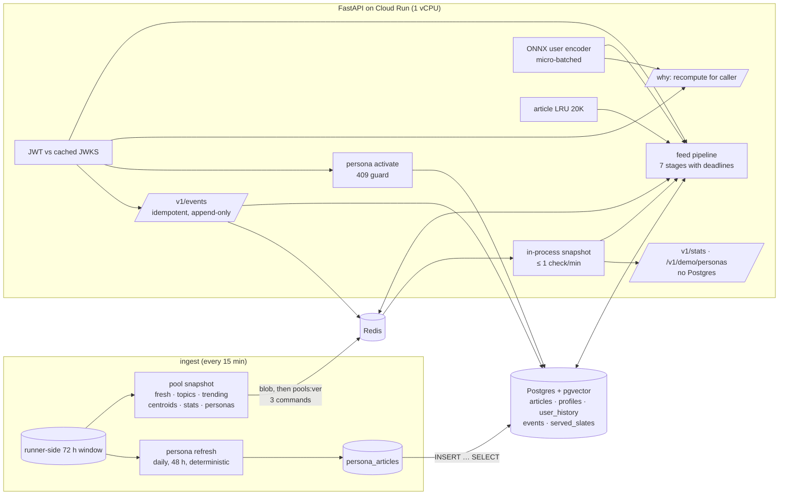
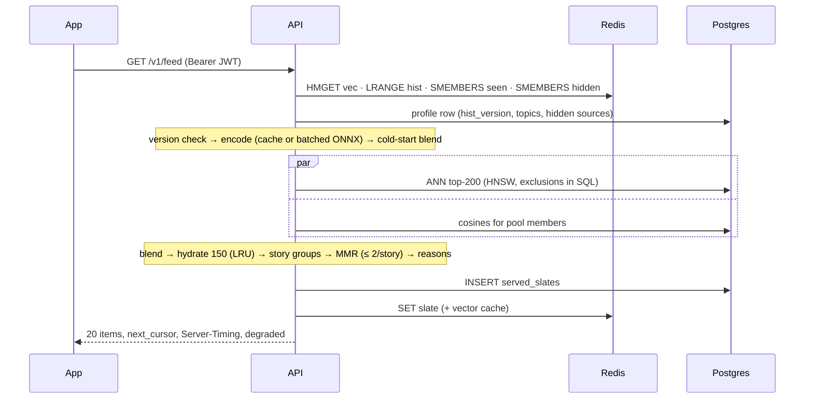

# 03: The recommendation API

> Phase 3 of [SPEC.md §16](../../SPEC.md), shipped as five PRs:
> **3a: ingestion egress fix, pool snapshot, trending v2** · **3b: ranking in core, tuned on MIND** · **3c: auth, user data, events, retention** · **3d: the feed** · **3e: personas, "Why this?", stats, the persona replay, local p95.**

---

## 1. What we built and why

Phase 2 left us with a database of live, embedded, topic-labelled headlines. Phase 3 turns it into a **personal front page**: an HTTP API that, for any reader, returns the 20 stories they're most likely to want *right now*, including stories published minutes ago that nobody has clicked yet.

A request to `GET /v1/feed`:

1. checks who the reader is (a Supabase token);
2. loads what they've read and hidden (Redis, with Postgres as the durable copy);
3. turns their history into one 384-number vector with the NRMS-lite encoder (or, for a new reader, the average of the topics they picked);
4. finds candidate articles near that vector (pgvector) plus fresh, trending and followed-topic pools;
5. scores each candidate (closeness + freshness + trending), keeps at most two items per story, spreads the page across stories (MMR), and writes a reason for each item;
6. records what was shown, and responds in tens of milliseconds.

Around it: idempotent events (clicks, impressions, hides), a "Why this?" endpoint, demo personas for recruiters, public stats, deletion of a reader's data, rate limits, metrics, and an OpenAPI contract for the app.

**Analogy.** A newsagent who knows each regular.
- The **wire desk** (Phase 2) delivers every new story with a summary card (embedding, topic, story id).
- The newsagent keeps a **notebook per customer** (history in Redis, ledger in Postgres) and a **board of today's papers** (the pool snapshot) at the counter.
- When a customer walks in, they glance at the notebook, pull the closest matches from the shelf (ANN), add what's new and what everyone's talking about, and never hand over two copies of the same story.
- A new customer who says "I like sport and health" gets the sport-and-health pile until the notebook fills up (cold start).
- Everything is written down *before* the customer leaves, because the shop's lights go off the moment the door closes (Cloud Run bills CPU only during requests).

**Why this shape?** Four constraints decided almost everything:
- **$0.** Supabase bills egress (5 GB/month), Upstash bills every Redis command (we cap ourselves at 300K/month). Each design is costed per request ([ADR 0011](../adr/0011-free-tier-budgets.md)).
- **Request-based billing on Cloud Run.** No background loops, no work after a response.
- **Train/serve consistency.** The blend, MMR, cold-start vector, story thresholds and reasons exist once, in `packages/core`, and the offline tuning ran the same code.
- **Honesty.** Constants come from pre-registered rules on MIND, live behaviour is checked on replayed real news, and latency is measured at Cloud Run's shape.

---

## 2. Concepts from first principles

### 2.1 Two towers, one of them frozen

A recommender scores (reader, article) pairs. A **two-tower** model computes one vector per reader and one per article, and the score is their dot product. Our article tower is the frozen `bge-small` embedding ([ADR 0004](../adr/0004-identity-item-tower.md)): ingestion computes it once at insert time, and the database can search it with an index. Only the reader tower (NRMS-lite: self-attention over the last 50 clicked articles' vectors) is learned. Because both live in the same 384-d space and are L2-normalized, `score = cosine(reader, article)`, and an article published a minute ago is scorable immediately: that is the item cold-start solution.

### 2.2 Candidate generation vs ranking

Scoring all 14,000 articles of the last 72 h with full features for every request would be slow and would move vectors across the network. So the feed works in two passes:
- **Candidate generation** (cheap, recall-oriented): an approximate nearest-neighbour (ANN) search returns the 200 articles closest to the reader's vector, and the pool snapshot contributes the freshest 200, the top 200 trending, and 100 per followed topic. Both are computed **in SQL**: only `(id, score, first_seen_at, cluster, domain)` comes back, about 70 bytes a row.
- **Ranking** (precise, on ≤ 150 items): the blend, story grouping, MMR and reasons, in Python with the vectors from an in-process cache.

### 2.3 HNSW and iterative scans

pgvector's **HNSW** index is a layered proximity graph: a search enters at the top layer and greedily walks towards the query, keeping a candidate list of size `ef_search`. It is approximate: recall@200 is the share of the exact top 200 it finds. A `WHERE first_seen_at > now() − 72h` filter used to *shrink* HNSW results (filtered rows were dropped after the walk). pgvector 0.8's **iterative scans** keep walking until enough rows pass the filter. We run them with `SET LOCAL` (session settings don't survive Supabase's transaction pooler) and re-sort in a materialized CTE with `ORDER BY d + 0` (Postgres 17 otherwise trusts the index order). The pre-registered benchmark chose HNSW at `ef_search = 400` (recall 0.98, faster than exact; [ADR 0017](../adr/0017-feed-serving-pipeline.md)).

### 2.4 The blend

`final = cos(u, a) + w_fresh · 2^(−age / 3 h) + w_trend · trend_percentile` with `w_fresh = 0.1`, `w_trend = 0.05` in the default `rank-3` (readers with ≤ 2 clicks keep the cold segment's 0.05 / 0.1). The trend term is a **percentile within the request**, so a MIND proxy (recent clicks) and the live signal (distinct outlets covering the story in 24 h, a 6 h half-life) mean the same thing: only their ranks matter. The weights were chosen on MIND-small's holdout by rules written before any result (`rank-1`, 0.05 / 0.025); `rank-3` is the owner's pick among configs that tie on the holdout objective, made after the persona replay showed `rank-1/2` pages too old ([ADR 0014](../adr/0014-ranking-blend-mmr-cold-start.md)).

### 2.5 MMR and the story cap

A page of five copies of the same breaking story is useless. **Maximal Marginal Relevance** picks items greedily by `λ · relevance − (1 − λ) · max similarity to what's already picked` (λ = 0.7), and a hard **story cap** allows at most 2 items per story group. Story groups come from ingestion's `story_cluster_id` plus **complete-linkage** grouping at τ_feed: an item joins a group only if it is close enough to *every* member, so A≈B and B≈C never drag A and C together. The cap counts what the reader was already shown on earlier pages too.

### 2.6 Cold start for readers

A brand-new reader has no clicks. They pick ≥ 3 topics, and their vector is the normalized mean of those topics' **centroids** (the average vector of the last 72 h of articles per topic, published in the snapshot). As clicks arrive the vector blends towards the encoder's output: `u = normalize(w · topics + (1 − w) · clicks)` with `w = k / (k + n)`. With rank-2's `k = 3`, topics weigh 75% after one click and 50% after three. With k = 0, one click replaces the topics entirely; the persona replay measures what that does to page 2 (§6).

### 2.7 Slates and cursors

The first page ranks a **slate** of 100 items and stores it in Redis (30 min). Later pages are served from it with an opaque cursor, so pagination costs 2 Redis commands and no ranking. The slate remembers the history version it was ranked with: a click (version moves) or a hide re-ranks the rest, excluding everything served, so a click shows on the next page and nothing repeats. Every served page is also recorded in Postgres (`served_slates`), which keys events to what was shown and backs up the slate if Redis loses it.

### 2.8 Versioned, append-only user state

Two event batches can arrive at once. If both read the history, appended, and wrote it back, one click would vanish. So history writes are **append-only** (`RPUSH` + `LTRIM`), each entry carries the `hist_version` Postgres assigned in the same transaction as the event, and a reader trusts the Redis list only if the versions are contiguous up to the profile's. Any gap (a lost push, an expired key, a persona switch) means "rebuild from Postgres" ([ADR 0016](../adr/0016-user-data-rls-retention.md)).

### 2.9 Micro-batching

ONNX Runtime is more efficient on a batch than on many single calls. Concurrent requests that need a fresh user vector wait up to 5 ms (or until 32 are queued) and share one `session.run` on a dedicated thread. On one vCPU the CPU cost per user is nearly flat (0.74 vs 0.70 ms), so the gain is fewer thread hand-offs, not less arithmetic; P6 compares on and off.

### 2.10 Degraded modes

Every dependency fails sometimes. Each stage has a deadline and a defined fallback: Redis down → read the durable copies from Postgres; encoder slow → mean of history; ANN slow → pools only; no snapshot yet → ANN only; both candidate sources down → 503. The response says which parts degraded (`degraded: ["redis"]`), and a counter tracks it.

### 2.11 JWTs and JWKS

Supabase signs each reader's token with an ES256 private key and publishes the public keys as a **JWKS**. The API verifies tokens locally against a cached copy (≤ 10 minutes, single-flight refresh, no `jku` headers trusted, HS256 and `none` refused), so auth costs no network call per request ([ADR 0015](../adr/0015-auth-supabase-jwt.md)). The load test signs real ES256 tokens with a local key and points the API at that JWKS file.

### 2.12 Demo personas and "Why this?"

A **persona** is a synthetic reader whose history is 20 live articles from its topics, chosen once a day by ingestion. Activating one copies those articles into your history server-side. **"Why this?"** recomputes the blend's components for one article and one reader, and turns them into at most two human-readable reasons with the same `reasons()` function the feed uses ([ADR 0018](../adr/0018-personas-why-stats.md)).

### 2.13 Percentiles, p95 and arrival-rate load tests

A latency **p95** is the value 95% of requests beat. Averages hide the slow tail that users notice. A **constant-arrival-rate** load test (k6) starts requests at a fixed rate whatever the server does, so a slow server builds a queue and its latency grows, which is what real traffic does. A closed-loop test (N users each waiting for their response) would politely slow down with the server and flatter it.

---

## 3. Architecture of this phase





---

## 4. Walkthrough of the important files

| File | What it does | Why it exists |
|---|---|---|
| `packages/core/src/firstread_core/pools.py` | Pool snapshot dataclasses, the zlib-JSON blob codec with version checks, `topic_centroids` | One format shared by ingest (writer) and API (reader) |
| `packages/core/src/firstread_core/personas.py` | `PersonaSummary` as it travels in the blob | The API serves the persona list without Postgres |
| `packages/core/src/firstread_core/stories.py` | τ_story / τ_feed per pair type, the fallback, complete-linkage `group`, `near_any` | One story definition for trending, persona selection and the feed |
| `packages/core/src/firstread_core/ranking/` | `freshness`, `normalize`, `trend_feature`, `blend`, `mmr`, `cold_start_vector`, `reasons`, `rank-1/2.yaml` | Train/serve consistency: MIND tuning and the API run the same code |
| `services/ingest/src/firstread_ingest/window.py` | Runner-side 72 h window with delta sync and a checksum | Cuts ingestion egress from ~14 MB to 84 KB a run |
| `services/ingest/src/firstread_ingest/pools.py` | Builds the snapshot (trending v2, centroids, stats) and publishes it in 3 commands | Pools as one versioned blob instead of 30 commands |
| `services/ingest/src/firstread_ingest/personas.py` | Persona selection (48 h, confident topics, one per story, 3 per domain) and daily refresh | Demo readers from live news, no per-visitor cost |
| `services/api/src/firstread_api/auth.py` | JWKS cache, ES256 verification, claims | Auth without a network call per request |
| `services/api/src/firstread_api/redis_state.py` | Append-only versioned history, hidden/seen sets, rebuild, command counting | Concurrency-safe user state, observable cost |
| `services/api/src/firstread_api/repo.py` | Named, metered queries: events, history, profile, persona activation | Every query's egress is counted |
| `services/api/src/firstread_api/encoder.py` | Verified ONNX encoder and the micro-batcher | Batching without a background loop |
| `services/api/src/firstread_api/candidates.py` | ANN and pool-cosine SQL with exclusions | Vectors never leave Postgres in bulk |
| `services/api/src/firstread_api/feed.py` | The seven-stage pipeline, degraded modes, `Server-Timing`, rank trace | The feed |
| `services/api/src/firstread_api/slate.py` | Slates, cursors, page cache | Cheap pagination, no repeats |
| `services/api/src/firstread_api/why.py` | Recomputes one item's components for the caller | "Why this?" says what the ranking did |
| `services/api/src/firstread_api/routes/{demo,stats,articles}.py` | Persona list/activation, stats, `/why` | P3e endpoints |
| `services/api/openapi.json` | The exported contract (operationIds stable) | P4 generates its client from it |
| `infra/db/migrations/0007–0012` | Auth shim (local only), profiles, history, events, slates, personas | Schema with RLS everywhere |
| `services/api/scripts/persona_replay.py` | The real API on three replayed days, at 8 clock times a day | Checks story grouping, freshness and cold start on live-shaped data |
| `loadtest/seed_local.py`, `k6/feed.js`, `run_local.sh`, `analyze.py`, `session_cost.py` | Local load test and session cost measurement | SPEC §11's p95 and ADR 0011's measured budgets |

---

## 5. Rebuild from scratch

Prerequisites: P0–P2 (`make setup`, Docker Desktop with ≥ 4 GB, the cached GKG files from `make replay`, the v0.2.0 release cached by the first test run).

```bash
# 1. Local stack and schema (migrations 0001-0012)
make up && make db-migrate

# 2. Ranking constants (3b): holdout tuning writes rank-1.yaml; dev is reported once
make rank-tune            # MIND-small holdout, pre-registered rules (ADR 0014)
make rank-report          # MIND-large dev, once

# 3. The API: tests (real Postgres + Redis + the pinned encoder)
make lint typecheck test
uv run firstread-api openapi          # re-export the contract; the test fails if stale

# 4. Try it (the dev stack accepts X-Dev-User instead of a token)
make ingest
U=$(uuidgen | tr A-Z a-z); H="X-Dev-User: $U"
curl localhost:8000/v1/demo/personas
curl -X POST "localhost:8000/v1/demo/personas/markets-tech/activate" -H "$H"
curl -i "localhost:8000/v1/feed?limit=5" -H "$H"
curl "localhost:8000/v1/articles/<an id from the feed>/why" -H "$H"
curl localhost:8000/v1/stats

# 5. The persona replay (3 replayed days, the real feed at 8 clock times a day)
make persona-replay       # ~25-45 min; data/persona-replay/ (gitignored)
make persona-report       # docs/learn/data/03-personas.json (aggregates only)

# 6. Local p95 at Cloud Run's shape, and the session costs
make loadtest-seed        # firstread_loadtest + Redis db 2 + 240 readers and ES256 tokens
make loadtest             # 1 vCPU / 512 MiB container, k6 50 then 100 RPS -> loadtest/results/
docker restart firstread-api-lt && make session-cost LABEL=cold SESSIONS=1
make session-cost LABEL=warm SESSIONS=20 SKIP=1
```

---

## 6. How to test and verify it, and how to read the results

**Tests** (`make test`; CI runs them against Postgres, Redis and the Supabase image):
- auth matrix (expired, wrong issuer/audience, `role: anon`, HS256 confusion, `alg: none`, unknown kid, JWKS down → 503);
- events: idempotency, overlapping batches, Redis failure after commit → rebuild, hides surviving a Redis flush;
- feed: every degraded row, cursors (tamper → 400, no repeats over 5 pages, click → re-rank), every filter, the story cap within and across pages, Redis command counts, the end-to-end flow (anonymous reader → topics → feed → click → page 2 → `/why` → delete);
- personas: selection rules and determinism, the refresh schedule, the server-side copy, activation (copies the history, 409 guard, `replace=true`, persona→persona without a flag, hides kept), unknown/empty personas;
- `/why`: only the caller's history, `final` within 0.002 of the feed's score, reasons derived from the returned components, 2 Redis commands;
- `/v1/stats` and the persona list: served with zero Postgres queries, GDELT credit, 503 without a snapshot;
- the blob with five personas stays under 256 KB (229,875 bytes);
- the Supabase job: migrations as a non-superuser, `auth` untouched, owner-only reads, no grants on persona tables, pgvector ≥ 0.8.

### 6.1 The persona replay (`docs/learn/data/03-personas.json`)

`make persona-replay` replays 2026-10-12 02:30 → 10-15 02:15 (288 GKG runs, 14,400 articles, identical to P3a's replay) through the unchanged pipeline, which now refreshes the personas. At 24 clock times (every 3 h) the real app, its clock set to the replay time, serves each persona as a fresh activated reader under rank-2 and under rank-3, and runs the new-reader check under rank-1, rank-2 and rank-3. Aggregates use the 16 "steady" clock times, those with at least 24 h of news behind them. No response was degraded.

**Story grouping, and the fallback it triggered.** Sampled story-cap drops (with headlines; in `data/`, quoted in the PR) were LLM-labeled and spot-checked by a second, independent LLM session:

| Run | Title↔title τ_feed | Sampled drops | Same story | Different |
|---|---:|---:|---:|---|
| Labelled review run | 0.875 | 48 (27 via τ_feed, 21 via ingestion's cluster) | 47 | **1, via τ_feed:** three AP news-digest pages from different times of day |
| Re-run after the fallback | **0.925** | 40 (all via ingestion's cluster) | 38 | 2, inside one ingestion cluster each: AP digests again, and dated generic weather forecasts |

- By ADR 0013's pre-registered rule, the one τ_feed mistake raised GDELT↔GDELT τ_feed to its τ_story (0.925).
- The two remaining mistakes are ingestion's clusters (τ_story), which no pre-registered rule covers. A junk-title rule for digests and dated forecasts is proposed to the owner instead.

Per persona after the fallback (16 clock times each), under rank-2 → rank-3:

| Persona | Largest story group | Cap drops on page 1 (mean) | Cap drops in the slate (mean) |
|---|---:|---:|---:|
| Markets & tech | 3 → 3 | 0.12 → 0.12 | 0.50 → 1.12 |
| Sports & health | 3 → 3 | 0.19 → 0.19 | 1.25 → 1.50 |
| World affairs | 4 → 4 | 0.50 → 0.38 | 1.25 → 1.69 |
| Culture & food | 3 → 3 | 0.06 → 0.06 | 1.06 → 0.88 |
| U.S. news | 4 → 6 | 0.25 → 0.25 | 2.31 → 2.62 |

How to read it: a "drop" is an item that would have been in the page (or slate) by MMR alone but was the third copy of a story. Fewer than one drop per page means the cap is a backstop; the story was already represented twice. The thresholds don't depend on the weights, but the candidates do: rank-3 brings more fresh copies of developing stories into the re-rank set, so slates drop a few more and U.S. news once grouped 6. The labelled samples are from the rank-2 run.

**Freshness: rank-2 vs rank-3 (owner decision, 2026-10-23).** Page 1, all personas, 1,600 items each:

| | rank-2 (`w_fresh` 0.05, `w_trend` 0.025) | **rank-3, the default** (0.1 / 0.05) |
|---|---:|---:|
| under 2 h old | 33.1% | **65.6%** |
| under 30 min old | 6.3% | **14.8%** |
| median age | 4.1 h | **1.3 h** |

- On ADR 0014's pre-registered holdout objective, rank-3's weights tie rank-2's (J 0.42307 vs 0.42309): rank-2 won only the "smallest weights" tie-break. The replay shows what that tie-break cost on live news, so the owner shipped rank-3. Dev was not re-run.
- The replay's youngest items are ~1 h old, because a GKG file's crawl times precede the run that processes it; that is why several personas' rank-3 median is 1.08 h.
- An earlier comparison raised only `w_fresh` (0.1 with `w_trend` 0.025): 71% under 2 h. It wasn't shipped because it isn't among the holdout's best configs (J < 0.4214).

**New reader (ADR 0014 amendments):** 48 readers per ranking, 960 page-2 items each.

| | rank-1 (k = 0) | rank-2 (k = 3) | rank-3 (k = 3) |
|---|---:|---:|---:|
| page 2 from the followed topics | 10.5% | 50.8% | 50.8% |
| page 2 from the clicked story's topic | 48.5% | 13.4% | 13.4% |
| page 1 under 2 h old (median age) | 29.2% (3.8 h) | 29.2% (3.8 h) | 29.2% (3.8 h) |

- k = 3 keeps a new reader's topics after one off-topic click; one click no longer takes over the feed.
- rank-2 and rank-3 are identical for new readers **by construction**: with ≤ 2 clicks the cold segment's weights apply (0.05 / 0.1), and rank-3 kept them. So a brand-new reader's first page is still mostly older than 2 h (median 3.8 h). Changing that would mean changing the cold segment, which the owner kept.

### 6.2 Local p95 (`loadtest/results/03-local.json`)

Setup: the runtime image at Cloud Run's shape (`--cpus=1 --memory=512m`, one worker), real ES256 tokens, 200 readers, k6 2.3.0 at a constant arrival rate (60 s per rate, 60% first pages / 25% cursor pages / 15% event batches). The machine is an Apple M4 with Docker Desktop at 10 CPUs and 4 GB; Postgres and Redis share it without CPU limits.

| Rate | Errors | Server p50 / p95 / p99 (ms) | Client p50 / p95 / p99 (ms) |
|---|---:|---|---|
| 50 RPS | 0% | 12.8 / **20.5** / 32.6 | 14.1 / 22.3 / 34.5 |
| 70 RPS | 0% | 18.1 / 43.8 / 58.5 | 20.8 / 51.9 / 70.7 |
| 80 RPS | 13% | 176 / 915 / 1003 | 158 / 1028 / 1078 |
| **100 RPS** | **59%** | 795 / 1000 / 1019 | 1013 / 1051 / 1070 |

- **Read it plainly:** SPEC's "p95 ≤ 150 ms at 100 RPS" is **not met by one 1-vCPU container**. One container holds about 70 RPS at a 44 ms p95, then saturates.
- Past saturation, requests queue until the 1 s deadline and fail. 100 RPS needs two instances (Cloud Run allows 3). P6 studies concurrency limits and load shedding.
- Server time is the sum of the `Server-Timing` stages; client time includes the Docker network.
- Image 503.5 MB; startup to `/readyz` 200 median 776 ms (5 runs); 144 MiB resident after the run.
- These numbers come **after** a fix this run found (§8): before it, the same container failed 79% of requests at 50 RPS (`loadtest/results/03-local-before-blas-fix.json`).

### 6.3 What a session costs (ADR 0011, measured)

`loadtest/session_cost.py` runs ADR 0011's session (8 requests: `/me`, 3 pages of which 2 computed, 3 event batches with 40 impressions and 2 clicks, one `/why`) and reads the API's own counters and Redis `INFO` around it:

| | Redis commands | Postgres egress (est.) | Redis bytes |
|---|---:|---:|---:|
| Cold instance | 37 | 373 KB | 289 KB |
| Warm instance, returning reader | **30** | **153 KB** | 106 KB |

- **Commands are still the binding budget:** about 250–310 sessions a day under SPEC's 300K a month.
- **Supabase egress allows ~1,000 warm or ~420 cold sessions a day.**
- Cloud Run's free tier allows thousands.
- The full table is in [ADR 0011](../adr/0011-free-tier-budgets.md).

---

## 7. Decisions and alternatives considered

- **Runner-side window + one pool blob** instead of reading 14 MB a run and 30 Redis commands ([ADR 0012](../adr/0012-runner-window-and-pool-snapshot.md)).
- **Trending v2:** complete-linkage merging, syndication networks counted once, quality-ordered representatives ([ADR 0013](../adr/0013-trending-v2.md)); title↔title τ_feed later fell back to 0.925 by its pre-registered rule (§8).
- **Pre-registered tuning on MIND,** dev looked at once; rank-2 sets k = 3 and rank-3 w_fresh 0.1 / w_trend 0.05 as owner decisions, supported by the persona replay ([ADR 0014](../adr/0014-ranking-blend-mmr-cold-start.md)).
- **JWKS verification, not `getUser` per request;** in-process rate limits, not Redis ([ADR 0015](../adr/0015-auth-supabase-jwt.md)).
- **Append-only versioned Redis state with Postgres as truth;** retention and a size guard in ingestion ([ADR 0016](../adr/0016-user-data-rls-retention.md)).
- **Seven stages with deadlines and degraded modes,** HNSW by a pre-registered benchmark, Postgres-before-Redis persistence ([ADR 0017](../adr/0017-feed-serving-pipeline.md)).
- **Personas selected daily on the runner, public endpoints from the blob, `/why` recomputed for the caller** ([ADR 0018](../adr/0018-personas-why-stats.md)).
- **Freshness weight:** the owner shipped `rank-3` (w_fresh 0.1, w_trend 0.05), a tie on the holdout objective, after the replay (§6.1); dev not re-run.
- **Budgets:** measured per session and per quota ([ADR 0011](../adr/0011-free-tier-budgets.md)).

---

## 8. What went wrong and the gotchas

- **Egress would have been 8× the quota** before a single API request: `load_recent` pulled ~14 MB every run. Found by costing, not by a bill.
- **An ANN rule decided on the wrong query.** The first benchmark measured a draft without the story filters; re-run on the shipped query, HNSW won (ADR 0017).
- **A page repeated a story after a re-rank** in the local curl walk: the cap now counts the newest 100 served items too.
- **A failed `served_slates` insert used to leave Redis marking the page as served,** found by a test; persist is Postgres first.
- **A lost slate write could repeat a page** (PR #20 review): a slate behind the cursor is now ignored in favour of `served_slates`.
- **redis-py's defaults can hang a call for about a minute** (5 s timeouts, many retries): the client now fails in 0.5 s with one retry.
- **The first MIND dev run was killed for memory** before producing a number; the report now streams.
- **The persona replay found a false story merge:** three different AP news-digest pages (templated "summary at <time>" headlines) at cos 0.89–0.92, above title↔title τ_feed 0.875. ADR 0013's pre-registered fallback raised it to τ_story (0.925). Templated headlines are the recurring trap: they fooled τ_story in Phase 2 too.
- **`halfvec` has no `=` operator:** compare `::text` in SQL tests.
- **The pre-commit mypy hook checks untracked files,** so a half-written module blocks an unrelated commit; stash it first.
- **Local numbers flatter the database:** Postgres and Redis share the laptop's CPU without limits, unlike Supabase Nano and Upstash. P5 and P6 re-measure.
- **numpy's OpenBLAS starved the 1-vCPU container.** It starts a thread per *visible* host CPU (10 here), and they spin under a 1-CPU quota: the container was throttled in 88% of scheduler periods and used 74 ms of CPU per request against 29 ms of wall time. Every 30–80 ms stage deadline then fired, each fallback added work, and 79% of requests failed at 50 RPS. Loosening the deadlines didn't help. Setting `OPENBLAS_NUM_THREADS=1` did (0 errors, 21 ms p95 at 50 RPS), and CI now checks it. Lesson: pin every native thread pool (ONNX Runtime, BLAS, OpenMP) when the CPU quota is smaller than the CPUs the container can see.
- **Overload collapses instead of degrading** past ~75 RPS per instance: queued requests run into the 1 s deadline after spending CPU. P5 starts Cloud Run at max concurrency 10 and 3 instances, so the autoscaler adds an instance first; P6 tunes both (ADR 0017).
- **A shadowed variable in the k6 summarizer** (`name`, both the output file and the k6 metric) wrote every run to `iterations.json`; one pre-fix raw file was already deleted, so that run is recorded from its printed numbers.

---

## 9. Interview questions (with strong answers)

**1. How do you recommend an article nobody has clicked yet?**
Score it by content. Articles are embedded at ingest with a frozen text encoder; readers are encoded from the embeddings of what they clicked, into the same space. The score is a dot product, so a minutes-old article is rankable as soon as its row exists. The freshness term and the trending term (outlet breadth, not clicks) add recency and importance without needing engagement.

**2. Why two passes, candidate generation then ranking?**
Ranking needs vectors and Python logic; doing that for 14,000 articles per request would be slow and would move megabytes from the database. ANN plus pools reduce it to ~600 candidates computed in SQL (70 bytes a row), then the top 150 are re-ranked with vectors from an in-process cache.

**3. How do you stop the feed showing the same story five times?**
Story groups: ingestion's cluster id plus complete-linkage grouping at a feed threshold, so no chaining. MMR trades relevance against similarity to what's picked, and a hard cap allows 2 items per group, counting earlier pages. The threshold itself is checked by sampling and labelling cap drops; when one sample was two different stories, a pre-registered fallback raised it.

**4. What happens when Redis goes down mid-request?**
The state stage falls back to Postgres (history from `user_history`, hides from events and the profile), the response says `degraded: ["redis"]`, and slates come from `served_slates`. Because Redis writes are append-only and versioned, the next healthy request detects the gap and rebuilds.

**5. Why is the user history append-only with versions?**
Two event batches can overlap. Read-modify-write would lose one click. `RPUSH` is atomic, and versions assigned in the event's Postgres transaction let a reader prove the list is complete; any gap triggers a rebuild from the durable copy.

**6. How did you choose the blend weights without live data?**
On MIND-small's holdout, with proxies (first-seen time for freshness, prior clicks for trending, ranked per request so only ranks matter), by rules written before seeing any result, then reported once on MIND-large dev. The proxies' limits are stated, and the live behaviour is checked separately by the persona replay.

**7. What did the persona replay tell you about freshness?**
That the tuned weights under-delivered on the product promise: only a third of page 1 was under 2 h old, with a median age of 4 h. I reported it instead of changing a tuned constant silently. The owner then picked rank-3 (w_fresh 0.1, w_trend 0.05), which ties the shipped config on the pre-registered holdout objective (J 0.42307 vs 0.42309; it lost only the "smallest weights" tie-break) and gives 66% under 2 h with a 1.3 h median. New readers are unchanged, because the cold segment kept its weights; that's the next lever.

**8. Why k = 3 for the cold-start blend when the tuning chose 0?**
The pre-registered rule optimised only readers with ≤ 2 clicks, where k barely matters, and chose 0. But with k = 0 one click replaces a new reader's chosen topics, because NRMS-lite's output is essentially that one article. The owner set k = 3 as a product decision (rank-2, kept in rank-3), and the replay's new-reader check backs it: after one off-topic click, page 2 is 51% followed topics under k = 3 vs 10.5% under k = 0. On MIND's holdout, k = 3 also helped readers with 3–10 clicks by 3–4%.

**9. Did the API meet the 150 ms p95 at 100 RPS?**
No, not on one 1-vCPU container: it holds about 70 RPS at a 44 ms p95 and saturates at 80. At 50 RPS the p95 is 21 ms. Getting there needed one fix: numpy's BLAS was spawning a thread per host CPU inside a 1-CPU quota, which failed 79% of requests at 50 RPS. 100 RPS needs two instances. The local stack also flatters the database (no CPU limit on Postgres), so P5 re-measures on Supabase and P6 does the full study.

**10. What limits how many users this can serve for free?**
Upstash's command quota: a session costs 30–37 Redis commands, so SPEC's 300K a month allows about 250–310 sessions a day. Supabase egress comes next (~1,000 warm or ~420 cold sessions a day), then Redis bandwidth; Cloud Run allows thousands. The cheapest levers are dropping the user-vector cache write (2 commands per computed page) and fewer impression batches.

---

## 10. Glossary of new terms

| Term | Meaning |
|---|---|
| ANN | Approximate nearest-neighbour search; here pgvector HNSW over the last 72 h |
| HNSW | Hierarchical Navigable Small World graph index; `ef_search` sets how wide the search is |
| Iterative scan | pgvector 0.8 mode that keeps walking the index until enough rows pass a filter |
| Recall@200 | Share of the exact top 200 that the approximate search returns |
| Candidate generation | The cheap first pass that picks a few hundred items to rank |
| Blend | `cos + w_fresh·freshness + w_trend·trend percentile`, the final score |
| MMR | Maximal Marginal Relevance: relevance traded against similarity to what's picked |
| Story cap | At most 2 items per story group on a reader's pages |
| τ_story / τ_feed | Same-story cosine thresholds: strict (ingestion, "already read") / grouping (feed) |
| Complete linkage | Join a group only if close to every member: no chaining |
| Cold-start blend | `w·topics + (1 − w)·clicks`, `w = k/(k + n)` |
| Centroid | Mean vector of a topic's recent articles |
| Slate | The 100 ranked items behind a reader's pages, stored for 30 min |
| Cursor | Opaque token naming a slate and an offset |
| hist_version | Per-reader counter assigned to each history write; gaps trigger rebuilds |
| Degraded mode | A tested fallback when a dependency fails, reported in `degraded` |
| Micro-batching | Sharing one model call between concurrent requests |
| JWKS | A JSON list of public keys used to verify JWT signatures |
| Pool snapshot | The versioned blob of pools, centroids, stats and persona summaries |
| Persona | A synthetic demo reader whose history is 20 live articles |
| Server-Timing | Response header carrying per-stage durations |
| Constant arrival rate | Load test that starts requests at a fixed rate regardless of response times |
| p50/p95/p99 | The latency that 50/95/99% of requests beat |
| Egress | Bytes leaving Supabase (billed, pooler included) |

### External facts checked for this phase

Checked 2026-10-18 (plan) and re-checked where noted on 2026-10-23:

| Fact | Source |
|---|---|
| Supabase Free: 5 GB uncached egress, Shared Pooler egress counts; read-only above 500 MB | [egress](https://supabase.com/docs/guides/platform/manage-your-usage/egress), [database size](https://supabase.com/docs/guides/platform/database-size) |
| Supabase JWKS, ES256, edge cache 10 min; JWT claims | [signing keys](https://supabase.com/docs/guides/auth/signing-keys), [JWT fields](https://supabase.com/docs/guides/auth/jwt-fields) |
| No objects in `auth` since 2025-04-21; new tables not exposed to the Data API by default (2026) | [changelog 34270](https://supabase.com/changelog/34270-restricting-access-on-auth-storage-and-realtime-schemas-on-april-21-2025), [changelog 45329](https://supabase.com/changelog/45329-breaking-change-tables-not-exposed-to-data-and-graphql-api-automatically) |
| pgvector 0.8 iterative scans, `+ 0` re-sort on Postgres 17 | [pgvector README](https://github.com/pgvector/pgvector/blob/master/README.md) |
| Upstash Free: 500K commands, 250 MB, 10 GB bandwidth; every pipelined command billed | [pricing](https://upstash.com/pricing/redis), [billing](https://upstash.com/docs/redis/overall/billing) |
| Cloud Run request-based billing (CPU only during requests; 100 ms rounding), free tier 180K vCPU-s / 360K GiB-s / 2M requests | [billing settings](https://docs.cloud.google.com/run/docs/configuring/billing-settings), [pricing](https://cloud.google.com/run/pricing) |
| PyJWT CVE-2026-48522 fixed in 2.13.0 (we pin 2.15.1) | [OSV](https://osv.dev/vulnerability/ROOT-APP-PYPI-CVE-2026-48522) |
| `grafana/k6:2.3.0` published 2026-09-21 (re-checked 2026-10-23 on Docker Hub's tag list) | [Docker Hub](https://hub.docker.com/r/grafana/k6/tags) |
