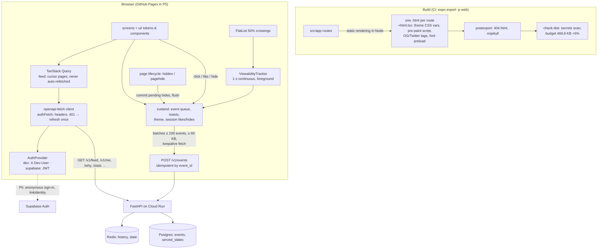

# 04: The app

> Phase 4 of [SPEC.md §16](../../SPEC.md), shipped as four PRs:
> **4a: foundations (design system, typed client, auth providers, static routes, E2E harness, three small API changes)** · **4b: onboarding, the feed, events and the Why sheet** · **4c: the hydration fix, demo readers, Account, System, Privacy, About** · **4d: polish, accessibility, performance, share cards, docs.**

---

## 1. What we built and why

Phase 3 gave us an API that returns a personal front page. Phase 4 is the thing people actually touch: an **Expo app** (React Native + TypeScript) that runs in a browser today and can become an iOS/Android app later from the same code.

A reader opens the link, picks three or more topics (or taps "Try a demo reader"), and gets an endless "For You" feed of live headlines. Each card links to the publisher; a heart likes it; an eye hides the story or its whole source, with a five-second **Undo**; an "i" explains **why** it was shown. Every click re-ranks what's still to come, because the app tells the API what the reader did. Around the feed: an Account page (Google linking for P5, hidden sources, theme, delete my data), a System page with live stats and the architecture, Privacy, and About with the GDELT credit.

Under the surface, the app does three jobs most demos skip:
- **It reports what was *seen*, not what was rendered:** a card counts after half of it has been on screen for a full second in the foreground (the MRC display viewability rule), once per page and story.
- **It never loses or double-counts an event:** each event gets its id when it's created, survives retries, reloads and a closing tab (keepalive), and the server drops duplicates.
- **It respects a free-tier budget:** the feed is never refetched by itself, because every first page costs 7 Upstash commands. A whole reading session costs ~33.

**Analogy.** A newspaper's front desk that rearranges the paper while you read.
- The **front desk** (the app) hands you today's paper (the feed) and watches which pages you actually read for more than a glance (viewability), not which ones you flipped past.
- It writes each thing you do on a numbered slip (event id) and posts the slips in batches; if the post office loses one, it re-posts the same numbered slip, and the newsroom throws away numbers it has already seen (idempotency).
- If you walk out mid-article, the desk shoves the last slips through the door as you leave (keepalive).
- And the desk prints the paper's layout on the doors (static HTML), so you can walk straight to the sports section (a deep link) without waiting for the desk to open.

**Why this shape?**
- **$0 hosting** means GitHub Pages: static files only, no server, no fallback for unknown paths. So every screen is pre-rendered HTML with a real file, and there are no dynamic path segments (`/why?id=…`, not `/why/<id>`).
- **Budgets** (ADR 0011) decide caching: the feed is fetched only on purpose.
- **Recruiters judge it in a browser**, so it must load fast, have no flashes or console errors, and pass an accessibility audit in light and dark.
- **One codebase for web and native** (SPEC §17) rules out a plain web app.

---

## 2. Concepts from first principles

### 2.1 React Native, react-native-web and Expo Router
React Native lets you write UI with components like `View`, `Text` and `Pressable` that map to native widgets on iOS and Android. **react-native-web** maps the same components to the DOM (`View` → `div`, a `Pressable` with `href` → `a`), so one component tree runs everywhere. **Expo** packages the toolchain and libraries; **Expo Router** turns files in `src/app/` into routes (`about.tsx` → `/about`), with `_layout.tsx` files defining navigators (a stack, a tab group).

### 2.2 Static rendering vs a single-page app
A single-page app ships one empty `index.html` and draws everything with JavaScript, so nothing appears until the bundle runs, and a static host needs tricks to serve deep links. **Static rendering** runs every route in Node at build time and writes one HTML file per route. The browser paints that HTML at once, then React **hydrates** it: it renders the same tree on the client and attaches event handlers to the existing DOM instead of rebuilding it.

Hydration has one rule: **the client's first render must produce the same markup as the server's.** Anything only a browser knows (window width, dark mode, a portal into `document.body`) breaks it. React then throws the server HTML away (error #418) and, worse, doesn't fix mismatched attributes, so a dark-mode reader kept light colors. The fix is `useSyncExternalStore` with a **server snapshot**: React uses the snapshot value for the hydration render and re-renders immediately with the real one (`src/hooks/useHydrated.ts`).

Two companion tricks make the first paint right *before* JavaScript:
- **Width:** both nav bars are in the HTML, tagged `data-shown`, and a media query shows the right one.
- **Theme (4d):** during hydration, colors are CSS variables (`var(--fr-surface)`), which `+html.tsx` defines per `prefers-color-scheme`; an inline head script applies a stored Light/Dark choice before the first paint.

### 2.3 Server state vs client state
**Server state** is a cached copy of something the server owns (the feed, `/v1/me`, stats): it can be stale, needs refetching and retries, and many screens share it. **TanStack Query** handles that: query keys, cache lifetimes, retries with backoff, and `useInfiniteQuery` for cursor pages. **Client state** belongs to the app alone (the event queue, toasts, theme, "liked in this session"): **zustand** stores. Keeping them apart avoids the classic bug of copying server data into a client store and then fighting to keep both in sync.

### 2.4 Cursor pagination
The API returns 20 items and an opaque `next_cursor`. Asking for the next page sends that cursor back; the server remembers the ranked slate and what it already served, so pages never repeat, and a click in between re-ranks what's left. The client never computes offsets. An expired cursor (the slate lives 30 min) returns `cursor_expired`, and the app starts over at page 1 with a toast.

### 2.5 Viewability and the MRC rule
An **impression** should mean "the reader could have seen it". The Media Rating Council's display rule, also used by the IAB: **≥ 50% of the pixels in view for ≥ 1 continuous second.** We add "while the page is in the foreground". FlatList reports when rows cross 50%; our `ViewabilityTracker` runs the one-second clock, cancels it when a row leaves, and pauses it in the background.

### 2.6 At-least-once delivery and idempotency
Networks can lose a request *or its response*. If the client retries after a lost response, the server sees the event twice. Two ways out: never retry (lose events), or make retries harmless. We do the second: the event's id (a UUID) is generated **when the event is created** and stored with it; the server keys events by that id and answers `duplicate` for a repeat. Delivery is **at least once**; the effect is **exactly once**.

### 2.7 Keepalive and the page lifecycle
When a tab closes, the browser may cancel in-flight requests. `fetch(url, { keepalive: true })` asks it to finish the request after the page is gone, for bodies up to 64 KiB in total. `navigator.sendBeacon` does the same but can't send an `Authorization` header, so we use keepalive fetch. The signals: `visibilitychange` → `hidden` (tab switched or closed, phone locked) and `pagehide` (navigation or close); on native, `AppState` → `background`. On those, the queue sends one batch at once, with **no `await` before `fetch`** (the unload could cut it off).

### 2.8 Anonymous auth, identity linking, bearer tokens and CORS
- **Anonymous sign-in** (Supabase) gives a first-time visitor a real user id and token with no form, so their history is theirs from the first click.
- **Linking** Google to that user (`linkIdentity`) keeps the same id, so the history follows them across devices. If that Google account already belongs to another user, linking fails (`identity_already_exists`) and the app explains that signing into it switches users.
- The API takes a **bearer token** (`Authorization: Bearer <jwt>`), not cookies, so there's no CSRF surface and the same scheme works on native.
- A browser sending a custom header to another origin first asks permission (**CORS preflight**, an `OPTIONS` request). The API had to allow `X-Dev-User` for the local dev sign-in, and only when the dev bypass is on (4a).

### 2.9 WCAG basics
The Web Content Accessibility Guidelines (2.2) in the parts we test:
- **Contrast** (1.4.3 / 1.4.11): text ≥ 4.5:1 against its background; UI parts and focus rings ≥ 3:1.
- **Keyboard** (2.1.1): everything works without a mouse; **focus visible** (2.4.7); a **skip link** to the main content (2.4.1).
- **Timing adjustable** (2.2.1): the Undo timer pauses on hover, focus, and while the page is hidden.
- **Reflow** (1.4.10): no horizontal scrolling at 320 CSS px; 200% zoom on a 1280 px window is a 640 px viewport.
- **Name, role, value** (4.1.2): each card is a link named "headline, source, 12 minutes ago"; like/hide/why are buttons named with the headline.
- Plus **reduced motion** (a user preference, `prefers-reduced-motion`): no slides, fades or shimmer.

**axe-core** (via `@axe-core/playwright`) audits a rendered page for many of these automatically; keyboard walks and reflow need their own tests.

### 2.10 Design tokens
A **token** is a named design value (`colors.light.surface`, `space.lg`, `radius.md`). Components use only tokens, so a theme is a second set of values, and a test can check every text/background pair's contrast in both themes.

### 2.11 Bundle size, gzip and WOFF2
What the first page downloads before it's interactive is its scripts plus the preloaded font. We count **gzip** sizes (what travels over the wire). A TTF font compresses only so far with gzip; **WOFF2** is the same font in a container compressed with Brotli and font-specific transforms, so the same glyphs shrink from ~105 KB to ~78 KB on the wire. Under the SIL Open Font License a converted file is a "Modified Version", which matters only if the font declares a Reserved Font Name; this Google Fonts copy declares none.

---

## 3. Architecture of this phase



The event path: a card crosses 50% → the tracker's clock runs for a second in the foreground → an `impression` with `position` and `request_id` enters the queue (id and timestamp fixed now, persisted). A click enters the queue and flushes it at once, carrying the pending impressions in one batch. The API appends the click to the reader's Redis history with a new version, so the next feed page re-ranks.

---

## 4. Walkthrough of the important files

All paths under `apps/mobile/`.

| File | What it does and why it exists |
|---|---|
| `app.json` | `web.output: "static"`, `experiments.baseUrl: "/firstread"` (Pages serves the repo under that path), React Compiler on. |
| `metro.config.js` | Expo's Metro config plus `.woff2` as an asset type (4d). |
| `src/app/+html.tsx` | The HTML shell of every page, run in Node: theme CSS variables per scheme, the pre-paint theme script, media queries for width-only views, Open Graph and Twitter card tags. |
| `src/app/_layout.tsx` | Providers, the skip link, the root stack anchored on `(tabs)` (a Why deep link has the feed behind it), the toast host, the never-awaited headline font. |
| `src/app/(tabs)/_layout.tsx` | The sections: bottom bar under 768 px, top bar from 768 px; both in the static HTML until hydrated. |
| `src/app/index.tsx` | The gate: onboarding for a new reader, the feed otherwise, decided on the client from `/v1/me`. |
| `src/app/why.tsx` | `/why?id=` as a transparent modal route over the feed. |
| `src/lib/site.ts` | Share-card text and image, and the pre-paint script with the storage key it reads (4d). |
| `src/hooks/useHydrated.ts` | Hydration-safe width, color scheme and "hydrated" flag (`useSyncExternalStore` with server snapshots). |
| `src/ui/tokens.ts` | Colors (light/dark), spacing, radii, type, the contrast pairs, and the CSS-variable colors used while hydrating. |
| `src/ui/theme.tsx` | System/Light/Dark preference (stored in an effect), CSS variables until hydrated, then `data-theme` and real colors. |
| `src/ui/Pressable.tsx` | The focus ring for keyboard users only, hover state, and Space for checkboxes/radios on web. |
| `src/ui/Sheet.tsx`, `Dialog.tsx`, `useEscapeWhileOpening.ts` | react-native-web `Modal`s (focus in, trapped, returned); Esc also during the fade-in; no animation with reduced motion. |
| `src/ui/ToastHost.tsx`, `toast.ts`, `src/lib/timer.ts` | One toast at a time in a polite live region; a timer paused by hover, focus and a hidden page; Undo can take focus after a keyboard hide. |
| `src/ui/ArticleCard.tsx` | A real new-tab link named "headline, source, age" (middle-clicks recorded), separate like/hide/why buttons, a lazy fixed-size thumbnail with a fallback tile. |
| `src/ui/headlineFont.ts` / `.web.ts` | The headline face: the TTF on native, the WOFF2 on web. |
| `src/api/client.ts`, `errors.ts`, `queries.ts` | Typed client over the generated schema, `ApiError`, query keys, cache lifetimes and the retry policy. |
| `src/auth/` | `AuthProvider` with the dev and Supabase implementations; Supabase is loaded lazily. |
| `src/providers/session.tsx` | Creates the auth provider and client in an effect (never at import time). |
| `src/features/feed/useFeed.ts` | The infinite feed query: waits for an onboarded reader and for the feed to be on screen; refresh resets to one first page; cursor errors start over. |
| `src/features/feed/FeedScreen.tsx` | The list, its states (loading, empty, end, error, offline, busy, degraded), impressions, the hide menu, focus to Undo after a keyboard hide. |
| `src/features/feed/actions.ts` | Open (click event), like, hide with Undo (the event is queued when the toast closes). |
| `src/events/viewability.ts` | The 50%/1 s foreground rule. |
| `src/events/queue.ts`, `batch.ts`, `transport.ts`, `EventsProvider.tsx` | Event creation, batching, flush triggers, keepalive sends, retries, persistence, the lifecycle wiring. |
| `src/lib/lifecycle.ts` | Foreground/background on web and native. |
| `src/lib/platformKit.ts` / `.web.ts` | UUIDs and opening links: expo-crypto and expo-web-browser on native, the browser's own APIs on web (4d). |
| `scripts/serve-pages.mjs` | A dependency-free server that behaves like GitHub Pages. |
| `scripts/check-dist.mjs`, `bundle-budget.json` | The secrets scan and the size budget with its printed table. |
| `scripts/make-og-image.mjs`, `public/og-image.png` | Renders the 1200×630 share image from HTML with Playwright's Chromium. |
| `e2e/*.spec.ts` | Playwright against the local stack: smoke, feed, screens, console errors, and the 4d polish pass. |
| `services/api/scripts/e2e_seed.py` | Seeds a separate `firstread_e2e` database and Redis db 3 with invented headlines, personas and a pool snapshot. |

---

## 5. Rebuild from scratch

Prerequisites: Node 24, uv, Docker. From the repo root:

```bash
# 1. The local data stack (only db and redis are needed for the app's E2E)
docker compose -f infra/docker/docker-compose.yml up -d db redis
make db-migrate

# 2. API changes from 4a (already merged): X-Dev-User in CORS only with the dev bypass,
#    a 64 KiB cap on POST /v1/events, DELETE /v1/me/hidden-sources/{domain}
uv run pytest services/api -q

# 3. The app's dependencies (exact pins; SDK-native modules via expo install)
cd apps/mobile
npm ci
# How they were added (for a new project):
#   npx expo install expo-crypto expo-network @react-native-async-storage/async-storage \
#     react-native-svg expo-image expo-web-browser expo-font
#   npm i -E @tanstack/react-query@5.104.1 zustand@5.0.15 @supabase/supabase-js@2.117.3 \
#     openapi-fetch@0.17.0 @expo-google-fonts/source-serif-4@0.4.2
#   npm i -DE openapi-typescript@7.13.0 @playwright/test@1.64.0 playwright-core@1.64.0 \
#     @axe-core/playwright@4.13.0 @types/node@24.19.2

# 4. The typed client from the committed OpenAPI spec
npm run gen:api            # services/api/openapi.json → src/api/schema.d.ts
npm run gen:api:check      # CI: fails if the types are stale

# 5. The web headline font (4d): the package's TTF converted to WOFF2, nothing else changed
uvx --from 'fonttools[woff]==4.60.1' fonttools ttLib.woff2 compress \
  -o assets/fonts/SourceSerif4-SemiBold.woff2 \
  node_modules/@expo-google-fonts/source-serif-4/600SemiBold/SourceSerif4_600SemiBold.ttf

# 6. The share-card image (needs Playwright's Chromium: npx playwright install chromium)
node scripts/make-og-image.mjs   # → public/og-image.png, 1200×630

# 7. Checks, build, budget
npm run lint && npm run typecheck && npm test
npm run export:web               # dist/: one .html per route, 404.html, .nojekyll
npm run check:dist               # secrets scan + size table + budget
npm run serve:web                # http://localhost:19006/firstread/ (like GitHub Pages)

# 8. Against a live local API (dev sign-in): make up, then
npx expo start --web             # talks to http://localhost:8000

# 9. The E2E suite (seeds firstread_e2e + Redis db 3, exports against :8010, runs Playwright)
npm run e2e                      # or: make e2e
```

Environment (all public, documented in the root `.env.example`): `EXPO_PUBLIC_API_URL`, `EXPO_PUBLIC_AUTH_MODE` (`dev` | `supabase`), `EXPO_PUBLIC_SUPABASE_URL`, `EXPO_PUBLIC_SUPABASE_PUBLISHABLE_KEY`, `EXPO_PUBLIC_SITE_URL` (the absolute origin for the share image).

To lower or raise the budget on purpose: change `maxGrowth` in `bundle-budget.json` if needed, then `node scripts/check-dist.mjs --update-baseline` after an export, and commit the file with a reason.

---

## 6. How to test and verify it, and how to read the results

### 6.1 Jest (`npm test`, 18 suites, 204 tests)
Component and screen tests with React Native Testing Library and a fake `fetch` (no network): the client and error mapping, `Retry-After`, the 401 refresh; the queue (≤ 100 and ≤ 60 KB splits, stable ids across retries, persistence, backoff, stale drop, 422/413 drop, flush triggers); the viewability tracker with fake timers; the undo timer; the auth providers against a mocked Supabase client; the token contrast table; every screen's states; and the 4d units (CSS-variable theme, the pre-paint script and its storage key, the share card, Space on toggles, middle-clicks, the feed staying idle when anchored under another screen). A green run ends with `Tests: 204 passed`.

### 6.2 Playwright E2E (`npm run e2e`, 49 tests)
Against the real API (dev bypass) on a seeded database. Read it as a list of behaviors:
- **smoke** (4a): the gate, the dev header through CORS, deep links and reloads, a real 404, the font rules;
- **feed** (4b): first page only after topics are saved; impressions by the 50%/1 s rule going out with the first click; page 2 re-ranked with no repeats; hide + Undo; a hide surviving the page closing inside its undo window; like; Why with focus return; 503 countdown; cursor reset; offline; duplicates on retry; **the session's Redis cost** (the log prints `Redis commands this session: 33 {…}`; the test fails above 37);
- **screens** (4c): persona 409 → Replace and Keep mine, un-hide, delete my data through a 503, the GDELT link everywhere;
- **console** (4c): no console error on any exported route, at three widths and both themes (the #418 guard);
- **polish** (4d): share-card tags on every exported page and a 1200×630 PNG served; **dark surfaces before JavaScript** (computed colors with JS disabled) and a stored choice applied before JS; deep links to About/Privacy/Personas fetching no feed; Esc during a fade-in; middle-click → click event; **a full axe pass** on every screen and overlay in light and dark (empty result = no serious or critical violations); **a keyboard-only walk** (skip link, onboarding with Space, a card's controls in order, hide, focus on Undo with the timer held); **reflow** at 320 px and 640 px (no element past the right edge); **reduced motion** (no `animationstart` while opening the hide menu and toast, and some without the preference, proving the probe works); thumbnails (lazy, 88×88, decorative, a tile on error); the list (unique rows in visual order, each a named link).

### 6.3 The bundle (`npm run check:dist`)
Each row is a file the first page loads (or a lazy chunk), with gzip and raw sizes, then the budget line, e.g. `initialGzipBytes: 481054 of 505107 allowed`.

**What the first load is made of** (4c → 4d, gzip KB; per-package shares are proportional estimates from the source map):

| Part | 4c (main adf6298) | 4d |
|---|---:|---:|
| react-native-web | 76.5 | 76.6 |
| react-dom | 47.2 | 47.2 |
| Expo Router (incl. its vendored React Navigation: core 27.1, elements 10.1, native 8.5, **bottom-tabs 6.5, unused**, routers 4.8, native-stack 1.7) | ~116 | ~116 |
| app source | 37.8 | 38.5 |
| TanStack Query (core + react) | 20.3 | 20.3 |
| react-native-svg | 12.5 | 12.5 |
| expo-image | 9.2 | 9.2 |
| expo-crypto + expo-web-browser (and their helpers) | 4.6 | 0 (platform split, −4.8 KB measured) |
| everything else | ~72 | ~71 |
| **JS total** | **395.8** | **391.5** |
| headline font | 105.4 (TTF) | 78.3 (WOFF2) |
| **First load** | **501.2** | **469.8** |
| lazy Supabase chunk (not loaded in dev mode) | 65.5 | 65.5 |

The budget is now baseline 469.8 KB with 5% growth (limit 493.3 KB), below the 4c size, so the savings can't quietly creep back. The earlier allowance (+25%) would have permitted ~601 KB.

### 6.4 Manual checks worth doing once
- Open `dist/index.html` in a text editor: the `og:*` and `twitter:*` tags, the `<script>` that reads `fr:theme`, the `--fr-*` variables.
- In Chrome DevTools: Rendering → emulate `prefers-color-scheme: dark` and disable JavaScript; the page should already be dark.
- Paste the live URL into a card validator after P5 deploys (the image must be publicly reachable).

---

## 7. Decisions and alternatives considered

- [ADR 0019: App architecture](../adr/0019-app-architecture.md): Expo + react-native-web with static rendering; no dynamic segments; TanStack Query for server state and zustand for client state; the feed never auto-refetched; the `AuthProvider` abstraction; FlatList over FlashList; hydration-safe values; the theme as CSS variables before hydration; WOFF2 on web; the bundle budget. Alternatives: a plain React web app, SPA output, Redux, a persisted query cache, FlashList, subsetting the font, removing bottom-tabs with a resolver hack.
- [ADR 0020: Impressions and event delivery](../adr/0020-impressions-and-event-delivery.md): the MRC 50%/1 s foreground rule with our own clock; client-side ids; batching under 100 events and 60 KB; flush triggers; keepalive fetch with no await; priority order on close; the retry table; middle-clicks. Alternatives: render-as-impression, `minimumViewTime` alone, IntersectionObserver, `sendBeacon`, per-event sends, server ids.
- Amendments from 4a: [ADR 0015](../adr/0015-auth-supabase-jwt.md) (`X-Dev-User` allowed by CORS only with the dev bypass; the 64 KiB body cap on `/v1/events`) and [ADR 0016](../adr/0016-user-data-rls-retention.md) (un-hide a source).

---

## 8. What went wrong and the gotchas

- **CORS blocked the dev sign-in in a browser.** `curl` worked; the browser's preflight refused `X-Dev-User`. It's now allowed only when the dev bypass is on, and a test proves a prod-shaped config doesn't allow it.
- **Static hosting has no fallback for dynamic routes:** `/why/<id>` would 404 on Pages. Hence `/why?id=`.
- **Never touch `window`/`localStorage` at import time:** `expo export` renders every route in Node. CI's export step is the test.
- **A `client_ts` more than 24 h old fails the whole batch (422).** The queue drops events older than 23 h before sending, or one stale event would block every retry.
- **keepalive has a 64 KiB budget** (shared across in-flight keepalive requests), so batches are capped at 60 KB, and the closing send can't `await` anything first.
- **Every feed refetch is a new first page (7 Redis commands).** TanStack's defaults (refetch on mount, focus, reconnect) would have multiplied the session cost; all off for the feed.
- **The root anchor mounted the feed under other screens.** In 4b it fetched a topic-less page 1 under onboarding (fixed: the feed waits for an onboarded reader); in 4d, deep links to About/Privacy/Personas still spent page 1 early (fixed: the query runs only while the feed is on screen or behind Why). The 4d Jest test was first written so it passed without the fix (it asserted before `/v1/me` had resolved, and `renderRouter` runs on fake timers, so a real `setTimeout` never fired); it now advances fake time and fails without the gate.
- **Hydration error #418 on every page** came from width, the Modal portal and the color scheme, not from the stack. React 19 also doesn't patch mismatched attributes, so dark-mode readers stayed light until 4c.
- **Dark-mode readers saw light surfaces before JavaScript** (4c fixed only after hydration): the static HTML is rendered with light colors in Node. CSS variables during hydration fixed it (4d).
- **react-native-web's Modal ignores Esc during its open animation** (it becomes the active dialog only when the animation ends), and its role/focus trap arrive then too. A capture-phase Esc handler covers the gap (4d). axe scans must also wait for the finished dialog: mid-fade, partial opacity fails every contrast check.
- **Space didn't toggle topic chips or theme radios:** react-native-web maps Space to a press only for `role="button"`. Found by the 4d keyboard walk; fixed in the shared `Pressable`.
- **After "Hide this story" by keyboard, focus fell to the top of the page:** the Modal returns focus to its trigger, but the trigger left with the hidden card, and Undo sits 80+ Tab stops away at the end of the page with 5 s on the clock. Now, after a keyboard hide, focus goes to Undo once the menu has closed (which pauses the timer). Mouse users are unaffected (focusing Undo would pause their timer forever).
- **Middle-clicks opened the tab without recording a click.** react-native-web forwards `onAuxClick` to the DOM, so the card's link now handles button 1 (4d).
- **Unused code can stay in the bundle:** Expo Router's CommonJS index requires `layouts/Tabs` eagerly and its error boundary imports the bottom-tabs barrel; Metro doesn't tree-shake CommonJS, so 6.5 KB of bottom-tabs ships unused. Removing it would need a resolver override of private build paths. Not done.
- **Metro doesn't bundle `.woff2` by default** (`assetExts` has `ttf` and `otf`): `metro.config.js` adds it. Native platforms can't load WOFF2, hence the `.web.ts` split.
- **`--update-baseline` used to reset the growth allowance to 25%;** it now keeps the file's value.
- **Playwright on react-native-web:** `scrollTo` doesn't move FlatList, so tests scroll with the mouse wheel; wait for `role=dialog` before pressing Esc in a sheet test; About/Privacy/Personas sit outside the tab group and have no nav bar (Back returns to the anchored feed).

---

## 9. Interview questions (with strong answers)

**1. Why Expo with react-native-web instead of a plain React web app?**
One codebase for web now and iOS/Android later (SPEC §17). The cost is bundle size: react-native-web and react-dom are ~124 KB of the 392 KB JS. Static rendering keeps the first paint fast anyway, because the HTML arrives ready and JavaScript only hydrates it.

**2. What is hydration, and how did you avoid hydration mismatches?**
React renders the same tree on the client and attaches to the server's DOM; the first client render must match the HTML. Browser-only inputs (width, color scheme, portals) go through `useSyncExternalStore` with a server snapshot: React hydrates with the server's value, then re-renders with the real one. Width-dependent views are all in the HTML with media queries; colors are CSS variables until hydration. An E2E fails if any exported route logs a console error.

**3. How do you define and measure an impression?**
The MRC display rule: ≥ 50% visible for ≥ 1 continuous second, plus foreground. FlatList reports 50% crossings; a tracker runs the clock, cancels on leave, pauses in the background, and emits once per (request, article) with position and request id so it joins the served slate. FlatList's own `minimumViewTime` wasn't continuous or foreground-aware.

**4. How do you make event delivery reliable without double-counting?**
Client-generated ids fixed at creation and persisted; the server is idempotent by id. Retries with backoff and `Retry-After`; 422/413 dropped (client bugs); events over 23 h dropped before sending; the persisted queue is re-sent on launch. At-least-once delivery, exactly-once effect.

**5. What happens to events when the user closes the tab?**
On `visibilitychange → hidden`/`pagehide`, pending hides are committed and one batch ≤ 60 KB goes out with `fetch(keepalive)`, started synchronously with cached headers. Priority: hides, clicks/likes, newest impressions; leftovers stay persisted. Not `sendBeacon`, because it can't carry an `Authorization` header.

**6. Why is the feed never refetched automatically?**
Each first page costs 7 Upstash commands against a monthly budget, and a refetch would also replace what the reader is looking at. `staleTime: Infinity` and no refetch on mount, focus or reconnect; only a pull-to-refresh or "New stories" resets it. The E2E asserts a session stays ≤ 37 commands (measured 33).

**7. How does undo work for hides, and what's tricky about it?**
The card disappears at once; the event is queued only when the 5 s toast closes; Undo restores it locally and nothing is sent. Tricky parts: the timer must pause on hover, focus and a hidden page (WCAG 2.2.1); a page closing inside the window must commit the hide into the keepalive batch; one undo at a time (a newer hide commits the older); and keyboard users must be able to reach Undo, so after a keyboard hide focus moves there.

**8. How do you handle auth locally and in production behind one interface?**
An `AuthProvider` interface with a dev implementation (a device UUID in `X-Dev-User`, refused unless the API is localhost; the API allows the header only with its dev bypass) and a Supabase one (anonymous sign-in, `linkIdentity` for Google, errors like `identity_already_exists`), chosen at build time. Supabase is lazy-loaded so dev builds don't pay for it.

**9. What did your accessibility work actually catch?**
Automated axe on every screen and overlay in both themes caught a missing page title (4a) and showed that mid-fade scans are meaningless. The manual-style E2E walks caught what axe can't: Space not toggling checkboxes/radios, focus falling to the page top after a keyboard hide with Undo out of reach, and Esc ignored during a sheet's fade-in. All fixed, all now tested.

**10. How did you cut the first load, and how do you keep it down?**
Measured what it's made of (source-map attribution), then took the safe wins: the font as WOFF2 (−27 KB) and native-only libraries behind platform files (−4.8 KB). Removing unused bottom-tabs code wasn't safe (CommonJS, private paths). CI's budget now uses the new 469.8 KB baseline with 5% growth, so the limit is below the old size; raising it is a reviewed change.

---

## 10. Glossary of new terms

| Term | Meaning |
|---|---|
| react-native-web | Library that renders React Native components to the DOM |
| Expo Router | File-based routing for Expo apps (`src/app/*.tsx` → routes) |
| Static rendering | Pre-rendering every route to HTML at build time |
| Hydration | React attaching to server-rendered HTML instead of rebuilding it |
| Error #418 | React's hydration mismatch error (text or markup differs) |
| Server snapshot | The value `useSyncExternalStore` uses during server rendering and hydration |
| Anchor (Expo Router) | The route kept underneath a stack so a deep link has something behind it |
| Server state / client state | Data cached from a server vs data owned by the app |
| Infinite query | A TanStack query that loads pages by cursor and keeps them together |
| Cursor | An opaque token for "the next page after this one" |
| Viewability | Whether an item was actually visible (MRC: 50% for 1 s) |
| Impression | One viewable showing of an item |
| Idempotency | Repeating an operation has the same effect as doing it once |
| At-least-once delivery | Every event arrives one or more times; duplicates are removed by id |
| keepalive | A `fetch` option that lets a request outlive the page (≤ 64 KiB) |
| `pagehide` / `visibilitychange` | Browser events when a page is left or hidden |
| CORS preflight | The browser's `OPTIONS` request asking if a cross-origin request is allowed |
| Anonymous sign-in | An auth session for a user with no credentials yet |
| Identity linking | Attaching a provider (Google) to an existing user |
| Design token | A named design value used instead of literal colors or sizes |
| WCAG | Web Content Accessibility Guidelines (we target 2.2 AA) |
| Reflow | Content fits a narrow viewport without horizontal scrolling |
| axe | An automated accessibility checker |
| Skip link | A first, keyboard-reachable link that jumps to the main content |
| Live region | An element whose changes screen readers announce (`role=status`) |
| WOFF2 | A compressed web font container (Brotli + font transforms) |
| OFL / Reserved Font Name | The SIL Open Font License; an RFN forbids modified versions from using that name |
| Open Graph | `og:*` meta tags that define a page's share card |
| `summary_large_image` | X's card type with a wide image |
| Bundle budget | A CI limit on the bytes the first page loads |
| Tree shaking | Dropping unused exports at build time (needs ES modules) |

### External facts checked for this phase

Checked during P4 (2026-10-23/24):

| Fact | Source |
|---|---|
| Static rendering: one HTML per route, no SPA fallback for dynamic routes; `+html.tsx` | [Expo static rendering](https://docs.expo.dev/router/reference/static-rendering/) |
| Adding asset extensions with `config.resolver.assetExts.push(...)` (Metro defaults include `ttf`, `otf`, not `woff2`, checked with `getDefaultConfig`) | [Customizing Metro](https://docs.expo.dev/guides/customizing-metro/) |
| `fetch` `keepalive`: body quota 64 KiB across in-flight keepalive requests; allows `Authorization` | [MDN: RequestInit.keepalive](https://developer.mozilla.org/en-US/docs/Web/API/RequestInit#keepalive) |
| `sendBeacon` can't set custom headers | [MDN: sendBeacon](https://developer.mozilla.org/en-US/docs/Web/API/Navigator/sendBeacon) |
| MRC display viewability: 50% of pixels for 1 continuous second | [MRC Viewable Ad Impression Measurement Guidelines](https://www.iab.com/wp-content/uploads/2015/06/MRC-Viewable-Ad-Impression-Measurement-Guideline.pdf) |
| Open Graph required properties (`og:title`, `og:type`, `og:image`, `og:url`) and `og:image:width/height/type/alt` | [ogp.me](https://ogp.me/) (re-checked 2026-10-24) |
| X `summary_large_image`: 2:1 aspect (300×157 to 4096×4096), < 5 MB, JPG/PNG/WEBP/GIF. Our 1200×630 (1.9:1) is cropped slightly by X | [X cards: summary with large image](https://developer.twitter.com/en/docs/twitter-for-websites/cards/overview/summary-card-with-large-image), [cards markup](https://developer.x.com/en/docs/x-for-websites/cards/overview/markup) (checked 2026-10-24 via search; the pages returned 402 to direct fetches) |
| react-native-web 0.21 Modal: Esc handler, `role="dialog"` and focus trap only once active (after the open animation); Space presses only `role="button"`; `onAuxClick` forwarded | Source in `node_modules/react-native-web/dist` (`exports/Modal`, `modules/usePressEvents/PressResponder.js`, `modules/forwardedProps`) |
| Expo Router 57's index requires `layouts/Tabs` eagerly (CommonJS), so bottom-tabs can't be tree-shaken | Source in `node_modules/expo-router/build/exports.js`, `views/ErrorBoundary.js` |
| Supabase anonymous sign-ins, `linkIdentity`, `identity_already_exists` | [Anonymous sign-ins](https://supabase.com/docs/guides/auth/auth-anonymous), [identity linking](https://supabase.com/docs/guides/auth/auth-identity-linking) |
| WCAG 2.2 success criteria 1.4.3, 1.4.10, 1.4.11, 2.1.1, 2.2.1, 2.4.1, 2.4.7, 4.1.2 | [WCAG 2.2](https://www.w3.org/TR/WCAG22/) |
| SIL OFL 1.1: Reserved Font Names and Modified Versions; the bundled Source Serif 4 OFL text declares no RFN | [OFL 1.1](https://openfontlicense.org/open-font-license-official-text/), `apps/mobile/public/fonts/OFL-SourceSerif4.txt` |
