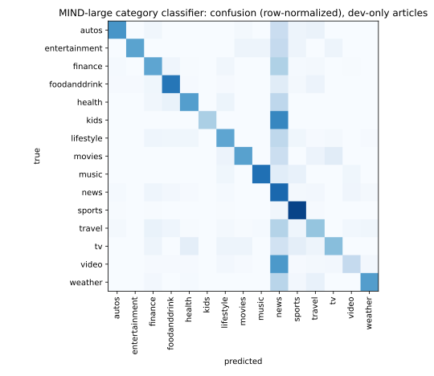

# Category classifier: MIND-large

Generated by `firstread-ml classify`; do not edit by hand. Aggregates only.
Logistic regression on frozen bge-small embeddings (`packages/core`).

- Train: 101,523 articles from train `news.tsv`; hyperparameters by macro-F1 on a stratified 10% split, then refit on all.
- Test: 2,624 articles that appear only in dev `news.tsv` (excluded 0 with a dropped label).
- Labels: 15; dropped (< 10 training articles): games, middleeast, northamerica.
- Selected: C=30.0, class_weight=none

## Test results (dev-only articles)

| Metric | Value |
|---|---:|
| Accuracy | **0.7214** |
| Macro-F1 | **0.5984** |
| Majority-class accuracy (reference) | 0.3255 |

## Per class

| Label | Precision | Recall | F1 | Support |
|---|---:|---:|---:|---:|
| autos | 0.607 | 0.607 | 0.607 | 61 |
| entertainment | 0.917 | 0.550 | 0.688 | 20 |
| finance | 0.523 | 0.538 | 0.531 | 145 |
| foodanddrink | 0.620 | 0.728 | 0.670 | 103 |
| health | 0.600 | 0.569 | 0.584 | 58 |
| kids | 1.000 | 0.333 | 0.500 | 3 |
| lifestyle | 0.615 | 0.536 | 0.573 | 110 |
| movies | 0.625 | 0.556 | 0.588 | 18 |
| music | 0.875 | 0.750 | 0.808 | 28 |
| news | 0.665 | 0.785 | 0.720 | 854 |
| sports | 0.944 | 0.925 | 0.935 | 803 |
| travel | 0.491 | 0.396 | 0.438 | 134 |
| tv | 0.375 | 0.429 | 0.400 | 21 |
| video | 0.523 | 0.250 | 0.338 | 184 |
| weather | 0.627 | 0.573 | 0.599 | 82 |

## Model selection (validation split of train articles)

| C | class_weight | Val macro-F1 | Val accuracy |
|---:|---|---:|---:|
| 0.1 | none | 0.5054 | 0.7405 |
| 0.1 | balanced | 0.5362 | 0.6487 |
| 0.3 | none | 0.5548 | 0.7499 |
| 0.3 | balanced | 0.5431 | 0.6559 |
| 1.0 | none | 0.5797 | 0.7550 |
| 1.0 | balanced | 0.5513 | 0.6607 |
| 3.0 | none | 0.5824 | 0.7545 |
| 3.0 | balanced | 0.5462 | 0.6592 |
| 10.0 | none | 0.5918 | 0.7521 |
| 10.0 | balanced | 0.5369 | 0.6572 |
| 30.0 | none | 0.5936 | 0.7525 |
| 30.0 | balanced | 0.5324 | 0.6548 |
| 100.0 | none | 0.5905 | 0.7514 |
| 100.0 | balanced | 0.5324 | 0.6552 |

