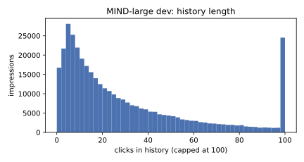
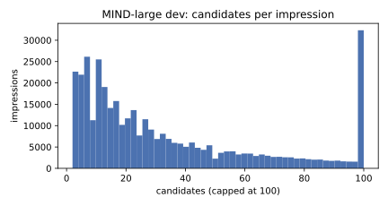
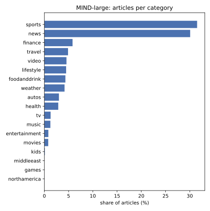

# EDA: MIND-large

Generated by `firstread-ml eda`; do not edit by hand. Aggregate statistics only.
Dataset: `Recommenders/MIND` @ `2115068f` (train + dev; test is unused).

## Size

| | train | dev |
|---|---:|---:|
| Impressions | 2,232,748 | 376,471 |
| Candidate rows | 83,507,374 | 14,085,557 |
| Clicks | 3,383,656 | 574,845 |
| CTR (clicks / candidates) | 4.05% | 4.08% |

Articles (union of train and dev `news.tsv`): 104,151.

## Time range (UTC day, impressions)

- train: 2019-11-09 (192,552), 2019-11-10 (212,343), 2019-11-11 (464,467), 2019-11-12 (478,375), 2019-11-13 (453,494), 2019-11-14 (431,517)
- dev: 2019-11-15 (376,471)
- Tuning holdout = last train day: 431,517 impressions; fit = earlier days: 1,801,231.

## Impressions

- Candidates per impression: mean 37.4 · median 23 · p90 92 · p99 185 (dev); mean 37.4 · median 25 · p90 92 · p99 166 (train)
- Clicks per impression (dev): mean 1.5 · median 1 · p90 3 · p99 6
- History length (dev): mean 32.6 · median 19 · p90 79 · p99 191
- History length (train): mean 33.0 · median 19 · p90 79 · p99 194
- Cold users (history ≤ 2): dev 6.8% (empty: 3.0%); train 5.8%

## Cold-start candidates

Never clicked in training (not a train positive, not in any train history).

- Dev candidate rows that are cold: 29.3%
- Distinct dev candidates that are cold: 44.0%
- Holdout candidate rows that are cold w.r.t. the fit period: 34.3%

## Article text (words)

- Title: mean 10.7 · median 10 · p90 15 · p99 20
- Abstract: mean 36.4 · median 25 · p90 75 · p99 84; empty abstracts: 5.4%

## Categories

| Category | Articles | Share |
|---|---:|---:|
| sports | 32,823 | 31.5% |
| news | 31,332 | 30.1% |
| finance | 6,061 | 5.8% |
| travel | 5,089 | 4.9% |
| video | 4,753 | 4.6% |
| lifestyle | 4,680 | 4.5% |
| foodanddrink | 4,521 | 4.3% |
| weather | 4,337 | 4.2% |
| autos | 3,132 | 3.0% |
| health | 2,987 | 2.9% |
| tv | 1,344 | 1.3% |
| music | 1,291 | 1.2% |
| entertainment | 857 | 0.8% |
| movies | 833 | 0.8% |
| kids | 107 | 0.1% |
| middleeast | 2 | 0.0% |
| games | 1 | 0.0% |
| northamerica | 1 | 0.0% |

