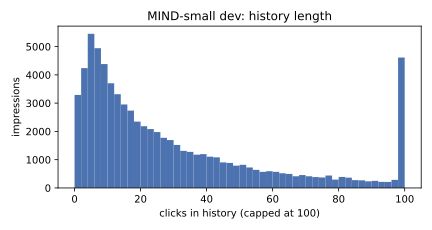
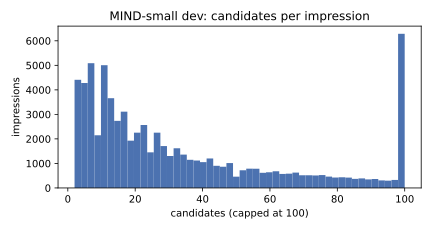
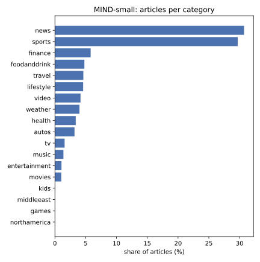

# EDA: MIND-small

Generated by `firstread-ml eda`; do not edit by hand. Aggregate statistics only.
Dataset: `Recommenders/MIND` @ `2115068f` (train + dev; test is unused).

## Size

| | train | dev |
|---|---:|---:|
| Impressions | 156,965 | 73,152 |
| Candidate rows | 5,843,444 | 2,740,998 |
| Clicks | 236,344 | 111,383 |
| CTR (clicks / candidates) | 4.04% | 4.06% |

Articles (union of train and dev `news.tsv`): 65,238.

## Time range (UTC day, impressions)

- train: 2019-11-09 (13,570), 2019-11-10 (15,048), 2019-11-11 (32,799), 2019-11-12 (33,654), 2019-11-13 (31,624), 2019-11-14 (30,270)
- dev: 2019-11-15 (73,152)
- Tuning holdout = last train day: 30,270 impressions; fit = earlier days: 126,695.

## Impressions

- Candidates per impression: mean 37.5 · median 23 · p90 92 · p99 182 (dev); mean 37.2 · median 24 · p90 91 · p99 166 (train)
- Clicks per impression (dev): mean 1.5 · median 1 · p90 3 · p99 6
- History length (dev): mean 32.3 · median 19 · p90 78 · p99 187
- History length (train): mean 32.5 · median 19 · p90 78 · p99 190
- Cold users (history ≤ 2): dev 6.9% (empty: 3.0%); train 5.8%

## Cold-start candidates

Never clicked in training (not a train positive, not in any train history).

- Dev candidate rows that are cold: 52.4%
- Distinct dev candidates that are cold: 61.3%
- Holdout candidate rows that are cold w.r.t. the fit period: 56.9%

## Article text (words)

- Title: mean 10.8 · median 10 · p90 15 · p99 20
- Abstract: mean 35.0 · median 25 · p90 75 · p99 84; empty abstracts: 5.2%

## Categories

| Category | Articles | Share |
|---|---:|---:|
| news | 20,039 | 30.7% |
| sports | 19,368 | 29.7% |
| finance | 3,786 | 5.8% |
| foodanddrink | 3,123 | 4.8% |
| travel | 3,013 | 4.6% |
| lifestyle | 2,991 | 4.6% |
| video | 2,712 | 4.2% |
| weather | 2,601 | 4.0% |
| health | 2,207 | 3.4% |
| autos | 2,076 | 3.2% |
| tv | 1,027 | 1.6% |
| music | 902 | 1.4% |
| entertainment | 695 | 1.1% |
| movies | 672 | 1.0% |
| kids | 22 | 0.0% |
| middleeast | 2 | 0.0% |
| games | 1 | 0.0% |
| northamerica | 1 | 0.0% |

