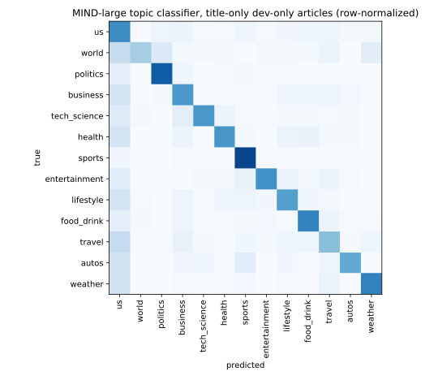

# Topic classifier: MIND-large

Generated by `firstread-ml topics`; do not edit by hand. Aggregates only.
Logistic regression on frozen bge-small embeddings (`packages/core`) predicting the
13 app topics; labels from `ml/configs/topic_map.yaml` (ADR 0006).

- Train: 97,651 train `news.tsv` articles x 2 text modes (title+abstract, title only) = 195,302 rows. 4,043 articles mapped to `exclude`.
- Selection: mean validation macro-F1 over both modes on a stratified 10% article split. Selected C=1.0, class_weight=none.
- Test: 2,457 articles that appear only in dev `news.tsv`.
- Low-confidence threshold for the feed-hint tie-breaker: **0.50**.
- Topic map SHA256: `ed1b13889e9ed2f6964b98af94fa4b5c3a32cb224cbbadaa4c7be387e2f73220`

## Test results (dev-only articles)

| Metric | Title + abstract | Title only |
|---|---:|---:|
| Accuracy | **0.7346** | **0.7184** |
| Macro-F1 | **0.6371** | **0.6244** |
| Majority-class accuracy (reference) | 0.3268 | 0.3268 |

Release gate: every topic's title-only F1 ≥ 0.3, and title-only macro-F1 at most 0.1 below title+abstract: **PASS**

## Per topic

| Topic | Train articles | F1 (title+abstract) | P / R / F1 (title only) | Support |
|---|---:|---:|---:|---:|
| us | 19,252 | 0.661 | 0.612 / 0.643 / 0.627 | 515 |
| world | 2,531 | 0.460 | 0.588 / 0.351 / 0.440 | 57 |
| politics | 5,697 | 0.815 | 0.803 / 0.824 / 0.814 | 188 |
| business | 6,006 | 0.562 | 0.529 / 0.600 / 0.562 | 150 |
| tech_science | 3,026 | 0.651 | 0.720 / 0.600 / 0.655 | 90 |
| health | 2,929 | 0.628 | 0.565 / 0.603 / 0.583 | 58 |
| sports | 32,032 | 0.936 | 0.928 / 0.918 / 0.923 | 803 |
| entertainment | 4,382 | 0.663 | 0.656 / 0.628 / 0.641 | 94 |
| lifestyle | 5,074 | 0.561 | 0.585 / 0.566 / 0.575 | 122 |
| food_drink | 4,421 | 0.661 | 0.583 / 0.680 / 0.628 | 103 |
| travel | 4,958 | 0.469 | 0.475 / 0.425 / 0.449 | 134 |
| autos | 3,071 | 0.571 | 0.542 / 0.525 / 0.533 | 61 |
| weather | 4,272 | 0.645 | 0.691 / 0.683 / 0.687 | 82 |

## Confidence bins (validation, both modes)

| Top-1 probability | n | Accuracy |
|---|---:|---:|
| 0.15-0.20 | 10 | 0.100 |
| 0.20-0.25 | 76 | 0.303 |
| 0.25-0.30 | 269 | 0.305 |
| 0.30-0.35 | 570 | 0.354 |
| 0.35-0.40 | 767 | 0.421 |
| 0.40-0.45 | 959 | 0.431 |
| 0.45-0.50 | 1,079 | 0.487 |
| 0.50-0.55 | 981 | 0.505 |
| 0.55-0.60 | 917 | 0.581 |
| 0.60-0.65 | 942 | 0.602 |
| 0.65-0.70 | 905 | 0.664 |
| 0.70-0.75 | 970 | 0.721 |
| 0.75-0.80 | 967 | 0.775 |
| 0.80-0.85 | 1,099 | 0.797 |
| 0.85-0.90 | 1,268 | 0.861 |
| 0.90-0.95 | 1,747 | 0.913 |
| 0.95-1.00 | 6,006 | 0.983 |

## Model selection (validation split of train articles)

| C | class_weight | Macro-F1 title+abstract | Macro-F1 title only | Mean |
|---:|---|---:|---:|---:|
| 0.3 | none | 0.6850 | 0.6682 | 0.6766 |
| 0.3 | balanced | 0.6623 | 0.6401 | 0.6512 |
| 1.0 | none | 0.6885 | 0.6704 | 0.6794 |
| 1.0 | balanced | 0.6617 | 0.6378 | 0.6498 |
| 3.0 | none | 0.6830 | 0.6700 | 0.6765 |
| 3.0 | balanced | 0.6577 | 0.6366 | 0.6471 |
| 10.0 | none | 0.6803 | 0.6672 | 0.6737 |
| 10.0 | balanced | 0.6556 | 0.6338 | 0.6447 |
| 30.0 | none | 0.6809 | 0.6668 | 0.6739 |
| 30.0 | balanced | 0.6544 | 0.6333 | 0.6439 |

